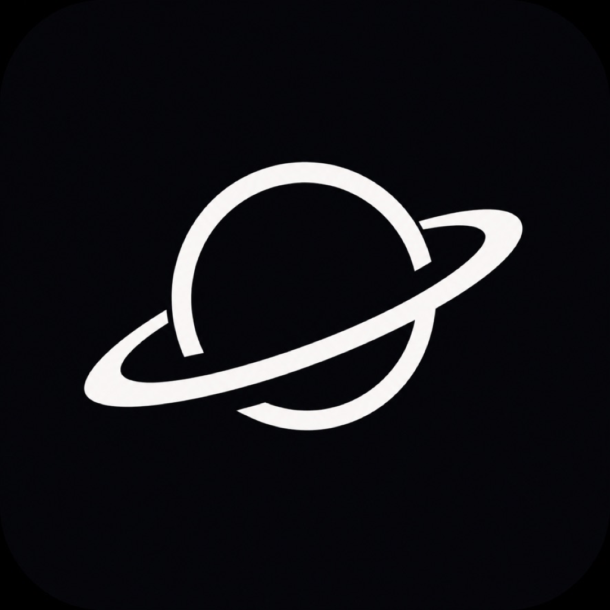
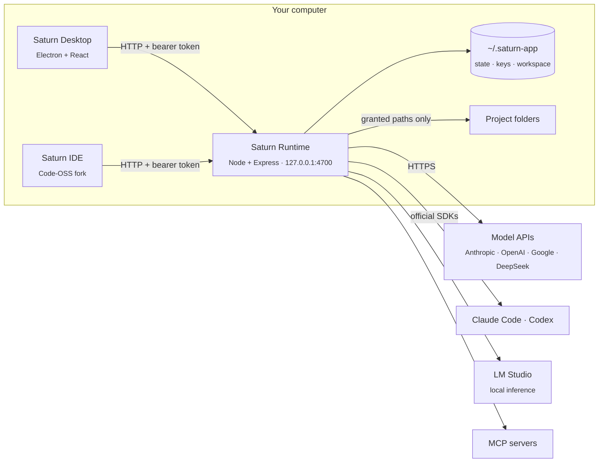

<div align="center">



# Saturn

**A local-first agent runtime, desktop app and IDE.**

Bring your own models, scope every agent to the folders you grant, and keep each tool call, file edit and network request inspectable, reviewable and reversible.

[](LICENSE)


[Features](#features) · [Install](#install) · [Architecture](#architecture) · [Models](#models) · [Security](#security-and-trust) · [API](#local-api) · [中文](README_ZH.md)

</div>

---

## Why Saturn

Most agent products run the control plane in a vendor cloud, or hand a model an unrestricted shell. Saturn keeps the control plane on your machine:

- **Local-first and verifiable.** The runtime is a loopback-only HTTP service on `127.0.0.1`. State, credentials and telemetry are files on disk, and every outbound request is logged ([how to verify](#security-and-trust)).
- **Model-agnostic.** Anthropic, OpenAI, Google and DeepSeek over their APIs with your keys; Claude Code and Codex on your existing subscriptions through their official SDKs; or fully offline models served by LM Studio.
- **Least privilege by default.** Agents are confined to granted folders, side-effecting actions go through an approval policy, and every edit is checkpointed and revertible per step.

### Saturn, Claude Code and Codex

What Saturn's own agent loop does (for API and local models; agents on Claude Code or Codex get those programs' own versions), next to the two programs. "—" means not checked for this table.

| | Saturn | Claude Code | Codex |
|---|---|---|---|
| Runs on your machine, any provider or a local model | Yes: Anthropic, OpenAI, Google, DeepSeek, LM Studio | Anthropic models | OpenAI models, local through `--oss` |
| Permission rules (allow, ask, deny by pattern) | Yes, with `.claude/settings.json` rules read too | Yes | Approval modes |
| OS sandbox for commands | macOS, Linux (bubblewrap); none on Windows | Yes | Yes |
| Context compaction | Yes, and `/compact` | Yes | Yes |
| Sub-agents | Yes (`delegate`) | Yes | — |
| Background commands | Yes | Yes | — |
| Hooks | Yes (`pre_tool`, `post_tool`, `stop`; Claude Code's format read) | Yes | — |
| Skills and slash commands | Yes (`SKILL.md`, `.claude/commands` read) | Yes | — |
| Plugins | Yes (Claude Code's layout installs as is) | Yes | — |
| Headless CLI | `saturn run` | `claude -p` | `codex exec` |
| SDK | Not yet: the local HTTP API and its event streams | Agent SDK | Codex SDK |
| Pull request follow-up (fix failing checks) | Yes, at most two rounds | Yes, in Claude Code on the web | — |
| Desktop app and IDE | Agent app, Saturn IDE (Code-OSS) | Desktop app, IDE extensions | IDE extension, app |
| Computer use, browser, multi-agent groups, schedules | Yes | — | — |
| Measured | Task evals (`scripts/eval`), nightly when a key is set | Anthropic's evaluations | OpenAI's evaluations |

Saturn is younger than both and has had far less real-world use; the evals are how changes to its loop are checked.

## Features

| | |
|---|---|
| 🤖 **Agents** | Per-agent system prompt, model, reasoning effort, tool set and approval policy. Agent, Ask (read-only) and Plan modes per message. |
| 📋 **Agents board** | One view of every running, queued, blocked and finished task across chats, with an inbox for approvals and failures, and native notifications. |
| 🌿 **Isolated worktrees** | Run a task in its own git worktree and branch, in the background. Merge, keep or discard it; resolve conflicts with the agent; open a pull request from the branch. |
| 🔁 **Pull request follow-up** | After Saturn opens a pull request it follows it every 2 minutes with your GitHub token. Failing checks go back to the agent with their log tails, at most twice, and its fix is committed and pushed so they run again. New comments and unresolved review threads wait in the chat until you send them to the agent (its answer is pushed too) or dismiss them. It stops when the pull request is merged or closed. |
| 📎 **Context** | `@`-mention files, folders, git changes and URLs; paste screenshots; per-project rules from `AGENTS.md` and similar files; semantic code search backed by a bundled on-device embedding model. |
| ✅ **Verification loop** | After a turn edits files, the project's check command (typecheck, lint, tests) runs, and failures go back to the agent for up to two automatic fix rounds. |
| 🔍 **Review** | Per-turn diffs with inline comments sent back to the agent, editable plans, a summary card per turn, terminal output, and replayable browser recordings. |
| ↩️ **Checkpoints** | Every file edit is recorded. Keep or revert a turn, or restore the workspace to any individual step. |
| 👥 **Groups** | Several agents in one conversation; each decides whether it is addressed and delegates with `@mentions`. |
| 📚 **Skills** | Folders with a `SKILL.md` (name, description, instructions) in a project's `.agents/skills`, `.saturn/skills` or `.claude/skills`, or your `~/.saturn-app/skills`. Agents see only the names and descriptions and load a skill when a task calls for it; type `/name` in the composer to use one yourself. |
| 🧩 **Plugins** | One folder that bundles skills, `/` commands, hooks and MCP servers, installed from a folder or a git URL in **Settings → Plugins** and turned on or off as a unit. Claude Code plugins (`.claude-plugin/plugin.json`) install as they are. Installing runs nothing: a plugin's hooks and local MCP servers each wait for your approval. |
| ⌨️ **Slash commands** | `/` in the composer lists Saturn's own commands (`/compact`, `/plan`, `/ask`, `/new`), the chat's skills, and prompt templates from a project's `.saturn/commands` or `.claude/commands` or your `~/.saturn-app/commands` (`$ARGUMENTS` is what follows the name). The chat shows what you typed; the expansion goes to the agent. |
| 🪆 **Sub-agents** | An agent hands a self-contained task (a wide search, an investigation, a subtask) to a sub-agent with a fresh context and gets back only its answer; several run in parallel, read-only by default, nested under the step that started them, with the same approvals and checkpoints as the chat. |
| 🛠️ **Tools** | Filesystem, shell (with background commands: a dev server or watcher keeps running across turns, readable and stoppable from the Terminal tab), web fetch, a browser you watch the agent use (live in the chat's Browser tab with its cursor, or a visible Chrome window with Saturn's own profile; Settings → General → Agent browser), multi-step planning, computer use on macOS and Windows, GitHub, automations, and any [MCP](https://modelcontextprotocol.io) server from the built-in marketplace. |
| ⏰ **Automations** | Cron-scheduled agent runs, with templates such as a daily pull request review. |
| 💸 **Usage and cost** | Token counts and cost at list price, per model and per agent, over any time range. |
| 📈 **Observability** | OpenTelemetry traces, metrics and logs, an outbound network log, and optional OTLP export to your own collector. |
| 💻 **Saturn IDE** | A Code-OSS distribution wired to the same runtime: Tab completion, next-edit suggestions, inline edits, an agent panel with diff review, and LSP-backed tools for the agent. |

## Install

Download the latest build from [Releases](../../releases): a `.dmg` (or `.zip`) for macOS on Apple Silicon, and a setup `.exe` for Windows x64. Releases are pre-releases while Saturn is in preview. Each file ships with a SHA-256 checksum and a signed build provenance attestation ([verify a download](#5-verify-the-release-provenance)).

The macOS app is not signed with an Apple Developer ID yet: approve the first launch in **System Settings → Privacy & Security → Open Anyway**. Windows builds are Authenticode-signed with Saturn's self-signed certificate (SHA-1 thumbprint `D285DA425077C16A3D115D61F9748AFA574BC786`, public half in [`desktop/build/saturn-code-signing.cer`](desktop/build/saturn-code-signing.cer)). Windows does not trust a self-signed publisher, so SmartScreen still asks: choose **More info → Run anyway**. No separate Node.js install is needed: the bundled runtime runs on the app's own Electron binary.

On first launch, onboarding walks through connecting a model, creating an agent and granting a project folder. Claude Code and Codex are not in the installer: Saturn uses your own installation if it finds one, or downloads the official program when you first need it (see [Models](#models)).

## Build from source

### Requirements

- [Node.js](https://nodejs.org) 22 or later
- macOS or Windows. macOS bundles must be built on macOS.

### Run in development

```bash
git clone https://github.com/Saturn-Technology-Project/Saturn-App.git
cd Saturn-App
npm install --prefix runtime
npm install --prefix desktop
npm run desktop
```

The desktop app spawns the runtime unless something is already listening on port `4700`. To run the runtime alone, headless, with its HTTP API:

```bash
npm run dev
```

### Package

```bash
npm run dist:mac   # unsigned Saturn.app in desktop/release/
npm run dist:win   # Windows x64 NSIS installer in desktop/release/
```

The macOS package embeds Saturn IDE, so build the IDE first (below), or set `SATURN_SKIP_IDE=1` to package the agent app alone.

`dist:win` runs on macOS or Windows. It installs the runtime's production dependencies for `win32-x64` into `desktop/.staging/` and packages those rather than the host's `runtime/node_modules`. Staging drops the Claude Code and Codex programs (about 530 MB), which Saturn downloads on demand.

Release builds come from the [release workflow](.github/workflows/release.yml): it builds and tests both platforms on GitHub-hosted runners, smoke-tests the IDE, attests the artifacts and publishes the release when a `v*` tag is pushed.

### Build Saturn IDE

Saturn IDE is a Code-OSS fork in [`Saturn-IDE/`](Saturn-IDE). It requires the Node version pinned in [`Saturn-IDE/.nvmrc`](Saturn-IDE/.nvmrc) and several gigabytes of dependencies:

```bash
cd Saturn-IDE
npm install
cd ..
npm run build:ide --prefix desktop       # macOS: VSCode-darwin-arm64/Saturn IDE.app
npm run build:ide:win --prefix desktop   # Windows: VSCode-win32-x64/ (run on Windows)
```

Native modules are compiled against the host toolchain, so the Windows IDE is built on Windows; the [Windows workflow](.github/workflows/windows.yml) produces it on every push to `main`. On Windows the IDE runs in place from `resources\Saturn IDE\`.

`node Saturn-IDE/test/smoke/smoke.mjs [path]` launches a build with a throwaway profile and checks the workbench, terminal, Explorer and Source Control.

Saturn's editor integration lives in [`Saturn-IDE/extensions/saturn/`](Saturn-IDE/extensions/saturn); everything else tracks upstream [microsoft/vscode](https://github.com/microsoft/vscode).

### Platform notes

- **Computer use** runs on macOS (accessibility APIs) and Windows (SendInput and UI Automation); see [Computer use](#computer-use).
- **Claude Code** on Windows requires [Git for Windows](https://git-scm.com/downloads/win), which provides the Bash it executes commands in.
- On Windows, the `code` tool and the Terminal panel run commands under `cmd.exe`.
- The Windows build is CI-tested but has seen little use on real hardware so far.

## Architecture



| Component | Responsibility |
|---|---|
| **Saturn Runtime** (`runtime/`) | The control plane: model adapters, the agent loop, tool execution, MCP clients, the approval policy, checkpoints, worktrees, usage accounting, telemetry and persistence. It has no Electron dependency and runs headless. |
| **Saturn Desktop** (`desktop/`) | The Electron client: chats, the Agents board, projects, groups, automations and settings. It reaches the runtime only through its HTTP API. |
| **Saturn IDE** (`Saturn-IDE/`) | The editor. It authenticates with the same token, keeps the runtime alive while a window is open, and exposes language-server tools to agents over a server-sent events bridge. |

Runtime and desktop follow the same layered architecture; dependencies point inward only:

```
runtime/src/                    desktop/src/
  domain/          entities,      domain/          view models and rules
                   policies
  application/     use cases      application/     use cases over the API
  infrastructure/  model SDKs,    infrastructure/  HTTP client
                   MCP, storage
  presentation/    HTTP routes    presentation/    React components
```

### Lifecycle

Launching Saturn starts the runtime, then opens the default surface: the agent app or the IDE. Closing the last window stops the runtime unless the IDE is still open. A parent-process watchdog terminates the runtime if the desktop app exits abnormally, so it never outlives its host.

**Context.** A chat's earlier turns are sent within a budget sized to the model's context window (half of it; a connection can state its own `contextTokens`). When they outgrow it, the oldest turns are summarized by the same model into the chat's running summary, which later turns ride on; the chat shows `⤵ n earlier turns folded` where it happened. The header's **Context · n%** chip shows how full the chat is, and clicking it, or sending `/compact`, folds the turns now. Claude Code and Codex manage their own context.

## Models

| Provider | Authentication | Notes |
|---|---|---|
| Claude | API key | Effort levels and adaptive thinking where supported |
| Claude (via Claude Code) | Claude subscription | Runs Claude Code through the Claude Agent SDK; Saturn sends no API request for these models (see [Claude and Anthropic's terms](#claude-and-anthropics-terms)). Uses your `claude` on the PATH, or downloads the official program from **Settings → General** (about 95 MB). Sign in once with it; Saturn never handles the credential. |
| Codex | ChatGPT subscription | Runs the official Codex program through the Codex SDK (see [Codex and OpenAI's terms](#codex-and-openais-terms)). Uses your `codex` on the PATH, or downloads the official program from **Settings → General** (about 135 MB). Codex's own device-code sign-in, started from Settings. |
| OpenAI | API key | Chat Completions and Responses APIs; reasoning effort on reasoning models |
| Google Gemini | API key | Thinking level (3.x and later) or thinking budget (2.5) |
| DeepSeek | API key | |
| LM Studio | None | Any locally served model, fully offline |

API keys are stored encrypted in `~/.saturn-app/secrets.json` (AES-256-GCM, key in the OS key store; see [Data at rest](#data-at-rest)), sent only to the provider they belong to, and never returned to the UI. One key covers every model of its provider.

### Claude and Anthropic's terms

Saturn offers Claude in two ways that are kept strictly apart:

| Provider | Authentication | What Saturn sends |
|---|---|---|
| Claude | Your Anthropic API key, under Anthropic's [Commercial Terms](https://www.anthropic.com/legal/commercial-terms) | API requests from Saturn to Anthropic |
| Claude (via Claude Code) | Your own Claude subscription, signed in with the official `claude` program | No API request at all: every turn runs in the unmodified Claude Code program, driven through the Claude Agent SDK |

How Saturn follows Anthropic's [Claude Code legal and compliance terms](https://code.claude.com/docs/en/legal-and-compliance):

- **Sign-in through Anthropic's own flow.** You sign in to Claude Code with `claude auth login` in a terminal. Saturn has no Claude login button and never collects, stores or forwards Claude.ai credentials or session tokens; it does not read `~/.claude` or the Keychain, and Claude Code runs in its own config folder with none of your Claude settings loaded.
- **The unmodified program.** Saturn runs Claude Code as Anthropic publishes it: the npm package its SDK was built against, checked against a pinned SHA-512, or your own installation.
- **Your own plan, billed to you.** Each user signs in with their own subscription; Saturn does not pay for, resell or intermediate Claude usage.
- **No authentication method removed.** Claude Code runs with the runtime's environment unchanged, so every method it supports stays available: your subscription, or your own `ANTHROPIC_API_KEY`, Bedrock, Vertex AI or Foundry settings, which it picks in its own documented order. Saturn never adds a credential: a key saved for the Claude provider stays with that provider.
- **Enforced in code, not by convention.** The model broker refuses any API request for a Claude (via Claude Code) model, such a model cannot hold an API key, and Saturn's side tasks (memory notes, automation drafts, editor completions) use API models only. Tests keep it that way.
- **Ordinary, individual use.** Anthropic's plan limits assume it, and its Consumer Terms allow automated access only through an API key, so automations cannot run on Claude (via Claude Code): those agents are disabled in the automation form and refused by the runtime.
- **Naming.** Saturn says in plain text that this provider runs Claude Code; it does not use Claude Code or Anthropic as the name of its own product or features, and it is not built, endorsed or partnered by Anthropic.

This is our reading of Anthropic's published terms, not legal advice, and Anthropic has the final say: if your use differs (a team deployment, a hosted service), use the Claude provider with an API key, or [ask Anthropic](https://code.claude.com/docs/en/legal-and-compliance).

### Codex and OpenAI's terms

Saturn offers OpenAI models in two ways, kept apart like Claude's:

| Provider | Authentication | What Saturn sends |
|---|---|---|
| OpenAI | Your OpenAI API key, under OpenAI's [Business Terms](https://openai.com/policies/business-terms/) | API requests from Saturn to OpenAI |
| Codex | Your own ChatGPT plan, signed in to the official `codex` program | No API request at all: every turn runs in Codex, driven through the [Codex SDK](https://developers.openai.com/codex/sdk) |

How Saturn follows OpenAI's [Terms of Use](https://openai.com/policies/terms-of-use/), the [Codex authentication guide](https://learn.chatgpt.com/docs/auth) and OpenAI's [brand guidelines](https://openai.com/brand/):

- **Codex signs you in, not Saturn.** Settings starts `codex login` (device code, or the browser) and shows what Codex prints. Saturn is not a "Sign in with ChatGPT" app, has no ChatGPT login of its own, and never reads Codex's `auth.json`; Codex keeps it in a Saturn-specific `CODEX_HOME`.
- **The official program.** Codex is open source under Apache-2.0, and OpenAI publishes the SDK for integrating Codex into other applications. Saturn runs the npm release its SDK was built against, checked against a pinned SHA-512, or your own installation.
- **Your own account.** OpenAI's terms do not let you share your account or credentials; each person signs in with their own, and Saturn does not resell or intermediate ChatGPT usage. Usage counts toward your plan's limits, which Saturn does not work around.
- **Enforced in code.** The model broker refuses any API request for a Codex model, a Codex model cannot hold an API key, and Saturn removes API-key variables (`OPENAI_API_KEY`, `CODEX_API_KEY`, `CODEX_ACCESS_TOKEN`) from Codex's environment so it always runs on the sign-in you chose.
- **Automations.** OpenAI documents ChatGPT sign-in for trusted scripts and schedulers but recommends API keys for automation; for scheduled work, prefer an agent on the OpenAI provider.
- **Naming.** Saturn names OpenAI's products only to say what a provider runs. It does not use ChatGPT, GPT, Codex or OpenAI's logos in its own name or features, and it is not built, endorsed or partnered by OpenAI.

This is our reading of OpenAI's published terms, not legal advice; OpenAI's terms govern your account.

### Local models

**Built-in embedding models.** The code index runs its own embedding model on the CPU, so semantic search works with no model connected and no network. Choose it in **Settings → General → Embedding model**:

| Model | Size | Notes |
|---|---|---|
| Multilingual E5 small (default) | 118 MB, bundled | Chinese and English questions, 512-token passages |
| Jina v2 code | 162 MB, downloaded on first use | English questions about code, 2,048-token passages |

You can also use an embedding model served by LM Studio (default `text-embedding-nomic-embed-text-v1.5`) or OpenAI.

**Chat and agent models through LM Studio.** Two settings decide whether a local model works as a Saturn agent:

- **Tool calling.** Agents act through tools, so the model must be trained for function calling (LM Studio marks these models with a tool icon). Models without it answer, but never act.
- **Context length of 32K or more.** Saturn's system prompt and tool definitions alone exceed LM Studio's default 8K load, which fails with *"tokens to keep … greater than the context length"*. Load the model with a larger context in LM Studio, or:

```bash
lms load qwen/qwen3.5-4b --context-length 32768
```

**Tested models.** Each model ran three agent tasks twice through Saturn's own tools (read a file and answer from it; write a script, run it and report its output; fix a bug and verify the fix with a command), and one Tab completion. Results are checked on disk, not taken from the model's reply. Tested on 2026-10-21 on an Apple M1 Pro with 16 GB, LM Studio 0.4.26, 4-bit weights, 32K context:

| Model | Size | Agent tasks | Median task | Tab completion | Use it for |
|---|---|---|---|---|---|
| Qwen3.5 4B (`qwen/qwen3.5-4b`) | 3.1 GB | 6/6 | 29 s | correct, 10 s | Agents on 16 GB machines: fastest and smallest |
| Gemma 4 E4B (`google/gemma-4-e4b`) | 6.9 GB | 6/6 | 48 s | correct, 12 s | Agents |
| Ministral 3 8B (`mistralai/ministral-3-8b`) | 6.1 GB | 6/6 | 65 s | correct, 1.5 s | Agents, and Tab completion |
| Qwen3.5 9B (`qwen/qwen3.5-9b`) | 6.0 GB | 6/6 | 71 s | correct, 8 s | Agents |
| Qwen2.5-Coder 7B | 4.3 GB | 3/6 | n/a | correct, 1 s | Tab completion only: unreliable tool use |

Reasoning models (Qwen3.5, Gemma 4) think before every completion, which is too slow for Tab: pair one of them for agents with Ministral 3 8B or Qwen2.5-Coder 7B as the completion model (**Settings → General → Completion model**). These are small tasks on one machine; larger models (Qwen3.6 27B, Qwen3-Coder 30B and up) need 32 GB or more and were not tested.

## Security and trust

Saturn executes code on your machine and holds your provider credentials, so its trust model should not depend on taking our word for it. This section documents the data inventory, every egress path, and how to verify each claim with standard tooling, without reading the source.

**Summary:** there is no Saturn backend. Credentials, conversations and telemetry are local files under `~/.saturn-app`. Outbound traffic goes only to endpoints you configure (model providers, and the sites, APIs and MCP servers your agents use), and every request is observable.

### Data at rest

Everything lives under `~/.saturn-app` (override with `SATURN_DATA_DIR`). Deleting the directory is a complete reset.

| Data | Location | Notes |
|---|---|---|
| API keys and OAuth tokens | `secrets.json` | Encrypted at rest with AES-256-GCM under a random 256-bit key held by the OS key store: the macOS Keychain, Windows DPAPI, or the Secret Service (libsecret) on Linux; a mode `0600` key file only where none is available. Mode `0600`. Plaintext files from earlier versions are encrypted on first launch. |
| Agents, conversations, projects, settings | `state.json` | Plain JSON. |
| Telemetry (traces, metrics, logs) | In memory and `telemetry.json` | Exported only if you configure an OTLP endpoint. |
| Outbound request log | `network.log` | JSON Lines: timestamp, method, host, path. Query strings and bodies are never recorded. Rotates at 5 MB. |
| Memory, code index, checkpoints, attachments | `memory/`, `index/`, `checkpoints/`, `run-images/` | Local files. Embeddings are computed on-device by the bundled model. |
| API session token | `runtime-token` | Mode `0600`. |
| Claude Code and Codex programs | `tools/` | Downloaded only when you ask, checked against a sha512 pinned in Saturn before they are unpacked. Removable from Settings. |
| Saturn IDE telemetry | Ingested by the runtime on `127.0.0.1` | Code-OSS's Microsoft telemetry and crash-reporting endpoints are replaced; nothing is sent to Microsoft. |

### Egress inventory

| Destination | Trigger | Payload |
|---|---|---|
| Your model provider (Anthropic, OpenAI, Google, DeepSeek) | Agent turns, Tab completion, inline edits | The conversation, files you or the agent attach, tool results. The key goes only to that provider. |
| Anthropic / OpenAI via Claude Code and Codex | Turns on those providers | Their official CLIs talk to their own vendor under your subscription. Saturn never reads or forwards those credentials. |
| Sites, APIs and MCP servers | When an agent fetches a URL, drives the browser, calls GitHub, or uses an MCP server you added | Whatever that tool call needs. Remote MCP servers are reached over HTTP(S); a local one runs only after you approve its exact command, and its own traffic is its business. The web and browser tools refuse private, link-local and loopback addresses (SSRF protection). |
| GitHub Releases | App startup | Update check via electron-updater. On macOS, only for Developer ID-signed builds. Disable with `SATURN_NO_UPDATES=1`. |
| Open VSX and `raw.githubusercontent.com` | Saturn IDE: the extension gallery, plus once at startup | Extension metadata, and Open VSX's extension blocklist. |
| GitHub (from Saturn IDE) | Only after you sign in to GitHub in the IDE | Git and GitHub extension traffic. |
| Hugging Face | Only if you select an embedding model that is not bundled | The model download. |
| `registry.npmjs.org` | Only when you press **Download** for Claude Code or Codex | The official program's npm package, the exact version Saturn's SDKs were built against, verified against a pinned sha512. |
| Your OpenTelemetry collector | Only if `OTEL_EXPORTER_OTLP_ENDPOINT` is set | Saturn's traces, metrics and logs. |

There is no other egress: no product analytics, no crash reporting, no account and no hosted service.

Measured baseline: on a fresh install with no active turn, the runtime opens **zero** outbound connections, and Saturn IDE opens one (its network utility process fetching the Open VSX blocklist from `raw.githubusercontent.com`).

### Verify it yourself

Each check is independent and needs no knowledge of the codebase.

#### 1. Observe egress at the OS level

The kernel sees every socket, regardless of what the application claims.

```bash
# macOS: live TCP connections of every Saturn process
nettop -m tcp -p $(pgrep -d, -f "Saturn") 2>/dev/null || lsof -i -nP | grep -i saturn
```

```powershell
# Windows: established connections owned by Saturn processes
Get-NetTCPConnection -State Established | Where-Object { (Get-Process -Id $_.OwningProcess).ProcessName -like "Saturn*" }
```

For per-connection prompts, use an outbound application firewall: [LuLu](https://objective-see.org/products/lulu.html) (free, open source) or Little Snitch on macOS, or outbound rules in Windows Defender Firewall. Every connection should map to a row in the egress inventory.

#### 2. Read the runtime's network log

**Settings → Telemetry → Network** lists every host the runtime has contacted, with request counts and the latest requests. The same data is appended to a file:

```bash
tail -f ~/.saturn-app/network.log
jq -r .host ~/.saturn-app/network.log | sort | uniq -c | sort -rn   # requests per host
```

It is captured from Node's `diagnostics_channel` hooks for `undici` and `http`/`https`, so it covers every HTTP client in the runtime process, including the model SDKs, without per-call instrumentation.

#### 3. Run air-gapped

Connect a local model in [LM Studio](https://lmstudio.ai) (one that supports tool calling, loaded with a 32K context; see [Local models](#local-models)), block Saturn in your firewall, and keep working: agents, Tab completion and the code index all run offline.

#### 4. Inspect data at rest

```bash
ls -la ~/.saturn-app          # secrets.json and runtime-token are -rw------- (owner-only)
head -c 300 ~/.saturn-app/secrets.json   # an AES-256-GCM envelope: no key appears in it
security find-generic-password -s Saturn | grep acct   # macOS: the Keychain item that holds the encryption key
cat ~/.saturn-app/state.json  # agents, conversations and settings as plain JSON
```

#### 5. Verify the release provenance

Every release artifact has a SHA-256 checksum and a signed [build provenance attestation](https://docs.github.com/actions/security-for-github-actions/using-artifact-attestations) (SLSA provenance, signed through Sigstore). It binds the file's digest to this repository, the public [release workflow](.github/workflows/release.yml) and the exact commit it was built from:

```bash
shasum -a 256 -c Saturn-<version>-mac-arm64-unsigned.dmg.sha256
gh attestation verify Saturn-<version>-mac-arm64-unsigned.dmg -R Saturn-Technology-Project/Saturn-App
```

On Windows, the installer's Authenticode signature names Saturn's certificate:

```powershell
(Get-AuthenticodeSignature .\Saturn-<version>-win-x64-setup.exe).SignerCertificate.Thumbprint   # D285DA425077C16A3D115D61F9748AFA574BC786
```

Build logs are public on the [Actions](../../actions/workflows/release.yml) page. Alternatively, [build from source](#build-from-source).

### Monitoring

- **Network log:** `network.log` is JSON Lines; ship it with Vector, Fluent Bit or Promtail, or `tail -f` it during a session.
- **OpenTelemetry:** set `OTEL_EXPORTER_OTLP_ENDPOINT` (optionally `SATURN_OTEL=otlp`) to export traces, metrics and logs to Grafana, Jaeger, Honeycomb, Datadog or any OTLP collector. Each model call, tool call and agent turn is a span, with outbound HTTP requests as child spans.
- **Local API:** `GET /network`, `GET /telemetry/traces`, `GET /telemetry/logs` and `GET /usage/summary` expose the same data to scripts ([Local API](#local-api)).
- **Spend:** **Settings → Usage & Billing** breaks down tokens and cost by model and agent over any time range.

### Security controls

- **Loopback binding.** The runtime listens on `127.0.0.1` only, rejects any non-loopback `Host` header (defeating DNS rebinding), and refuses `null` and non-local browser origins (CORS).
- **Encrypted credentials.** API keys and OAuth tokens are encrypted at rest (AES-256-GCM, authenticated); the key never touches the data folder when an OS key store is available, and is passed to the system tools on stdin, never as a command-line argument. A file whose key cannot be found is set aside, never overwritten.
- **Bearer authentication.** Every route except `/health` and the OAuth redirect requires `Authorization: Bearer <token>`. The token lives in `~/.saturn-app/runtime-token` (mode `0600`), so other local users and web pages cannot call the API.
- **Local MCP servers run only with your approval.** A remote MCP server is an HTTP(S) URL. A local one (a program Saturn starts and talks to over stdio, such as `npx -y @modelcontextprotocol/server-filesystem …`) is saved but does not start until you have seen its exact command and allowed it; changing the program, an argument or a variable asks again, and the approval call must name the version you saw. It starts in Saturn's workspace folder with only a minimal environment (PATH and the few system variables programs need) plus the variables you set, whose values are kept encrypted in `secrets.json`; Saturn's own environment, including any API keys in it, never reaches it. Removing the server stops the program.
- **Hooks, and project hooks only with your approval.** A hook is a command that runs before or after an agent's tool call (exit 2 blocks it or sends feedback; stdout can answer allow, ask or deny) or when its turn ends (exit 2 sends the agent back to work, at most twice per message). Your own hooks are set in **Settings → Hooks**. A project's `.saturn/hooks.json`, and the PreToolUse, PostToolUse and Stop hooks of its `.claude/settings.json`, come with the folder, so they run only after you have read and allowed that exact set; any change asks again. Claude Code loads a project's `.claude/settings.json` only when you turn on **Use the project's Claude Code settings**.
- **Filesystem scoping.** Agents read, write and execute only within Saturn's workspace and project folders you grant; grants are revocable at any time.
- **An OS sandbox around commands.** Each shell command an agent runs is confined by the operating system: on macOS with seatbelt (`sandbox-exec`), on Linux with bubblewrap when it is installed. The default, *workspace-write*, allows writes only inside the project folder, temp folders and the usual package caches; *read-only* allows none; the network can be switched off for commands. An agent that needs to write elsewhere asks with `sandbox: "off"`, which shows an approval card in every mode but full autonomy. Set it under **Settings → General → Sandbox**, or per project. Windows has no sandbox; commands there say so in their result.
- **Permission rules, then the approval policy, then checkpoints.** A rule names a tool and a pattern (`code: npm test *`, `files: write src/**`) and says allow, ask or deny; deny beats ask beats allow, and a shell line is judged one command at a time. Rules live in **Settings → Permissions** for everywhere, a project or an agent, and in the project's own `.saturn/settings.json`; the `permissions` of a `.claude/settings.json` are read too. **Always allow…** on an approval card saves one. When no rule applies, risky commands and writes outside the working directory block on your approval unless you opt into full autonomy. Every edit is checkpointed and revertible down to a single step.
- **Subscription credential isolation.** Claude Code and Codex authenticate through their official CLIs, in Saturn-specific config directories. Saturn never reads, copies or forwards those credentials, and never adds a key of its own. Claude Code gets the runtime's environment unchanged, so any authentication method you set up for it (your own `ANTHROPIC_API_KEY`, Bedrock, Vertex AI or Foundry) stays available, as Anthropic's terms require; Codex gets its API-key variables removed so a stray key cannot override the ChatGPT sign-in.

### Reducing exposure

- Issue Saturn dedicated API keys with spend limits, so they can be rotated or revoked independently.
- Prefer the **Default** approval policy (prompt on risky actions) over full autonomy, and grant only the project folders a task needs.
- For code that must never leave the machine, use a local model through LM Studio.

### Supply chain and upstream maintenance

Saturn ships about a thousand open-source packages, Electron, a Code-OSS fork and a machine-learning model. Each one is pinned, checked and replaceable, and the checks run in public CI.

**What gets installed**

- **Pinned lock files.** The runtime, the desktop app and Saturn IDE pin every package to an exact version from `https://registry.npmjs.org/` with a SHA-512 integrity hash. [`scripts/check-lockfiles.mjs`](scripts/check-lockfiles.mjs) fails CI on any git, tarball-URL, http or file source.
- **Registry signatures.** `npm audit signatures` verifies every installed package's registry signature, and its provenance attestation where the publisher provides one.
- **No install scripts.** Dependency install scripts, the usual way a compromised package runs code, never run: the runtime and the desktop app deny each one in `allowScripts`, and CI installs them with `--ignore-scripts`. Saturn IDE keeps Code-OSS's own allowlist for the native modules it must compile.
- **Hashes for everything outside npm.** The Claude Code and Codex downloads are pinned to the lock file's SHA-512 ([`agent-programs-manifest.ts`](runtime/src/infrastructure/agent-programs-manifest.ts), kept in step by a test); the bundled embedding model to SHA-256 ([`fetch-embedding-model.mjs`](desktop/scripts/fetch-embedding-model.mjs)); every GitHub Action to a full commit SHA.

**Staying current**

- **Dependabot** opens a security update as soon as an advisory is published, and grouped version updates weekly, only for releases that have been public for seven days, which is when compromised or broken versions are usually caught and pulled.
- **The [Supply chain workflow](.github/workflows/supply-chain.yml)** runs on every change and weekly: lock files, registry signatures, and `npm audit` at high severity for everything that ships.
- **Electron** is the same version in the desktop app and Saturn IDE (43.7.7), one that still receives Electron security fixes, and moves with upstream Code-OSS.

**What ships, and who can ship it**

- **An SBOM with every release.** `Saturn-<version>-sbom.cdx.json` (CycloneDX 1.5) lists about a thousand components with their licenses and hashes, plus Electron and the model. The SBOM, installers and archives all carry build provenance attestations.
- **Signatures that mean something.** Windows builds sign only Saturn's own executables; third-party programs keep their publisher's signature.
- **Release permissions.** Publishing waits for a maintainer's approval in a protected environment. Release tags can be created only by admins and can never be moved or deleted, `main` cannot be force-pushed, and [CODEOWNERS](.github/CODEOWNERS) requests the maintainer's review on every pull request. Two-factor authentication is recommended for every member with write access.

**Upstream Code-OSS**

Saturn IDE is microsoft/vscode with a small, listed set of changes. [`Saturn-IDE/UPSTREAM.md`](Saturn-IDE/UPSTREAM.md) records the base commit and version, the rules (Saturn's features live in their own extension; upstream files are excluded from the build, never deleted) and each of the 50 files Saturn edits. A weekly [upstream sync](.github/workflows/upstream-sync.yml) three-way merges every new VS Code release against upstream's history, builds and tests it, and opens a pull request, as a draft listing the conflicts when it needs a person. Monthly releases are merged within two weeks, upstream security fixes within a week.

**Reviewed exceptions.** Advisories that cannot be fixed yet (no patch, or the patch needs an upstream change), and those Dependabot reports in code that never ships, are listed with their reason and closing condition in [`docs/known-advisories.md`](docs/known-advisories.md).

**Check it yourself**

```bash
node scripts/check-lockfiles.mjs
(cd runtime && npm ci --ignore-scripts && npm audit signatures)
gh attestation verify Saturn-<version>-sbom.cdx.json -R Saturn-Technology-Project/Saturn-App
```

### Known limitations

Saturn is an early preview and has not had a third-party security audit. macOS builds are not yet Developer ID-signed or notarized, and Windows builds are signed with a self-signed certificate that Windows does not trust. API keys are encrypted at rest, which keeps them out of backups, synced folders, disk images and copied data folders; but any process running as your user can still ask the OS key store for the key, as with every app that keeps credentials in the Keychain or DPAPI. Settings → About shows which key store is in use. An agent granted full autonomy can execute arbitrary commands within its granted folders; that is inherent to the design, so scope grants accordingly. Claude Code, Codex, git and local MCP servers run as separate processes and do not appear in the runtime's network log; observe them with OS-level tools. A local MCP server you allow runs with your user account's permissions, so allow only programs you trust.

Report vulnerabilities privately to [security@saturn-core.com](mailto:security@saturn-core.com) rather than in a public issue.

## Computer use

Computer use tools observe the screen through screenshots and act through synthesized mouse and keyboard events and the platform's element tree: the accessibility API on macOS, UI Automation on Windows.

### macOS

macOS requires two TCC permissions for **Saturn**, under System Settings → Privacy & Security:

- **Accessibility**, to click, type and read the UI tree.
- **Screen & System Audio Recording**, to capture screenshots.

macOS keys these grants to the app's code signature. Ad-hoc-signed builds present a new identity after every update, so the grants stop applying: if an agent reports a missing permission that is already enabled, remove Saturn with − and add it again. While the screen is locked, agents report it rather than act.

### Windows

Windows asks for no permission. A single helper process (Windows PowerShell running a small compiled C# module) handles every action: SendInput for the mouse, wheel and keys, Unicode input for typing (any language, without touching the clipboard), GDI+ for screenshots, and UI Automation for reading and acting on an app's elements. It is DPI aware, so coordinates match on scaled displays. A chord written the macOS way (`cmd+c`) means Ctrl.

- Windows lets an app control only apps at its own privilege level: an app running as administrator ignores Saturn's input unless Saturn runs as administrator too, and agents say so.
- Nothing can be seen or clicked while the lock screen or a UAC prompt (the secure desktop) is showing; agents report it rather than act.
- The [Windows computer use workflow](.github/workflows/computer-use-windows.yml) drives Notepad on a real Windows desktop for every change.

## Configuration

| Variable | Default | Purpose |
|---|---|---|
| `SATURN_DATA_DIR` | `~/.saturn-app` | State, credentials, session token and workspace |
| `SATURN_RUNTIME_HOST` | `127.0.0.1` | Bind address |
| `SATURN_RUNTIME_PORT` | `4700` | Listen port |
| `SATURN_RUNTIME_TOKEN` | generated | Fixed session token (32+ characters) instead of the persisted one |
| `SATURN_NODE` | `node` on `PATH` | Node binary used to spawn the runtime in development |
| `SATURN_OTEL` | local only | `otlp` or `console` to export telemetry, `off` to keep it local |
| `OTEL_EXPORTER_OTLP_ENDPOINT` | unset | OTLP collector endpoint; setting it enables export |
| `OTEL_SDK_DISABLED` | unset | `true` disables telemetry entirely |
| `SATURN_NO_UPDATES` | unset | `1` disables the update check |
| `SATURN_SECRET_STORE` | the OS key store | `keychain`, `dpapi`, `libsecret` or `file`: where a new secrets key is kept |
| `SATURN_SKIP_IDE` | unset | `1` packages without Saturn IDE |
| `SATURN_IDE_BUILD` | the local build | IDE build to embed when packaging |

## Command line

**Settings → General → Command Line** installs `saturn` in `~/.local/bin`. It runs the app's own CLI against the running Saturn, so it always matches the app:

```bash
saturn run "fix the failing test" --agent Saturn --project .
saturn run - --agent Reviewer --json < prompt.txt
saturn runs
saturn approve RUN ACTION
```

`saturn run` streams the agent's steps to stderr and its answer to stdout (`--json` prints the whole run). An approval is asked on a terminal; in a script `saturn` exits with code 3 and prints the `saturn approve` command that answers it. As with automations, an agent on Claude (via Claude Code) only runs from a terminal, never unattended.

## Local API

The desktop app and the IDE are clients of the same HTTP API, and so can your scripts be:

```bash
TOKEN=$(cat ~/.saturn-app/runtime-token)
curl -H "Authorization: Bearer $TOKEN" http://127.0.0.1:4700/agents
```

| Method | Path | Purpose |
|---|---|---|
| `GET` | `/health` | Liveness probe (unauthenticated) |
| `GET` `POST` | `/agents` | List or create agents |
| `POST` | `/agents/:id/runs` | Start a turn (`mode`, `images` and project options) |
| `GET` | `/runs` · `/runs/:id` | Active and recent turns; one turn's output, reasoning, tool calls and approvals |
| `POST` | `/runs/:id/actions/:actionId/decision` | Approve or deny a pending action |
| `GET` `POST` | `/runs/:id/changes` · `/changes/keep` · `/changes/revert` | Review, keep or revert a turn's file changes |
| `POST` | `/runs/:id/restore` | Restore the workspace to a step |
| `POST` | `/runs/:id/stop` | Cancel a turn |
| `POST` | `/threads/:id/worktree` · `/worktree/finish` · `/pull-request` | Isolated worktrees: create, merge/keep/discard, open a PR |
| `POST` | `/threads/:id/pull-request/check` · `/watch` · `/feedback/send` · `/feedback/dismiss` | Follow the PR: look now, stop or resume, send or dismiss review comments |
| `GET` `POST` | `/groups` · `/groups/:id/messages` | Group conversations |
| `GET` `POST` | `/automations` | Scheduled runs |
| `GET` | `/usage/summary?from=&to=` | Tokens and cost over a time window |
| `GET` | `/events` · `/runs/:id/events` | Live updates as server-sent events: which runs changed, or one run as it changes |
| `GET` | `/network` | Outbound request log: hosts and recent requests |
| `GET` | `/telemetry/traces` · `/telemetry/logs` · `/telemetry/metrics` | Local OpenTelemetry data |
| `POST` | `/complete` · `/complete/stream` | Single model call (IDE Tab completion and inline edits) |
| `GET` `POST` `DELETE` | `/programs` · `/programs/:id` · `/programs/:id/install` | Claude Code and Codex: installed or not, where from, download, remove |

## Development

```bash
npm test            # runtime test suite
npm run typecheck   # strict type-check of runtime and desktop
npm run test:ide    # Saturn IDE extension checks
```

Tests boot the runtime's HTTP API against a temporary data directory and fake model servers, so they need no credentials and never touch your data.

**Task evals.** `scripts/eval` runs small coding tasks end to end through Saturn's agent loop with a real model and grades them with tests the agent never sees: pass rate, steps, tokens, cost and time. `node --test scripts/eval/self-test.mjs` checks the harness with a scripted model and costs nothing; a real run spends tokens:

```bash
SATURN_EVAL_PROVIDER=claude SATURN_EVAL_MODEL=claude-sonnet-5-5 SATURN_EVAL_API_KEY=… node scripts/eval/run.mjs
```

The [Evals workflow](.github/workflows/evals.yml) runs them nightly once the repository has the `SATURN_EVAL_API_KEY` secret and the `SATURN_EVAL_PROVIDER` and `SATURN_EVAL_MODEL` variables, and fails when the pass rate drops more than 15 points under `scripts/eval/baseline.json`.

Before opening a pull request:

1. Respect the layering: domain code imports neither Express nor React.
2. Add or update tests for runtime behavior, and run `npm test` and `npm run typecheck`.
3. Never log or return a secret. Log which credential was used (provider or model), never its value.

[CONTRIBUTING.md](CONTRIBUTING.md) covers dependency changes: updating the Claude Agent SDK or Codex SDK, install-script approvals, Dependabot pull requests and Saturn IDE's upstream merges.

## Roadmap

- Developer ID-signed, notarized macOS builds, and Windows builds signed with a CA-issued Authenticode certificate
- Linux packages

## License

[MIT](LICENSE) © 2026 Prism Capital LLC

### Saturn IDE and Microsoft's terms

Saturn IDE is built from [Code-OSS](https://github.com/microsoft/vscode), the MIT-licensed source of Visual Studio Code, © Microsoft Corporation. It ships Code-OSS's license and third-party notices. It is not Visual Studio Code, which Microsoft builds and licenses separately, and it is not built, endorsed or partnered by Microsoft.

- **Name and icons.** Saturn IDE uses its own name, icons, bundle identifiers and links, not Microsoft's trademarks.
- **Extensions come from [Open VSX](https://open-vsx.org).** The Visual Studio Marketplace's terms allow its extensions only in Microsoft's products, so Saturn IDE does not connect to it.
- **Microsoft's proprietary extensions are not included.** Some Microsoft extensions (for example C/C++, Pylance, C# Dev Kit, Remote - SSH and Live Share) are licensed for Microsoft's Visual Studio products only. Saturn IDE neither bundles nor recommends them; installing one by hand is outside its license. The Microsoft extensions Saturn IDE does include (JavaScript Debugger) are MIT-licensed.
- **No Microsoft services by default.** Telemetry goes to the Saturn runtime on `127.0.0.1`; there is no Microsoft update service, settings sync or experiment service, and GitHub sign-in uses Saturn IDE's own OAuth app. See [`Saturn-IDE/UPSTREAM.md`](Saturn-IDE/UPSTREAM.md) for every change from Code-OSS.
