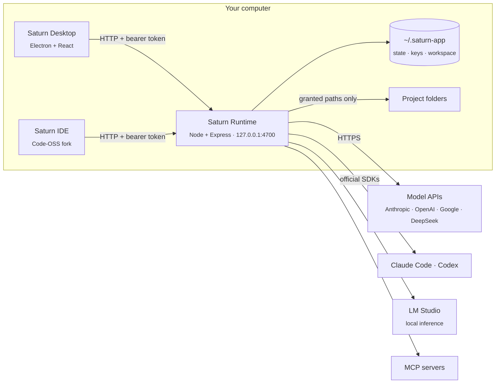

<div align="center">


# Saturn

**A local-first agent runtime, desktop app and IDE.**

Bring your own models, scope every agent to the folders you grant, and keep each tool call, file edit and network request inspectable, reviewable and reversible.

[](LICENSE)


[Features](#features) · [Install](#install) · [Architecture](#architecture) · [Models](#models) · [Security](#security-and-trust) · [API](#local-api) · [中文](README_ZH.md)

</div>

---

## Why Saturn

Most agent products run the control plane in a vendor cloud, or hand a model an unrestricted shell. Saturn keeps the control plane on your machine:

- **Local-first and verifiable.** The runtime is a loopback-only HTTP service on `127.0.0.1`. State, credentials and telemetry are files on disk, and every outbound request is logged ([how to verify](#security-and-trust)).
- **Model-agnostic.** Anthropic, OpenAI, Google and DeepSeek over their APIs with your keys; Claude Code and Codex on your existing subscriptions through their official SDKs; or fully offline models served by LM Studio.
- **Least privilege by default.** Agents are confined to granted folders, side-effecting actions go through an approval policy, and every edit is checkpointed and revertible per step.

## Features

| | |
|---|---|
| 🤖 **Agents** | Per-agent system prompt, model, reasoning effort, tool set and approval policy. Agent, Ask (read-only) and Plan modes per message. |
| 📋 **Agents board** | One view of every running, queued, blocked and finished task across chats, with an inbox for approvals and failures, and native notifications. |
| 🌿 **Isolated worktrees** | Run a task in its own git worktree and branch, in the background. Merge, keep or discard it; resolve conflicts with the agent; open a pull request from the branch. |
| 📎 **Context** | `@`-mention files, folders, git changes and URLs; paste screenshots; per-project rules from `AGENTS.md` and similar files; semantic code search backed by a bundled on-device embedding model. |
| ✅ **Verification loop** | After a turn edits files, the project's check command (typecheck, lint, tests) runs, and failures go back to the agent for up to two automatic fix rounds. |
| 🔍 **Review** | Per-turn diffs with inline comments sent back to the agent, editable plans, a summary card per turn, terminal output, and replayable browser recordings. |
| ↩️ **Checkpoints** | Every file edit is recorded. Keep or revert a turn, or restore the workspace to any individual step. |
| 👥 **Groups** | Several agents in one conversation; each decides whether it is addressed and delegates with `@mentions`. |
| 🛠️ **Tools** | Filesystem, shell, web fetch, a headless browser, multi-step planning, macOS computer use, GitHub, automations, and any [MCP](https://modelcontextprotocol.io) server from the built-in marketplace. |
| ⏰ **Automations** | Cron-scheduled agent runs, with templates such as a daily pull request review. |
| 💸 **Usage and cost** | Token counts and cost at list price, per model and per agent, over any time range. |
| 📈 **Observability** | OpenTelemetry traces, metrics and logs, an outbound network log, and optional OTLP export to your own collector. |
| 💻 **Saturn IDE** | A Code-OSS distribution wired to the same runtime: Tab completion, next-edit suggestions, inline edits, an agent panel with diff review, and LSP-backed tools for the agent. |

## Install

Download the latest build from [Releases](../../releases): a `.dmg` (or `.zip`) for macOS on Apple Silicon, and a setup `.exe` for Windows x64. Releases are pre-releases while Saturn is in preview. Each file ships with a SHA-256 checksum and a signed build provenance attestation ([verify a download](#5-verify-the-release-provenance)).

Builds are not code-signed yet. On macOS, approve the first launch in **System Settings → Privacy & Security → Open Anyway**; on Windows, choose **More info → Run anyway** in SmartScreen. No separate Node.js install is needed: the bundled runtime runs on the app's own Electron binary.

On first launch, onboarding walks through connecting a model, creating an agent and granting a project folder.

## Build from source

### Requirements

- [Node.js](https://nodejs.org) 22 or later
- macOS or Windows. macOS bundles must be built on macOS.

### Run in development

```bash
git clone https://github.com/Saturn-Technology-Project/Saturn-App.git
cd Saturn-App
npm install --prefix runtime
npm install --prefix desktop
npm run desktop
```

The desktop app spawns the runtime unless something is already listening on port `4700`. To run the runtime alone, headless, with its HTTP API:

```bash
npm run dev
```

### Package

```bash
npm run dist:mac   # unsigned Saturn.app in desktop/release/
npm run dist:win   # Windows x64 NSIS installer in desktop/release/
```

The macOS package embeds Saturn IDE, so build the IDE first (below), or set `SATURN_SKIP_IDE=1` to package the agent app alone.

`dist:win` runs on macOS or Windows. It installs the runtime's production dependencies for `win32-x64` into `desktop/.staging/` (Claude Code and Codex ship per-platform native packages) and packages those rather than the host's `runtime/node_modules`.

Release builds come from the [release workflow](.github/workflows/release.yml): it builds and tests both platforms on GitHub-hosted runners, smoke-tests the IDE, attests the artifacts and publishes the release when a `v*` tag is pushed.

### Build Saturn IDE

Saturn IDE is a Code-OSS fork in [`Saturn-IDE/`](Saturn-IDE). It requires the Node version pinned in [`Saturn-IDE/.nvmrc`](Saturn-IDE/.nvmrc) and several gigabytes of dependencies:

```bash
cd Saturn-IDE
npm install
cd ..
npm run build:ide --prefix desktop       # macOS: VSCode-darwin-arm64/Saturn IDE.app
npm run build:ide:win --prefix desktop   # Windows: VSCode-win32-x64/ (run on Windows)
```

Native modules are compiled against the host toolchain, so the Windows IDE is built on Windows; the [Windows workflow](.github/workflows/windows.yml) produces it on every push to `main`. On Windows the IDE runs in place from `resources\Saturn IDE\`.

`node Saturn-IDE/test/smoke/smoke.mjs [path]` launches a build with a throwaway profile and checks the workbench, terminal, Explorer and Source Control.

Saturn's editor integration lives in [`Saturn-IDE/extensions/saturn/`](Saturn-IDE/extensions/saturn); everything else tracks upstream [microsoft/vscode](https://github.com/microsoft/vscode).

### Platform notes

- **Computer use** drives the screen through macOS accessibility APIs and is macOS-only.
- **Claude Code** on Windows requires [Git for Windows](https://git-scm.com/downloads/win), which provides the Bash it executes commands in.
- On Windows, the `code` tool and the Terminal panel run commands under `cmd.exe`.
- The Windows build is CI-tested but has seen little use on real hardware so far.

## Architecture



| Component | Responsibility |
|---|---|
| **Saturn Runtime** (`runtime/`) | The control plane: model adapters, the agent loop, tool execution, MCP clients, the approval policy, checkpoints, worktrees, usage accounting, telemetry and persistence. It has no Electron dependency and runs headless. |
| **Saturn Desktop** (`desktop/`) | The Electron client: chats, the Agents board, projects, groups, automations and settings. It reaches the runtime only through its HTTP API. |
| **Saturn IDE** (`Saturn-IDE/`) | The editor. It authenticates with the same token, keeps the runtime alive while a window is open, and exposes language-server tools to agents over a server-sent events bridge. |

Runtime and desktop follow the same layered architecture; dependencies point inward only:

```
runtime/src/                    desktop/src/
  domain/          entities,      domain/          view models and rules
                   policies
  application/     use cases      application/     use cases over the API
  infrastructure/  model SDKs,    infrastructure/  HTTP client
                   MCP, storage
  presentation/    HTTP routes    presentation/    React components
```

### Lifecycle

Launching Saturn starts the runtime, then opens the default surface: the agent app or the IDE. Closing the last window stops the runtime unless the IDE is still open. A parent-process watchdog terminates the runtime if the desktop app exits abnormally, so it never outlives its host.

## Models

| Provider | Authentication | Notes |
|---|---|---|
| Anthropic | API key | Effort levels and adaptive thinking where supported |
| Claude Code | Claude subscription | Claude Agent SDK. Sign in once with the official `claude` CLI; Saturn never handles the credential. |
| Codex | ChatGPT subscription | Codex SDK. Device-code sign-in from Settings. |
| OpenAI | API key | Chat Completions and Responses APIs; reasoning effort on reasoning models |
| Google Gemini | API key | Thinking level (3.x and later) or thinking budget (2.5) |
| DeepSeek | API key | |
| LM Studio | None | Any locally served model, fully offline |

API keys are stored encrypted in `~/.saturn-app/secrets.json` (AES-256-GCM, key in the OS key store; see [Data at rest](#data-at-rest)), sent only to the provider they belong to, and never returned to the UI. One key covers every model of its provider.

## Security and trust

Saturn executes code on your machine and holds your provider credentials, so its trust model should not depend on taking our word for it. This section documents the data inventory, every egress path, and how to verify each claim with standard tooling, without reading the source.

**Summary:** there is no Saturn backend. Credentials, conversations and telemetry are local files under `~/.saturn-app`. Outbound traffic goes only to endpoints you configure (model providers, and the sites, APIs and MCP servers your agents use), and every request is observable.

### Data at rest

Everything lives under `~/.saturn-app` (override with `SATURN_DATA_DIR`). Deleting the directory is a complete reset.

| Data | Location | Notes |
|---|---|---|
| API keys and OAuth tokens | `secrets.json` | Encrypted at rest with AES-256-GCM under a random 256-bit key held by the OS key store: the macOS Keychain, Windows DPAPI, or the Secret Service (libsecret) on Linux; a mode `0600` key file only where none is available. Mode `0600`. Plaintext files from earlier versions are encrypted on first launch. |
| Agents, conversations, projects, settings | `state.json` | Plain JSON. |
| Telemetry (traces, metrics, logs) | In memory and `telemetry.json` | Exported only if you configure an OTLP endpoint. |
| Outbound request log | `network.log` | JSON Lines: timestamp, method, host, path. Query strings and bodies are never recorded. Rotates at 5 MB. |
| Memory, code index, checkpoints, attachments | `memory/`, `index/`, `checkpoints/`, `run-images/` | Local files. Embeddings are computed on-device by the bundled model. |
| API session token | `runtime-token` | Mode `0600`. |
| Saturn IDE telemetry | Ingested by the runtime on `127.0.0.1` | Code-OSS's Microsoft telemetry and crash-reporting endpoints are replaced; nothing is sent to Microsoft. |

### Egress inventory

| Destination | Trigger | Payload |
|---|---|---|
| Your model provider (Anthropic, OpenAI, Google, DeepSeek) | Agent turns, Tab completion, inline edits | The conversation, files you or the agent attach, tool results. The key goes only to that provider. |
| Anthropic / OpenAI via Claude Code and Codex | Turns on those providers | Their official CLIs talk to their own vendor under your subscription. Saturn never reads or forwards those credentials. |
| Sites, APIs and MCP servers | When an agent fetches a URL, drives the browser, calls GitHub, or uses an MCP server you installed | Whatever that tool call needs. The web and browser tools refuse private, link-local and loopback addresses (SSRF protection). |
| GitHub Releases | App startup | Update check via electron-updater. On macOS, only for Developer ID-signed builds. Disable with `SATURN_NO_UPDATES=1`. |
| Open VSX and `raw.githubusercontent.com` | Saturn IDE: the extension gallery, plus once at startup | Extension metadata, and Open VSX's extension blocklist. |
| GitHub (from Saturn IDE) | Only after you sign in to GitHub in the IDE | Git and GitHub extension traffic. |
| Hugging Face | Only if you select an embedding model that is not bundled | The model download. |
| Your OpenTelemetry collector | Only if `OTEL_EXPORTER_OTLP_ENDPOINT` is set | Saturn's traces, metrics and logs. |

There is no other egress: no product analytics, no crash reporting, no account and no hosted service.

Measured baseline: on a fresh install with no active turn, the runtime opens **zero** outbound connections, and Saturn IDE opens one (its network utility process fetching the Open VSX blocklist from `raw.githubusercontent.com`).

### Verify it yourself

Each check is independent and needs no knowledge of the codebase.

#### 1. Observe egress at the OS level

The kernel sees every socket, regardless of what the application claims.

```bash
# macOS: live TCP connections of every Saturn process
nettop -m tcp -p $(pgrep -d, -f "Saturn") 2>/dev/null || lsof -i -nP | grep -i saturn
```

```powershell
# Windows: established connections owned by Saturn processes
Get-NetTCPConnection -State Established | Where-Object { (Get-Process -Id $_.OwningProcess).ProcessName -like "Saturn*" }
```

For per-connection prompts, use an outbound application firewall: [LuLu](https://objective-see.org/products/lulu.html) (free, open source) or Little Snitch on macOS, or outbound rules in Windows Defender Firewall. Every connection should map to a row in the egress inventory.

#### 2. Read the runtime's network log

**Settings → Telemetry → Network** lists every host the runtime has contacted, with request counts and the latest requests. The same data is appended to a file:

```bash
tail -f ~/.saturn-app/network.log
jq -r .host ~/.saturn-app/network.log | sort | uniq -c | sort -rn   # requests per host
```

It is captured from Node's `diagnostics_channel` hooks for `undici` and `http`/`https`, so it covers every HTTP client in the runtime process, including the model SDKs, without per-call instrumentation.

#### 3. Run air-gapped

Connect a local model in [LM Studio](https://lmstudio.ai), block Saturn in your firewall, and keep working: agents, Tab completion and the code index all run offline.

#### 4. Inspect data at rest

```bash
ls -la ~/.saturn-app          # secrets.json and runtime-token are -rw------- (owner-only)
head -c 300 ~/.saturn-app/secrets.json   # an AES-256-GCM envelope: no key appears in it
security find-generic-password -s Saturn | grep acct   # macOS: the Keychain item that holds the encryption key
cat ~/.saturn-app/state.json  # agents, conversations and settings as plain JSON
```

#### 5. Verify the release provenance

Every release artifact has a SHA-256 checksum and a signed [build provenance attestation](https://docs.github.com/actions/security-for-github-actions/using-artifact-attestations) (SLSA provenance, signed through Sigstore). It binds the file's digest to this repository, the public [release workflow](.github/workflows/release.yml) and the exact commit it was built from:

```bash
shasum -a 256 -c Saturn-<version>-mac-arm64-unsigned.dmg.sha256
gh attestation verify Saturn-<version>-mac-arm64-unsigned.dmg -R Saturn-Technology-Project/Saturn-App
```

Build logs are public on the [Actions](../../actions/workflows/release.yml) page. Alternatively, [build from source](#build-from-source).

### Monitoring

- **Network log:** `network.log` is JSON Lines; ship it with Vector, Fluent Bit or Promtail, or `tail -f` it during a session.
- **OpenTelemetry:** set `OTEL_EXPORTER_OTLP_ENDPOINT` (optionally `SATURN_OTEL=otlp`) to export traces, metrics and logs to Grafana, Jaeger, Honeycomb, Datadog or any OTLP collector. Each model call, tool call and agent turn is a span, with outbound HTTP requests as child spans.
- **Local API:** `GET /network`, `GET /telemetry/traces`, `GET /telemetry/logs` and `GET /usage/summary` expose the same data to scripts ([Local API](#local-api)).
- **Spend:** **Settings → Usage & Billing** breaks down tokens and cost by model and agent over any time range.

### Security controls

- **Loopback binding.** The runtime listens on `127.0.0.1` only, rejects any non-loopback `Host` header (defeating DNS rebinding), and refuses `null` and non-local browser origins (CORS).
- **Encrypted credentials.** API keys and OAuth tokens are encrypted at rest (AES-256-GCM, authenticated); the key never touches the data folder when an OS key store is available, and is passed to the system tools on stdin, never as a command-line argument. A file whose key cannot be found is set aside, never overwritten.
- **Bearer authentication.** Every route except `/health` and the OAuth redirect requires `Authorization: Bearer <token>`. The token lives in `~/.saturn-app/runtime-token` (mode `0600`), so other local users and web pages cannot call the API.
- **Filesystem scoping.** Agents read, write and execute only within Saturn's workspace and project folders you grant; grants are revocable at any time.
- **Approval policy and checkpoints.** Risky commands and writes outside the working directory block on your approval unless you opt into full autonomy. Every edit is checkpointed and revertible down to a single step.
- **Subscription credential isolation.** Claude Code and Codex authenticate through their official CLIs, in Saturn-specific config directories. Saturn never reads, copies or forwards those credentials, and strips API-key and token variables from their environment so no key can override the subscription session.

### Reducing exposure

- Issue Saturn dedicated API keys with spend limits, so they can be rotated or revoked independently.
- Prefer the **Default** approval policy (prompt on risky actions) over full autonomy, and grant only the project folders a task needs.
- For code that must never leave the machine, use a local model through LM Studio.

### Known limitations

Saturn is an early preview and has not had a third-party security audit. Builds are not yet code-signed or notarized. API keys are encrypted at rest, which keeps them out of backups, synced folders, disk images and copied data folders; but any process running as your user can still ask the OS key store for the key, as with every app that keeps credentials in the Keychain or DPAPI. Settings → About shows which key store is in use. An agent granted full autonomy can execute arbitrary commands within its granted folders; that is inherent to the design, so scope grants accordingly. Claude Code, Codex and git run as separate processes and do not appear in the runtime's network log; observe them with OS-level tools.

Report vulnerabilities privately to [security@saturn-core.com](mailto:security@saturn-core.com) rather than in a public issue.

## Computer use (macOS)

Computer use tools observe the screen through screenshots and act through synthesized mouse and keyboard events and the accessibility API. macOS requires two TCC permissions for **Saturn**, under System Settings → Privacy & Security:

- **Accessibility**, to click, type and read the UI tree.
- **Screen & System Audio Recording**, to capture screenshots.

macOS keys these grants to the app's code signature. Ad-hoc-signed builds present a new identity after every update, so the grants stop applying: if an agent reports a missing permission that is already enabled, remove Saturn with − and add it again. While the screen is locked, agents report it rather than act.

## Configuration

| Variable | Default | Purpose |
|---|---|---|
| `SATURN_DATA_DIR` | `~/.saturn-app` | State, credentials, session token and workspace |
| `SATURN_RUNTIME_HOST` | `127.0.0.1` | Bind address |
| `SATURN_RUNTIME_PORT` | `4700` | Listen port |
| `SATURN_RUNTIME_TOKEN` | generated | Fixed session token (32+ characters) instead of the persisted one |
| `SATURN_NODE` | `node` on `PATH` | Node binary used to spawn the runtime in development |
| `SATURN_OTEL` | local only | `otlp` or `console` to export telemetry, `off` to keep it local |
| `OTEL_EXPORTER_OTLP_ENDPOINT` | unset | OTLP collector endpoint; setting it enables export |
| `OTEL_SDK_DISABLED` | unset | `true` disables telemetry entirely |
| `SATURN_NO_UPDATES` | unset | `1` disables the update check |
| `SATURN_SECRET_STORE` | the OS key store | `keychain`, `dpapi`, `libsecret` or `file`: where a new secrets key is kept |
| `SATURN_SKIP_IDE` | unset | `1` packages without Saturn IDE |
| `SATURN_IDE_BUILD` | the local build | IDE build to embed when packaging |

## Local API

The desktop app and the IDE are clients of the same HTTP API, and so can your scripts be:

```bash
TOKEN=$(cat ~/.saturn-app/runtime-token)
curl -H "Authorization: Bearer $TOKEN" http://127.0.0.1:4700/agents
```

| Method | Path | Purpose |
|---|---|---|
| `GET` | `/health` | Liveness probe (unauthenticated) |
| `GET` `POST` | `/agents` | List or create agents |
| `POST` | `/agents/:id/runs` | Start a turn (`mode`, `images` and project options) |
| `GET` | `/runs` · `/runs/:id` | Active and recent turns; one turn's output, reasoning, tool calls and approvals |
| `POST` | `/runs/:id/actions/:actionId/decision` | Approve or deny a pending action |
| `GET` `POST` | `/runs/:id/changes` · `/changes/keep` · `/changes/revert` | Review, keep or revert a turn's file changes |
| `POST` | `/runs/:id/restore` | Restore the workspace to a step |
| `POST` | `/runs/:id/stop` | Cancel a turn |
| `POST` | `/threads/:id/worktree` · `/worktree/finish` · `/pull-request` | Isolated worktrees: create, merge/keep/discard, open a PR |
| `GET` `POST` | `/groups` · `/groups/:id/messages` | Group conversations |
| `GET` `POST` | `/automations` | Scheduled runs |
| `GET` | `/usage/summary?from=&to=` | Tokens and cost over a time window |
| `GET` | `/network` | Outbound request log: hosts and recent requests |
| `GET` | `/telemetry/traces` · `/telemetry/logs` · `/telemetry/metrics` | Local OpenTelemetry data |
| `POST` | `/complete` · `/complete/stream` | Single model call (IDE Tab completion and inline edits) |

## Development

```bash
npm test            # runtime test suite
npm run typecheck   # strict type-check of runtime and desktop
npm run test:ide    # Saturn IDE extension checks
```

Tests boot the runtime's HTTP API against a temporary data directory and fake model servers, so they need no credentials and never touch your data.

Before opening a pull request:

1. Respect the layering: domain code imports neither Express nor React.
2. Add or update tests for runtime behavior, and run `npm test` and `npm run typecheck`.
3. Never log or return a secret. Log which credential was used (provider or model), never its value.

## Roadmap

- Developer ID-signed, notarized macOS builds and Authenticode-signed Windows builds
- Linux packages

## License

[MIT](LICENSE) © 2026 Prism Capital LLC
