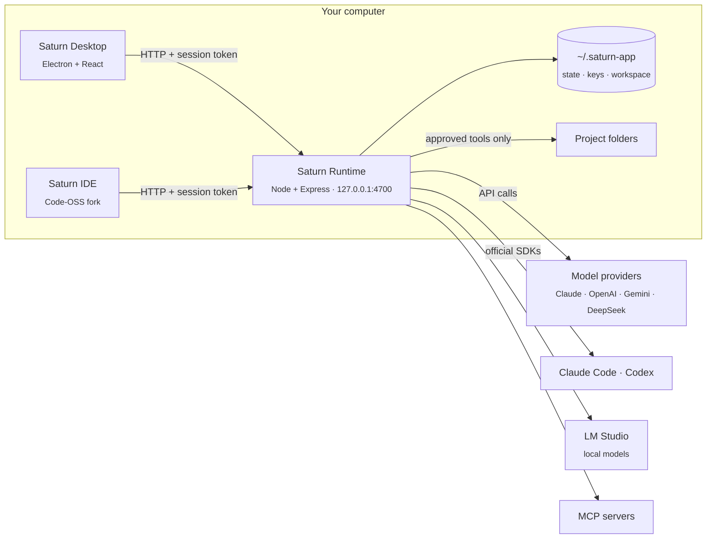

<div align="center">


# Saturn

**AI agents that run on your own computer.**

Pick the models, the tools and the folders they may touch. Saturn's agents read code, run commands, edit files and automate work, and everything they do stays visible, reviewable and reversible.

[](LICENSE)


[Features](#features) · [Quick start](#quick-start) · [Architecture](#architecture) · [Models](#models) · [Security](#security-model) · [API](#local-api) · [中文](README_ZH.md)

</div>

---

## Why Saturn

Most agent tools run in someone else's cloud, or hand an AI your shell with little say over what it does. Saturn takes the other road:

- **Local first.** The agents' core is a small server on `127.0.0.1`. Your agents, chats, keys and telemetry stay on your machine.
- **Bring your own model.** Claude, OpenAI, Gemini and DeepSeek with your API keys; Claude Code on your Claude plan; Codex on your ChatGPT plan; or a fully offline model in LM Studio.
- **You stay in control.** Agents work only in folders you grant. Risky actions wait for your approval, every edit is checkpointed, and any change can be reverted.

## Features

| | |
|---|---|
| 🤖 **Agents** | Give each agent instructions, a model, an effort level and a set of tools. Chat with one alone or inside a project. |
| 📁 **Projects are real folders** | A project is a folder on disk. Agents read and write there only after you grant access, and you can revoke it at any time. |
| 👥 **Groups** | Put several agents in one chat. Each one reads the conversation, decides whether it is needed, and hands work to others with `@mentions`. |
| 🛠️ **Tools** | Files, shell, web, multi-step plans, computer use, automations, and any [MCP](https://modelcontextprotocol.io) server, installed in one click from a built-in marketplace. |
| ✅ **Approvals** | Choose per agent or per group: ask before every action, ask only for risky ones, or let agents work on their own. |
| ↩️ **Checkpoints** | Every edit an agent makes is recorded. Review it as a diff, keep it, revert it, or restore a chat to before any turn. |
| ⏰ **Automations** | Run an agent on a cron schedule, for example "every weekday at 9:00, summarize yesterday's commits". |
| 🧠 **Effort control** | Set how hard a model thinks, from Low to Max. Saturn maps it to each provider's own control. |
| 💸 **Usage & billing** | Token counts and cost at each provider's official price, by model and by agent, for today, this week, this month or any date range. |
| 📈 **Observability** | OpenTelemetry traces, metrics and logs, kept locally and optionally exported to any OTLP collector. |
| 💻 **Saturn IDE** | A Code-OSS editor wired to the same agents: Tab completion, next-edit suggestions, inline edits, and an agent panel whose changes you review as diffs. |

## Quick start

### Requirements

- [Node.js](https://nodejs.org) 22 or newer
- macOS or Windows. The macOS app must be built on a Mac.

### Run from source

```bash
git clone https://github.com/Saturn-Technology-Project/Saturn-App.git
cd Saturn-App
npm install --prefix runtime
npm install --prefix desktop
npm run desktop
```

The desktop window starts the runtime for you if nothing is listening on port `4700`. Open **Settings → Models**, connect a model, create an agent, and send it a task.

To run only the runtime, the local core with its HTTP API:

```bash
npm run dev
```

### Build the app

```bash
npm run dist:mac   # unsigned Saturn.app in desktop/release/
npm run dist:win   # Windows x64 installer in desktop/release/
```

The macOS build bundles Saturn IDE, so build the IDE first (below), or package with `SATURN_SKIP_IDE=1` to get the app without the editor.

### Build Saturn IDE

Saturn IDE is a Code-OSS fork in [`Saturn-IDE/`](Saturn-IDE). It needs the Node version in [`Saturn-IDE/.nvmrc`](Saturn-IDE/.nvmrc) and a few gigabytes of dependencies:

```bash
cd Saturn-IDE
npm install
cd ..
npm run build:ide --prefix desktop   # Saturn IDE.app in VSCode-darwin-arm64/
```

Saturn's own editor features live in [`Saturn-IDE/extensions/saturn/`](Saturn-IDE/extensions/saturn); everything else follows upstream [microsoft/vscode](https://github.com/microsoft/vscode).

The builds are not signed yet. On macOS, open the app the first time with right-click → Open; on Windows, SmartScreen may ask for confirmation. No separate Node install is needed: the packaged runtime runs on the app's own executable.

## Architecture



| Part | Role |
|---|---|
| **Saturn Runtime** (`runtime/`) | The local core. It calls models, runs the agent loop and tools, connects MCP servers, enforces approvals, records usage and telemetry, and stores state. It does not depend on Electron and runs on its own. |
| **Saturn Desktop** (`desktop/`) | The Electron app: chats, projects, groups, automations, customizations and settings. It talks to the runtime only over HTTP. |
| **Saturn IDE** (`Saturn-IDE/`) | The editor, a Code-OSS fork. It finds the runtime through the same token and keeps it alive while a window is open. |

The runtime and the desktop app follow the same layers, and the inner ones never import the outer ones:

```
runtime/src/                    desktop/src/
  domain/          rules, types   domain/          types and rules for the UI
  application/     use cases      application/     use cases that call the runtime
  infrastructure/  models, MCP,   infrastructure/  the HTTP client
                   files, store
  presentation/    HTTP routes    presentation/    React screens
```

### Lifecycle

Launching Saturn starts the runtime, then opens whichever app you chose to launch by default: the agent app or the IDE. Closing the last Saturn window stops the runtime, unless the IDE is still open. A watchdog ends the runtime if the desktop app crashes, so it never outlives it.

## Models

| Provider | Sign-in | Notes |
|---|---|---|
| Claude | API key | Effort and adaptive thinking on models that support them |
| Claude Code | Your Claude plan | Runs the official Claude Agent SDK. You sign in once with the official `claude` program; Saturn never sees the credential. |
| Codex | Your ChatGPT plan | Runs the official Codex SDK. Sign in from Settings with a one-time device code. |
| OpenAI | API key | Chat Completions and Responses APIs; reasoning effort on reasoning models |
| Gemini | API key | Thinking level (3.x and later) or thinking budget (2.5) |
| DeepSeek | API key | |
| LM Studio | None | Any model served locally, fully offline |

API keys are stored in `~/.saturn-app/secrets.json` with owner-only permissions. They are sent only to their own provider and are never returned to the UI. One key serves every model of that provider.

## Security model

Saturn runs code on your machine, so its defaults are strict:

- **Loopback only.** The runtime binds to `127.0.0.1`, rejects requests whose `Host` is not loopback, and refuses `null` and non-local browser origins.
- **Session token.** Every route except `/health` and the OAuth redirect needs `Authorization: Bearer <token>`. The token lives in `~/.saturn-app/runtime-token` (mode `0600`), so other users and web pages cannot call the API.
- **Scoped work.** Files and commands stay in the runtime's `workspace/`, or in a project folder you granted. The `web` tool refuses local and private addresses.
- **Approvals.** Destructive commands and edits outside the working folder wait for you unless you choose full autonomy.
- **Plan logins stay with their owners.** Claude Code and Codex sign in through their official programs, in Saturn's own config folders. Saturn never reads, copies or forwards their credentials, and removes API-key environment variables so they cannot take over a plan session.

Found a vulnerability? Please report it privately to [security@saturn-core.com](mailto:security@saturn-core.com) instead of opening a public issue.

## Computer use (macOS)

Agents with the Computer Use tools see the screen through screenshots and act with real mouse, keyboard and accessibility input. macOS asks for two permissions, both granted to **Saturn** in System Settings → Privacy & Security:

- **Accessibility**, to click, type and read app windows.
- **Screen & System Audio Recording**, to take screenshots.

Builds that are not signed with a stable developer identity look like a new app to macOS after every update, so these permissions stop applying. If an agent reports a missing permission while Saturn is already turned on, remove Saturn from the list with the − button and add it again. Nothing works while the screen is locked; agents say so instead of acting.

## Configuration

State lives in `~/.saturn-app`. These variables override the defaults:

| Variable | Default | Purpose |
|---|---|---|
| `SATURN_DATA_DIR` | `~/.saturn-app` | State, keys, the session token and the workspace |
| `SATURN_RUNTIME_HOST` | `127.0.0.1` | Address the runtime binds to |
| `SATURN_RUNTIME_PORT` | `4700` | Runtime port |
| `SATURN_RUNTIME_TOKEN` | generated | Session token to use (at least 32 characters) instead of the saved one |
| `SATURN_NODE` | `node` on `PATH` | The Node binary the desktop app uses to start the runtime in development |
| `SATURN_OTEL` | local only | `otlp` or `console` to export telemetry, `off` to keep it local |
| `OTEL_EXPORTER_OTLP_ENDPOINT` | unset | Your collector; setting it turns on OTLP export |
| `SATURN_SKIP_IDE` | unset | `1` packages the macOS app without Saturn IDE |

## Local API

The desktop app and the IDE use the same HTTP API, and so can your own scripts:

```bash
TOKEN=$(cat ~/.saturn-app/runtime-token)
curl -H "Authorization: Bearer $TOKEN" http://127.0.0.1:4700/agents
```

| Method | Path | Purpose |
|---|---|---|
| `GET` | `/health` | Whether the runtime is up (no token needed) |
| `GET` `POST` | `/agents` | List or create agents |
| `POST` | `/agents/:id/runs` | Give an agent a task |
| `GET` | `/runs/:id` | Read a turn: output, reasoning, tool calls, approvals |
| `POST` | `/runs/:id/actions/:actionId/decision` | Approve or deny a waiting action |
| `GET` `POST` | `/runs/:id/changes` · `/changes/revert` | Review or revert a turn's file changes |
| `POST` | `/runs/:id/stop` | Stop a turn |
| `GET` `POST` | `/groups` · `/groups/:id/messages` | Group chats |
| `GET` `POST` | `/automations` | Scheduled agent runs |
| `GET` | `/usage/summary?from=&to=` | Tokens and cost, optionally for a time window |
| `POST` | `/complete` | One plain model call (used for the IDE's Tab completion and inline edits) |

## Development

```bash
npm test            # runtime tests
npm run typecheck   # type-check the runtime and the desktop app
```

Tests start the runtime's HTTP API against a temporary data directory and fake model servers, so they need no keys and never touch your own data.

Contributions are welcome. Before opening a pull request:

1. Keep the layering: domain code imports neither Express nor React.
2. Add or update tests for runtime behavior, then run `npm test` and `npm run typecheck`.
3. Never log or return a secret. Log which key was used (model or provider), never the key itself.

## Roadmap

- Signed and notarized macOS builds, and auto-update
- Linux packages

## License

[MIT](LICENSE) © 2026 Prism Capital LLC
