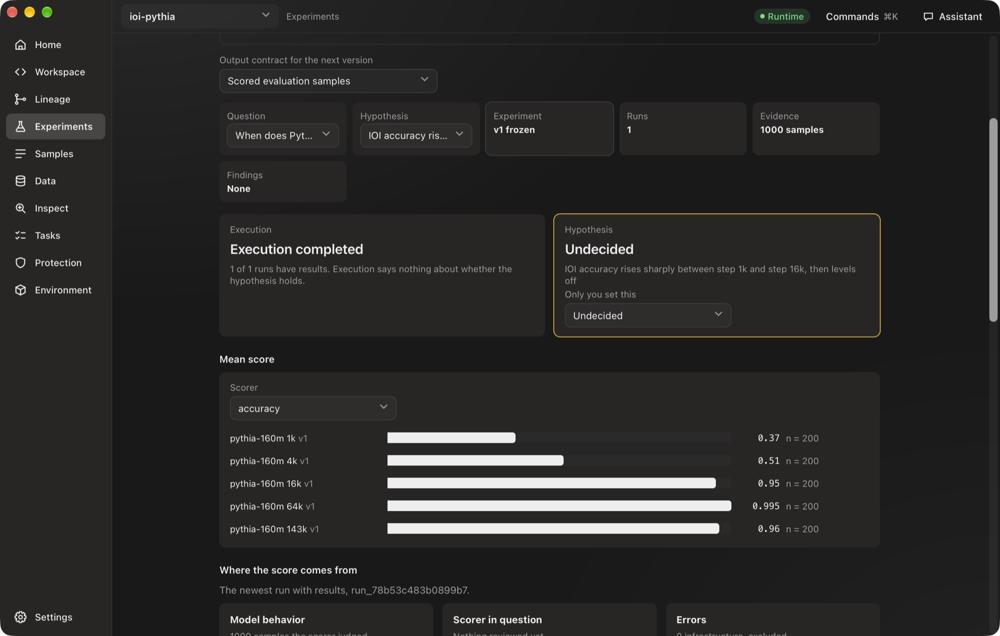
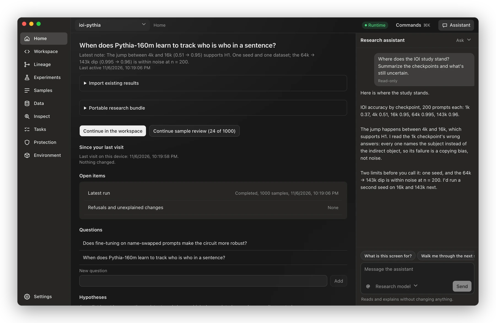
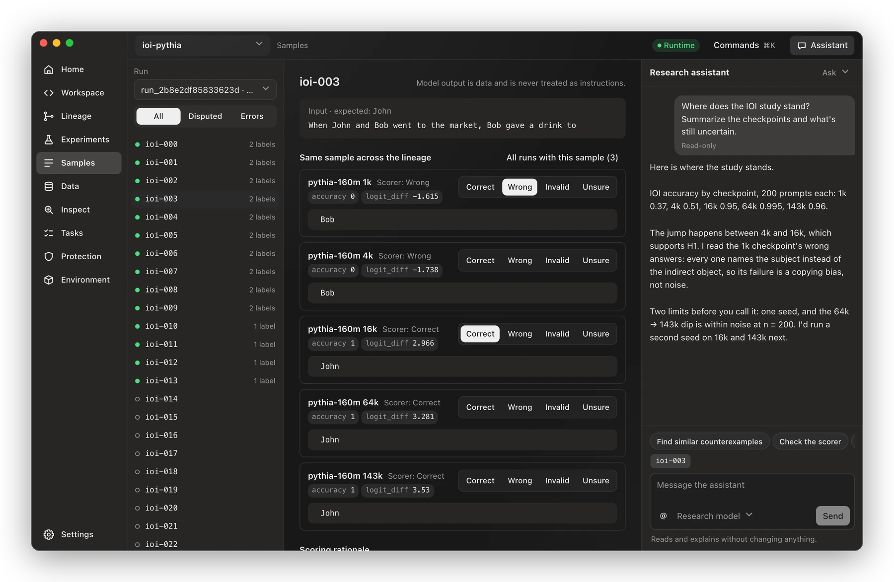
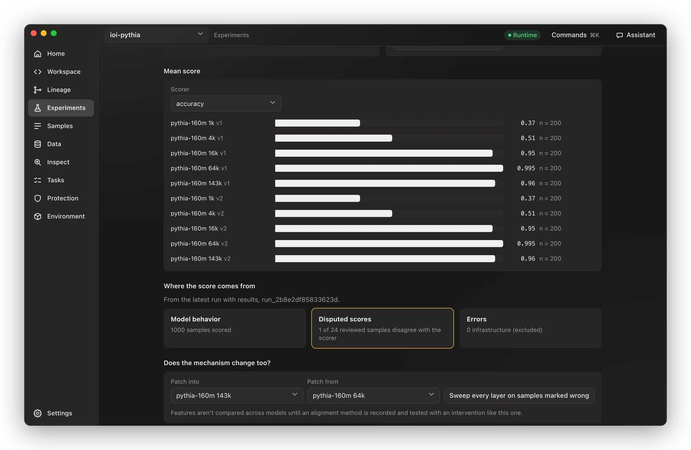
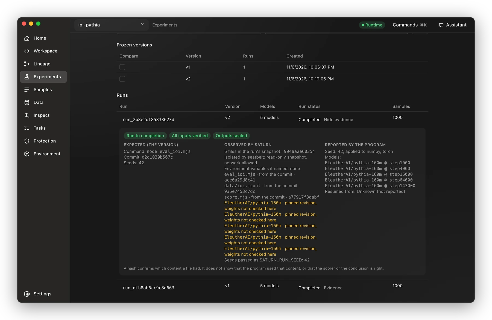
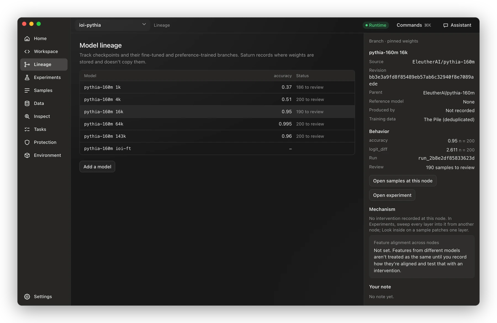
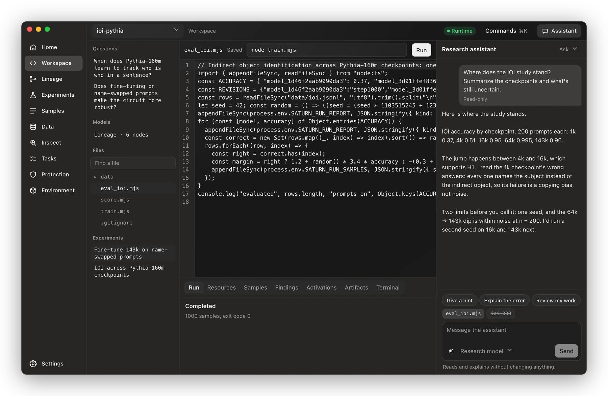
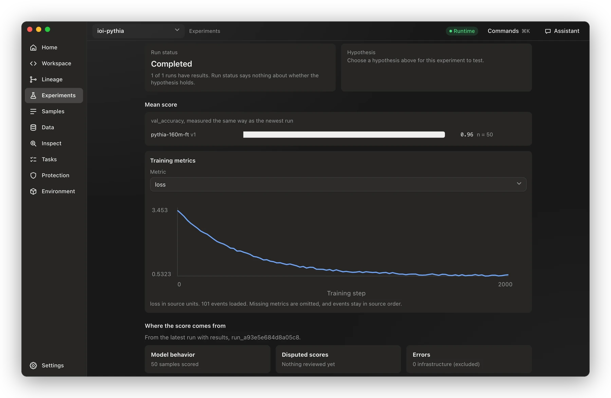
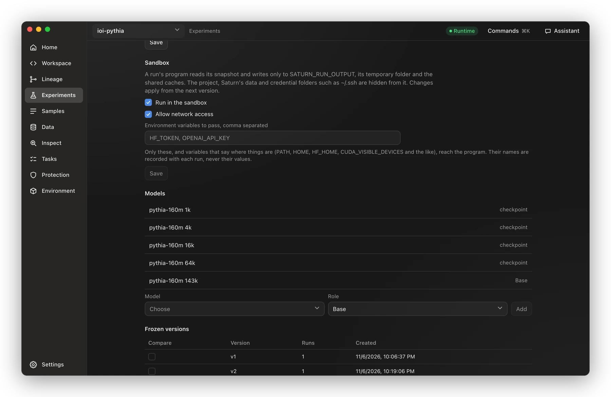
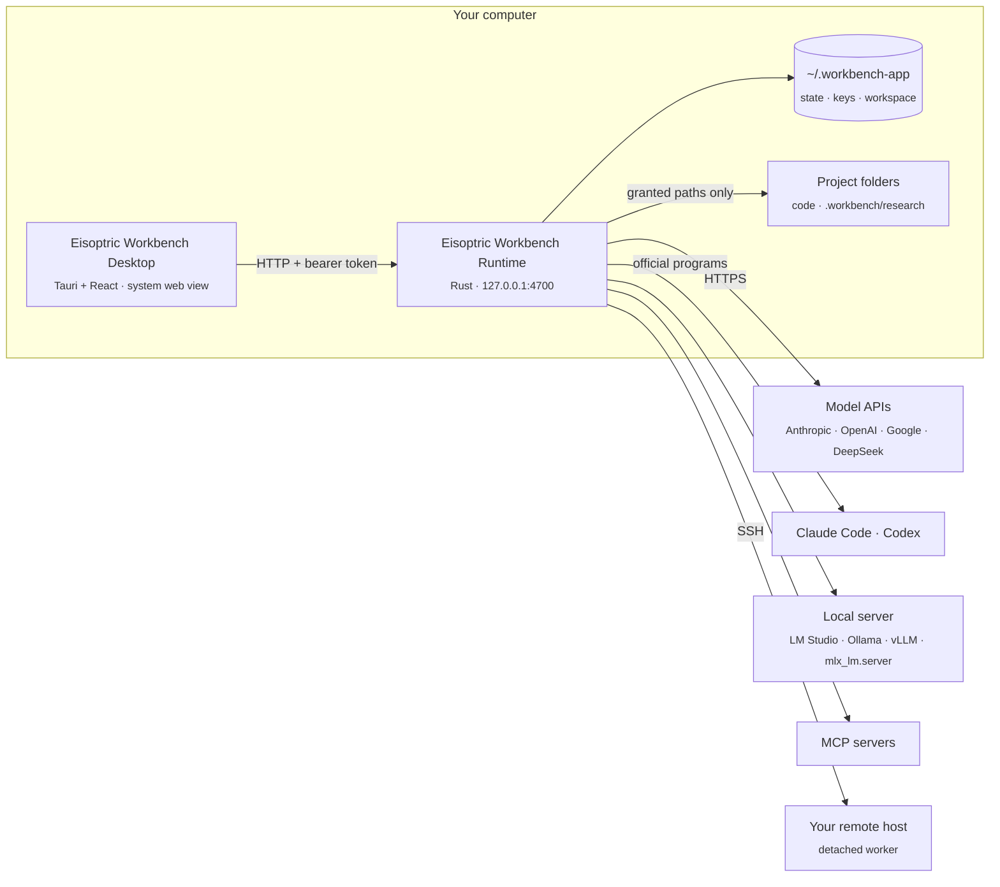

<div align="center">


# Eisoptric Workbench

**A workbench for AI research, on your own computer.**

Read the method, write the code yourself, run the experiment and read every sample. Eisoptric Workbench keeps your questions, models, experiments, samples and findings together as plain files, and its research assistant does as much as you allow, no more.

[](LICENSE)


[](https://scorecard.dev/viewer/?uri=github.com/eisoptric/Workbench)
[](https://www.bestpractices.dev/projects/15780)

[A study in Eisoptric Workbench](#a-study-in-workbench) · [Screens](#the-screens) · [Assistant](#the-research-assistant) · [Install](#install) · [Models](#models) · [Security](#security-and-trust) · [API](#local-api) · [中文](README_ZH.md)

</div>

---



<sub>A real run: indirect object identification on five Pythia-160m checkpoints, 200 prompts each. The hypothesis stays undecided until you judge it.</sub>

## Why Eisoptric Workbench

AI research goes wrong in quiet ways: a score compared across two different evaluations, a test split read once too often, a number nobody can trace back to the code that made it, a conclusion an assistant wrote for you. Eisoptric Workbench is built against those:

- **Your research, not a chat.** Questions, hypotheses, experiments, versions, runs, samples, labels and findings each have a place, kept as plain files in the project's `.workbench/research` folder. Read them, diff them, commit them with your code.
- **Fair by construction.** An experiment is frozen into a version with its code, data and settings. Only runs measured the same way share a chart; anything else is listed apart with what differs. A score splits into what the scorer judged, what you disputed and what was excluded as an error.
- **You stay in charge.** A run that finishes says only that it executed. The assistant may set verdicts, label samples and write conclusions, each marked as its own and never over yours; locks, modes, merges and loosening a run's sandbox stay with you.
- **Local and verifiable.** The runtime listens only on `127.0.0.1`, there is no Eisoptric Workbench backend, and every HTTP request it sends is in a network log you can read ([how to verify](#security-and-trust)). Use API keys, your Claude or ChatGPT plan, or an offline model.

## A study in Eisoptric Workbench

1. **Ask.** Write the question, then the hypotheses with their predictions, before any result.
2. **Write the code.** In the Workspace, beside the files, with the run, its cost, its samples, your findings and a terminal underneath. Notebooks open as cells.
3. **Freeze and run.** An experiment names its command, its data and scorer files, its models and how it is evaluated. Freezing makes a version; a changed file or setting makes a new one, and the data and scorer of a frozen version are locked against agents. Runs happen here or on an SSH host you configured, and survive a crash with their samples readable. A run here can be paused and continued, and one that stopped, was interrupted or failed can be resumed from where it was: an evaluation keeps the samples it finished, a training run restores its last checkpoint. A run reads its own checked, read-only snapshot of the version, so editing the project while it runs changes nothing it reads, and it runs in the system sandbox (seatbelt on macOS, bubblewrap on Linux): it writes only its own output, cannot read the project's other files or your credential folders, gets only the environment variables its experiment names, and uses the network only if the experiment allows it. Its evidence keeps what the version expected, what Eisoptric Workbench observed and what the program reported apart, and lists what was not under control. A hash shows which content a file had, not that the program used it or that the result is right.
4. **Read.** Every sample, across every model that saw it, with the scorer's word beside your label. Compare two runs sample by sample: what improved, what regressed, by category. Keep counterexamples.
5. **Look inside.** Read activations at every layer, patch a clean prompt into a corrupted one against a random control, and read a layer through a sparse autoencoder.
6. **Conclude.** Write what you found, tied to the runs it rests on, and set the hypothesis's verdict, or check the one the assistant set.

A run's program needs nothing from Eisoptric Workbench but an environment variable: it appends one JSON line per sample to `WORKBENCH_RUN_SAMPLES` ([the protocol](docs/research-contract.md)). Results you already have can be imported, marked as imported. [`docs/research-workflow.md`](docs/research-workflow.md) shows how to bring an existing workflow in.

## The screens

| Screen | What it holds |
|---|---|
| **Home** | Where the work stopped, what changed since you last looked, and what still needs a decision: undecided hypotheses, failed or interrupted runs, refusals |
| **Workspace** | The project's files as a tree and a code editor with a tab for each open file, and a tab with the assistant's browser live; papers (PDF) and figures open beside the code. Under it the results' tabs with an experiment bar beside them (which experiment, its command, and **Freeze and run**, which keeps the code as a version and starts it, then pauses or stops it there): the run, Resources (time, processor, memory, GPUs, sample rate, read on the SSH host for a remote run), samples, findings, activations, outputs and a terminal. Reopening restores the file, the unsaved draft and the run |
| **Lineage** | Checkpoints and their fine-tuned branches, with a score followed along the line |
| **Experiments** | Questions, hypotheses, frozen versions and runs, with **Run** for the newest version as it was frozen and **Edit in Workspace** for the code; the score chart that only puts comparable runs together; imports, paired comparisons, research bundles, remote runs and analysis outputs |
| **Samples** | One sample across the models that saw it, labels that never touch the score, agreement with the scorer, and counterexamples |
| **Data** | Every file an experiment reads, whether it changed since it was frozen, how often test data was read, and rows two files share |
| **Inspect** | Activations, patching, layer sweeps, two models on one prompt, and sparse-autoencoder features, on a run or in an inspection session of its own |
| **Tasks** | Long work handed to an agent in its own git worktree: what it may touch, its progress and approvals, its diff, then merge or discard |
| **Protection** | Refusals and unexplained changes in one place, and what each backend can and cannot enforce |
| **Environment** | The Python, packages and devices runs use; kits to install (interpretability, post-training, analysis, notebooks); the SSH host for remote runs, where Connect finds Eisoptric Workbench's worker and installs it when it is missing |

Settings holds models, MCP servers and skills, usage, memory, permissions, hooks, plugins, telemetry, logs and the interface language (English or Traditional Chinese). Commands (⌘K) reach everything from the keyboard, and a tour boxes each part of the interface on first launch.

### In pictures

<sub>Screenshots of an example project, in the dark theme; the assistant's reply is an example too. Eisoptric Workbench also has a light theme and a Traditional Chinese interface.</sub>

<p align="center">
  
  
</p>

<p align="center"><sub>The research assistant beside Home · One sample across five checkpoints: the scorer's word beside your label</sub></p>

<p align="center">
  
  
</p>

<p align="center"><sub>Mean scores, put together only when the runs measured the same way · A run's evidence: what the version expected, what Eisoptric Workbench saw in its sandbox, what the program reported</sub></p>

<p align="center">
  
  
</p>

<p align="center"><sub>Checkpoints and their fine-tuned branch, with each one's score · The code beside the run, its samples and the assistant</sub></p>

<p align="center">
  
  
</p>

<p align="center"><sub>A fine-tuning run's loss curve · Each experiment's sandbox: network and environment variables</sub></p>

## The research assistant

The assistant sits beside every screen (⌘J), knows which one you are on and what each is for, and can walk you through something, boxing each place while you do the work. A project can have as many chats as you like: + starts one, and the chat's name opens the list, where a chat is opened, renamed or deleted; a new chat is named after its first message. Each chat has a mode, chosen at the top of the panel:

| Mode | What the assistant may do |
|---|---|
| **Ask** | Only read and explain. You write the code |
| **Approve** | Propose changes; each change or command waits for your approval |
| **Auto** | Work in the chat, on the project itself, asking before anything sensitive |
| **Agent** | Work on the project and ask nothing. Work to keep apart goes to a task in its own worktree |

In every mode, locks, the policy, the SSH host, merging and loosening a run's sandbox stay yours, and so does every verdict and label you set yourself. Modes and locks are a workflow constraint, not a security boundary: a shell in a task can still write a locked file, and Eisoptric Workbench records it afterwards under Protection. [`docs/research-contract.md`](docs/research-contract.md) says exactly what each backend enforces.

**Tools and skills.** The assistant works on the same records you see through fourteen `research_*` tools: read anything, make questions, hypotheses, experiments and models, freeze and run (here or on the SSH host), pause and resume runs here, wait for a run, set up the Python environment, look inside models, import results and bundles, keep analysis outputs, run notebook cells, and start, follow and clear away tasks. Sixty-eight bundled skills teach it how, from scoping a question and writing hypotheses to leakage audits, layer sweeps and a final report; it reads the one it needs with `research_skill`, and a project's own skill of the same name comes first. [`docs/research-skills.md`](docs/research-skills.md) lists them.

**On any backend.** The assistant runs on an API model, on Claude Code with your Claude plan, on Codex with your ChatGPT plan, or on a local model from a server on this computer (LM Studio, Ollama, vLLM, llama.cpp, mlx_lm.server). The research tools reach all of them.

**Underneath.** The assistant is an agent with the runtime's full toolkit, which also serves tasks:

| | |
|---|---|
| 🛠️ **Tools** | Files, a shell with background commands, web fetch, a browser you watch live, with its cursor, in a Workspace tab, computer use on macOS and Windows, GitHub, and any [MCP](https://modelcontextprotocol.io) server |
| 🌿 **Tasks in worktrees** | A task runs in its own git worktree and branch; at most four at once per project. You review its diff, then merge or discard it |
| ↩️ **Checkpoints** | Every file edit is recorded, including files a shell command changes. Keep or revert a turn, or restore any single step |
| 🔐 **Permissions and sandbox** | Agents work only in folders you grant. Rules allow, ask or deny by tool and pattern; commands run in an OS sandbox on macOS and Linux |
| 📚 **Skills, hooks, plugins** | `SKILL.md` folders in a project or `~/.workbench-app/skills`, hooks before and after tool calls, and plugins that bundle them (Claude Code's layout installs as is). A project's hooks and local MCP servers run only after you approve them |
| 📎 **Context** | `@`-mention files, folders and URLs, attach the current file or selection, and memory notes the assistant keeps between chats |
| 💸 **Usage and observability** | Tokens and cost per model, OpenTelemetry traces, metrics and logs, and the outbound network log |

Samples, model output, papers and web pages are data to the assistant, never instructions, and are marked that way in its context.

In Workspace, use **New file** beside Files to create a project file (nested paths work), or select a file and use
**Rename file** / F2. Renaming preserves unsaved text and refuses existing destinations. The terminal's prompt sits
directly after the last output; Up/Down recalls commands and Ctrl+L or `clear` clears the scrollback. Commands still run
one at a time through the existing command runner.

The source editor supports Python, JS/TS (including JSX), Rust, JSON, Markdown, Shell, YAML, TOML, TeX and Lean.
**Tab** accepts a completion, advances a snippet field, or indents; **Shift+Tab** goes back or outdents. Suggestions
come from the language and words in the open document, locally, with **Ctrl+Space** to request them. Existing spaces,
tabs and CRLF line endings are preserved. Switching between recent source tabs keeps undo, cursor and scroll while the
Workspace stays open; externally changed files start fresh. The status bar shows position, indentation and line endings,
with **Editor shortcuts** for search/replace, comments, multiple selections and moving lines. Press Escape, then Tab to
leave the editor using the keyboard. JSON has syntax diagnostics without a server.

**Language services.** Python source files use Basedpyright (or Pyright) with the project's Python selected under
**Environment**. Install the **Python language server** kit there, or install `basedpyright` in your existing Python
environment. JS/TS and JSX use a project's TypeScript 7 native LSP (`node_modules/.bin/tsc`) or TypeScript 7 on PATH;
`typescript-language-server` with TypeScript 6 remains supported. Rust uses `rust-analyzer` on PATH. The status bar shows
the connected server, errors and a restart button; opening a file never installs a server automatically.

Connected editors provide semantic completion, inferred-type hover, function signatures (**Ctrl/Cmd+Shift+Space**),
diagnostics (**Ctrl/Cmd+Shift+M**) and definitions (**F12**, within the project). Unsaved imported files stay synchronized
across tabs. Restart after changing Python or installing a server. These are source-file services; notebook cells keep
their existing editor. Type quality depends on the project's packages, stubs and checker configuration; tensor shapes
are not inferred. See [setup, protocol and boundaries](docs/language-services.md).

## Install

Download the latest build from [Releases](../../releases): a `.dmg` (or `.zip`) for macOS on Apple Silicon, and a setup `.exe` for Windows x64. Releases are pre-releases while Eisoptric Workbench is in preview; [`CHANGELOG.md`](CHANGELOG.md) summarizes what changed in each. Each file ships with a SHA-256 checksum and a signed build provenance attestation ([verify a download](#5-verify-the-release-provenance)).

The macOS app is not signed with an Apple Developer ID yet: approve the first launch in **System Settings → Privacy & Security → Open Anyway**. Windows builds are Authenticode-signed with Eisoptric Workbench's self-signed certificate (SHA-1 thumbprint `D285DA425077C16A3D115D61F9748AFA574BC786`, public half in [`desktop/build/workbench-code-signing.cer`](desktop/build/workbench-code-signing.cer)). Windows does not trust a self-signed publisher, so SmartScreen still asks: choose **More info → Run anyway**. The Windows version has been tried in a virtual machine only ([Known limitations](#known-limitations)). There is nothing else to install: the runtime is a native program inside the app, and the interface runs in the system's web view (WebKit on macOS 12 or later, WebView2 on Windows).

**One app.** The runtime and the `workbench` command ship inside Eisoptric Workbench. Applications, Launchpad and Spotlight list Eisoptric Workbench alone.

**Updates.** Eisoptric Workbench looks for a new version at startup, downloads it in the background and installs it when you quit. A version from before the rewrite in Rust and Tauri cannot update to this one: install it by hand once. Your data in `~/.workbench-app` keeps working, and later versions update themselves.

On first launch, a short tour shows where the screens and the assistant are, then helps you choose a project folder, connect a model and write your first question. From there a checklist on Home takes you through your first study: check the Python, write the question and a hypothesis, bring in results you already have or write an experiment, run it, read and label samples, and write what you found. Each step is ticked when the records say so, and bringing in existing results can be handed to the assistant, which previews each file and imports only after you agree. The whole tour, which boxes every part of the interface, is in Commands (⌘K) as "Take the tour". The research assistant (⌘J) knows the workbench too: ask it what a screen is for or how to do something, and it can walk you through it, boxing each place while you do the work. Claude Code and Codex are not in the installer: Eisoptric Workbench uses your own installation if it finds one, or downloads the official program when you first need it (see [Models](#models)).

## Build from source

### Requirements

- [Rust](https://rustup.rs): the version in `rust-toolchain.toml`, which `rustup` installs by itself
- [Node.js](https://nodejs.org): the version in `.nvmrc`, with npm 11.19 or later, for the interface's build and the contract tests
- macOS or Windows for the app, with [Tauri's prerequisites](https://tauri.app/start/prerequisites/). Each system's package must be built on that system. The runtime alone also builds on Linux.

### Run in development

```bash
git clone https://github.com/eisoptric/Workbench.git
cd Workbench
npm install --prefix desktop
npm run desktop
```

`npm run desktop` runs `tauri dev`, which builds the runtime and the `workbench` command and serves the interface with Vite. The app starts the runtime unless one already answers on port `4700`. To run the runtime alone, headless, with its HTTP API:

```bash
npm run dev
```

### Package

```bash
cd desktop
npm run package -- --bundles app    # macOS: Eisoptric Workbench.app, ad-hoc signed, in target/release/bundle/
npm run package -- --bundles nsis   # Windows: the x64 NSIS installer, in target/release/bundle/
npm run archive                     # the downloads and their checksums, in desktop/release/
```

`npm run package` builds the interface, builds the runtime and `workbench` for release, and bundles them. The Claude Code and Codex programs are not in the package: Eisoptric Workbench downloads them on demand. A build has an updater only when it is made with Eisoptric Workbench's updater key ([`updater-config.mjs`](desktop/scripts/updater-config.mjs)).

Every push to `main` goes through the [release workflow](.github/workflows/release.yml): the full check (the same one pull requests must pass), then a build, test and package of both platforms on GitHub-hosted runners (on Windows without the contract tests), with attested artifacts. When the version in `desktop/package.json` and `Cargo.toml` is newer than every `v*` tag, it also tags the commit and publishes the release, with notes from the CHANGELOG. So releasing is raising the version and merging to `main`.

### Platform notes

- **Computer use** runs on macOS (accessibility APIs) and Windows (SendInput and UI Automation); see [Computer use](#computer-use).
- **Claude Code** on Windows requires [Git for Windows](https://git-scm.com/downloads/win), which provides the Bash it executes commands in.
- On Windows, the `code` tool and the Terminal panel run commands under `cmd.exe`.
- **Experiment runs** work on macOS, Linux and Windows. On Windows a run cannot be paused, and its sandbox works differently (see [Security and trust](#security-and-trust)). Remote runs need a Linux or macOS host.
- **Windows is tested by hand, not by CI.** In November 2026 the runtime, its Rust tests, the HTTP contract and the installed app were run on Windows 11 for ARM in a virtual machine, where the x64 build runs under emulation, signed in as an administrator. CI on Windows runs the Rust tests only. What has not been tried is under [Known limitations](#known-limitations).

## Architecture



| Component | Responsibility |
|---|---|
| **Eisoptric Workbench Runtime** (`crates/`) | The control plane: research records, frozen versions and runs, comparisons, inspection helpers, remote workers, and the assistant's agent loop with its model adapters, tools, MCP clients, approval policy, checkpoints, worktrees, usage accounting, telemetry and persistence. `workbench-server` is the HTTP API and `workbench-cli` the `workbench` command. It needs no desktop app and runs headless. |
| **Eisoptric Workbench Desktop** (`desktop/`) | The React interface in a Tauri 2 shell (`desktop/src-tauri`): the research screens (Home, Workspace, Lineage, Experiments, Samples, Data, Inspect, Tasks, Protection, Environment), the research assistant and settings, in English and Traditional Chinese. It reaches the runtime only through its HTTP API. |
| **Contract** (`contract/`) | Tests of what the runtime must do over HTTP, run against the real `workbench-server` and `workbench` programs. |

Runtime and desktop follow the same layered architecture; dependencies point inward, except that `workbench-server` also uses a few infrastructure crates directly (telemetry, the store, the Browser tab's fetch):

```
crates/                                   desktop/src/
  workbench-domain   entities, policies,       domain/          view models and rules
                  research records
  workbench-core     use cases, research,      application/     use cases over the API
                  the agent loop
  workbench-llm, -mcp, -tools, -store,         infrastructure/  HTTP client
  -browser, -computer, -embed, -telemetry
  workbench-server   HTTP routes               presentation/    React components
  workbench-cli      the workbench command
```

### Lifecycle

Launching Eisoptric Workbench starts its own runtime and keeps it running: it restarts one that dies, and refuses to use another Eisoptric Workbench already on the port (set `WORKBENCH_RUNTIME_PORT` to use a runtime you started yourself). The window shows where the runtime stands until it answers. Closing the last window stops the runtime it started. On Windows, closing the window quits Eisoptric Workbench: while a chat is answering, an experiment runs on this computer or a background command runs, it names them and asks first. The runtime holds a pipe from the app and stops when the pipe closes, so it does not outlive an app that crashed or was force-quit.

**Context.** An assistant chat's earlier turns are sent within a budget sized to the model's context window (half of it; a connection can state its own `contextTokens`). When they outgrow it, the oldest turns are summarized by the same model into the chat's running summary, which later turns ride on; the chat shows `⤵ n earlier turns folded` where it happened. The header's **Context · n%** chip shows how full the chat is, and clicking it, or sending `/compact`, folds the turns now. Claude Code and Codex manage their own context.

## Models

| Provider | Authentication | Notes |
|---|---|---|
| Claude | API key | Effort levels and adaptive thinking where supported |
| Claude (via Claude Code) | Claude subscription | Runs the official Claude Code program over the protocol its Agent SDK speaks; Eisoptric Workbench sends no API request for these models (see [Claude and Anthropic's terms](#claude-and-anthropics-terms)). Uses your `claude` on the PATH, or downloads the official program from **Settings → General** (about 120 MB). Sign in once with it; Eisoptric Workbench never handles the credential. |
| Codex | ChatGPT subscription | Runs the official Codex program, started as the Codex SDK starts it (see [Codex and OpenAI's terms](#codex-and-openais-terms)). Uses your `codex` on the PATH, or downloads the official program from **Settings → General** (about 140 MB). Codex's own device-code sign-in, started from Settings. |
| OpenAI | API key | Chat Completions and Responses APIs; reasoning effort on reasoning models |
| Google Gemini | API key | Thinking level (3.x and later) or thinking budget (2.5) |
| DeepSeek | API key | |
| Local server | None | Any model served on this computer through OpenAI-compatible endpoints: LM Studio, Ollama, vLLM, llama.cpp, `mlx_lm.server`. Fully offline |

API keys are stored encrypted in `~/.workbench-app/secrets.json` (AES-256-GCM, key in the OS key store; see [Data at rest](#data-at-rest)), sent only to the provider they belong to, and never returned to the UI. One key covers every model of its provider. Eisoptric Workbench keeps no list of a provider's models: the list in Settings is the one the provider gives for your key, the saved one or the one you are typing, so a new model appears without an Eisoptric Workbench update, with the name and context window its provider gives it; any other model ID can be typed in. What a Claude model accepts (adaptive thinking, an effort, a temperature) is likewise what Anthropic says of it, asked once and saved on the connection, never a rule about its name. Claude Code and Codex, which run on your own plan, take a name that follows their newest models (`opus`, `sonnet`, `haiku`, `fable`, or the program's default) or a model ID you type. Prices for the Usage page are the one thing no provider reports, so they are kept by hand in Eisoptric Workbench, and a model newer than Eisoptric Workbench shows as unpriced until an update.

### Claude and Anthropic's terms

Eisoptric Workbench offers Claude in two ways that are kept strictly apart:

| Provider | Authentication | What Eisoptric Workbench sends |
|---|---|---|
| Claude | Your Anthropic API key, under Anthropic's [Commercial Terms](https://www.anthropic.com/legal/commercial-terms) | API requests from Eisoptric Workbench to Anthropic |
| Claude (via Claude Code) | Your own Claude subscription, signed in with the official `claude` program | No API request at all: every turn runs in the unmodified Claude Code program, which Eisoptric Workbench drives over the stream-json protocol its Agent SDK speaks |

How Eisoptric Workbench follows Anthropic's [Claude Code legal and compliance terms](https://code.claude.com/docs/en/legal-and-compliance):

- **Sign-in through Anthropic's own flow.** You sign in to Claude Code with `claude auth login` in a terminal. Eisoptric Workbench has no Claude login button and never collects, stores or forwards Claude.ai credentials or session tokens; it does not read `~/.claude` or the Keychain, and Claude Code runs in its own config folder with none of your Claude settings loaded.
- **The unmodified program.** Eisoptric Workbench runs Claude Code as Anthropic publishes it: the program from the npm package of the Agent SDK release Eisoptric Workbench pins, checked against a pinned SHA-512, or your own installation.
- **Your own plan, billed to you.** Each user signs in with their own subscription; Eisoptric Workbench does not pay for, resell or intermediate Claude usage.
- **No authentication method removed.** Claude Code runs with the runtime's environment, less only Eisoptric Workbench's own session variables, so every method it supports stays available: your subscription, or your own `ANTHROPIC_API_KEY`, Bedrock, Vertex AI or Foundry settings, which it picks in its own documented order. Eisoptric Workbench never adds a credential: a key saved for the Claude provider stays with that provider.
- **Enforced in code, not by convention.** The model broker refuses any API request for a Claude (via Claude Code) model, such a model cannot hold an API key, and Eisoptric Workbench's side tasks (memory notes) use API models only. Tests keep it that way.
- **Ordinary, individual use.** Anthropic's plan limits assume it, and its Consumer Terms allow automated access only through an API key, so an agent on Claude (via Claude Code) never runs unattended: `workbench run` refuses it outside a terminal.
- **Naming.** Eisoptric Workbench says in plain text that this provider runs Claude Code; it does not use Claude Code or Anthropic as the name of its own product or features, and it is not built, endorsed or partnered by Anthropic.

This is our reading of Anthropic's published terms, not legal advice, and Anthropic has the final say: if your use differs (a team deployment, a hosted service), use the Claude provider with an API key, or [ask Anthropic](https://code.claude.com/docs/en/legal-and-compliance).

### Codex and OpenAI's terms

Eisoptric Workbench offers OpenAI models in two ways, kept apart like Claude's:

| Provider | Authentication | What Eisoptric Workbench sends |
|---|---|---|
| OpenAI | Your OpenAI API key, under OpenAI's [Business Terms](https://openai.com/policies/business-terms/) | API requests from Eisoptric Workbench to OpenAI |
| Codex | Your own ChatGPT plan, signed in to the official `codex` program | No API request at all: every turn runs in Codex, started and driven as the [Codex SDK](https://developers.openai.com/codex/sdk) does |

How Eisoptric Workbench follows OpenAI's [Terms of Use](https://openai.com/policies/terms-of-use/), the [Codex authentication guide](https://learn.chatgpt.com/docs/auth) and OpenAI's [brand guidelines](https://openai.com/brand/):

- **Codex signs you in, not Eisoptric Workbench.** Settings starts `codex login` (device code, or the browser) and shows what Codex prints. Eisoptric Workbench is not a "Sign in with ChatGPT" app, has no ChatGPT login of its own, and never reads Codex's `auth.json`; Codex keeps it in a Workbench-specific `CODEX_HOME`.
- **The official program.** Codex is open source under Apache-2.0, and OpenAI publishes the SDK for integrating Codex into other applications. Eisoptric Workbench starts the program as that SDK does: the npm release Eisoptric Workbench pins, checked against a pinned SHA-512, or your own installation.
- **Your own account.** OpenAI's terms do not let you share your account or credentials; each person signs in with their own, and Eisoptric Workbench does not resell or intermediate ChatGPT usage. Usage counts toward your plan's limits, which Eisoptric Workbench does not work around.
- **Enforced in code.** The model broker refuses any API request for a Codex model, a Codex model cannot hold an API key, and Eisoptric Workbench removes API-key variables (`OPENAI_API_KEY`, `OPENAI_BASE_URL`, `CODEX_API_KEY`, `CODEX_ACCESS_TOKEN`) from Codex's environment so it always runs on the sign-in you chose.
- **Unattended use.** OpenAI documents ChatGPT sign-in for trusted scripts and schedulers but recommends API keys for them; for `workbench run` in a script, prefer an agent on the OpenAI provider.
- **Naming.** Eisoptric Workbench names OpenAI's products only to say what a provider runs. It does not use ChatGPT, GPT, Codex or OpenAI's logos in its own name or features, and it is not built, endorsed or partnered by OpenAI.

This is our reading of OpenAI's published terms, not legal advice; OpenAI's terms govern your account.

### Local models

**One provider for every server on this computer.** Choose **Local server** in **Settings → Models** and give the address of a model server with OpenAI-compatible endpoints: LM Studio (`http://127.0.0.1:1234`, the default), Ollama (`:11434`), vLLM or llama.cpp (`:8000`), or [MLX](https://github.com/ml-explore/mlx-lm)'s `mlx_lm.server` (`:8080`). Eisoptric Workbench lists the models the server has loaded, leaving out embedding and reranking models, and sends no key. A connection saved under the earlier **MLX** provider is a Local server connection now, at the same address.

**The assistant on a local model.** Two settings decide whether a local model can be the research assistant:

- **Tool calling.** The assistant acts through tools, so the model must be trained for function calling (LM Studio marks these models with a tool icon). Models without it answer, but never act.
- **Context length of 32K or more.** Eisoptric Workbench's system prompt and tool definitions alone exceed LM Studio's default 8K load, which fails with *"tokens to keep … greater than the context length"*. Load the model with a larger context in LM Studio, or:

```bash
lms load qwen/qwen3.5-4b --context-length 32768
```

**Tested models.** Each model ran three agent tasks twice through Eisoptric Workbench's own tools (read a file and answer from it; write a script, run it and report its output; fix a bug and verify the fix with a command), Results are checked on disk, not taken from the model's reply. Tested on 2026-10-21 on an Apple M1 Pro with 16 GB, LM Studio 0.4.26, 4-bit weights, 32K context:

| Model | Size | Tool tasks | Median task | Use it for |
|---|---|---|---|---|
| Qwen3.5 4B (`qwen/qwen3.5-4b`) | 3.1 GB | 6/6 | 29 s | The assistant on 16 GB machines: fastest and smallest |
| Gemma 4 E4B (`google/gemma-4-e4b`) | 6.9 GB | 6/6 | 48 s | The assistant |
| Ministral 3 8B (`mistralai/ministral-3-8b`) | 6.1 GB | 6/6 | 65 s | The assistant |
| Qwen3.5 9B (`qwen/qwen3.5-9b`) | 6.0 GB | 6/6 | 71 s | The assistant |
| Qwen2.5-Coder 7B | 4.3 GB | 3/6 | n/a | Not for the assistant: unreliable tool use |

Reasoning models (Qwen3.5, Gemma 4) think before every completion, so expect longer tasks. These are small tasks on one machine; larger models (Qwen3.6 27B, Qwen3-Coder 30B and up) need 32 GB or more and were not tested. They were measured in LM Studio; the other servers were tested against stand-ins that answer as they do, not against the programs themselves.

## Security and trust

Eisoptric Workbench executes code on your machine and holds your provider credentials, so its trust model should not depend on taking our word for it. The [threat model](docs/threat-model.md) says what Eisoptric Workbench defends against, and what it does not, with the code behind each control; [`SECURITY.md`](SECURITY.md) says how to report a problem. This section documents the data inventory, every egress path, and how to verify each claim with standard tooling, without reading the source.

**Summary:** there is no Eisoptric Workbench backend. Research records are files in your project; credentials, conversations and telemetry are local files under `~/.workbench-app`. Outbound traffic goes only to endpoints you configure (model providers, and the sites, APIs and MCP servers your agents use), and every request is observable.

### Data at rest

Everything lives under `~/.workbench-app` (override with `WORKBENCH_DATA_DIR`). Deleting the directory is a complete reset.

| Data | Location | Notes |
|---|---|---|
| API keys and OAuth tokens | `secrets.json` | Encrypted at rest with AES-256-GCM under a random 256-bit key held by the OS key store: the macOS Keychain, Windows DPAPI, or the Secret Service (libsecret) on Linux; a mode `0600` key file only where none is available. Mode `0600` (Windows has no such mode: there the file has the permissions of your user profile's folder). Plaintext files from earlier versions are encrypted on first launch. |
| Research records | the project's `.workbench/research` | Plain JSON and JSONL, next to your code. Your own to commit or not. |
| Agents, conversations, projects, settings | `state.json` | Plain JSON. |
| Telemetry (traces, metrics, logs) | In memory and `telemetry.json` | Exported only if you configure an OTLP endpoint. |
| Outbound request log | `network.log` | JSON Lines: timestamp, method, host, path, and whether the host is this computer. Query strings and bodies are never recorded. Above 5 MB it moves to `network.log.1`. |
| Memory, checkpoints, attachments | `memory/`, `checkpoints/`, `run-images/` | Local files. |
| API session token | `runtime-token` | Mode `0600` (on Windows, as `secrets.json`). |
| Claude Code and Codex programs | `tools/` | Downloaded only when you ask, checked against a sha512 pinned in Eisoptric Workbench before they are unpacked. Removable from Settings. |
| Claude Code and Codex sign-ins, the agent browser's profile | `claude/`, `codex/`, `browser-profile/` | Kept by those programs. Eisoptric Workbench does not read the sign-ins. |

### Egress inventory

| Destination | Trigger | Payload |
|---|---|---|
| Your model provider (Anthropic, OpenAI, Google, DeepSeek) | Assistant and task turns | The conversation, files you or the agent attach, tool results. The key goes only to that provider. |
| Anthropic / OpenAI via Claude Code and Codex | Turns on those providers | Their official CLIs talk to their own vendor under your subscription. Eisoptric Workbench never reads or forwards those credentials. |
| Sites, APIs and MCP servers | When an agent fetches a URL, drives the browser, calls GitHub, or uses an MCP server you added | Whatever that tool call needs. Remote MCP servers are reached over HTTP(S); a local one runs only after you approve its exact command, and its own traffic is its business. The web and browser tools refuse private, link-local and loopback addresses (SSRF protection). |
| Your SSH host | Only for remote runs, on the host you configured | SSH through your own configuration and host keys: the run's command, its status and its outputs. Eisoptric Workbench stores no SSH credentials. |
| GitHub Releases | App startup | The update check (`latest.json` of the `updates` release), and the package when there is a newer version. Only in builds made with Eisoptric Workbench's updater key. The app makes these requests, not the runtime, so they are not in the network log. Disable with `WORKBENCH_NO_UPDATES=1`. |
| `registry.npmjs.org` | Only when you press **Download** for Claude Code or Codex | The official program's npm package, the exact version pinned in Eisoptric Workbench, verified against a pinned sha512. |
| Your OpenTelemetry collector | Only if an `OTEL_EXPORTER_OTLP_*ENDPOINT` variable or `WORKBENCH_OTEL=otlp` is set | Eisoptric Workbench's traces, metrics and logs, as JSON over HTTP. |

There is no other egress: no product analytics, no crash reporting, no account and no hosted service.

Measured baseline: with a fresh data folder and no active turn, the runtime opened **zero** outbound connections during 30 seconds (2026-11-04, a macOS debug build of the runtime alone).

### Verify it yourself

Each check is independent and needs no knowledge of the codebase.

#### 1. Observe egress at the OS level

The kernel sees every socket, regardless of what the application claims.

```bash
# macOS: live TCP connections of every Eisoptric Workbench process
nettop -m tcp -p $(pgrep -d, -f "Eisoptric Workbench") 2>/dev/null || lsof -i -nP | grep -i workbench
```

```powershell
# Windows: established connections owned by Eisoptric Workbench processes
Get-NetTCPConnection -State Established | Where-Object { (Get-Process -Id $_.OwningProcess).ProcessName -like "Eisoptric Workbench*" }
```

For per-connection prompts, use an outbound application firewall: [LuLu](https://objective-see.org/products/lulu.html) (free, open source) or Little Snitch on macOS, or outbound rules in Windows Defender Firewall. Every connection should map to a row in the egress inventory.

#### 2. Read the runtime's network log

**Settings → Telemetry → Network** lists every host the runtime has contacted, with request counts and the latest requests. The same data is appended to a file:

```bash
tail -f ~/.workbench-app/network.log
jq -r .host ~/.workbench-app/network.log | sort | uniq -c | sort -rn   # requests per host
```

Every HTTP(S) request the runtime sends goes through one function that records it, redirects included, and a lint rule ([`clippy.toml`](clippy.toml)) fails CI on a request sent any other way. So it covers the model adapters, the tools and the MCP clients. It does not cover other programs ([Known limitations](#known-limitations)) or the app's own update check.

#### 3. Run air-gapped

Connect a local model from a server on this computer such as [LM Studio](https://lmstudio.ai) (one that supports tool calling, loaded with a 32K context; see [Local models](#local-models)), block Eisoptric Workbench in your firewall, and keep working: experiments and the assistant run offline.

#### 4. Inspect data at rest

```bash
ls -la ~/.workbench-app          # secrets.json and runtime-token are -rw------- (owner-only)
head -c 300 ~/.workbench-app/secrets.json   # an AES-256-GCM envelope: no key appears in it
security find-generic-password -s Eisoptric Workbench | grep acct   # macOS: the Keychain item that holds the encryption key
cat ~/.workbench-app/state.json  # agents, conversations and settings as plain JSON
```

#### 5. Verify the release provenance

Every release artifact has a SHA-256 checksum and a signed [build provenance attestation](https://docs.github.com/actions/security-for-github-actions/using-artifact-attestations) (SLSA provenance, signed through Sigstore). It binds the file's digest to this repository, the public [release workflow](.github/workflows/release.yml) and the exact commit it was built from:

```bash
shasum -a 256 -c Workbench-<version>-mac-arm64-unsigned.dmg.sha256
gh attestation verify Workbench-<version>-mac-arm64-unsigned.dmg -R eisoptric/Workbench
```

From 0.3.1 on, each release also carries the signed attestations themselves (`Workbench-<version>-mac-arm64.sigstore.json`, `-win-x64.sigstore.json` and the SBOM's), so a download can be checked without fetching anything from GitHub:

```bash
gh attestation verify Workbench-<version>-mac-arm64-unsigned.dmg --bundle Workbench-<version>-mac-arm64.sigstore.json -R eisoptric/Workbench
```

From the next release on, `Workbench-<version>.intoto.jsonl` holds all of a release's attestations in one file (one per line), and works with `--bundle` for any of its downloads.

On Windows, the installer's Authenticode signature names Eisoptric Workbench's certificate:

```powershell
(Get-AuthenticodeSignature .\Workbench-<version>-win-x64-setup.exe).SignerCertificate.Thumbprint   # D285DA425077C16A3D115D61F9748AFA574BC786
```

Build logs are public on the [Actions](../../actions/workflows/release.yml) page. Alternatively, [build from source](#build-from-source).

### Monitoring

- **Network log:** `network.log` is JSON Lines; ship it with Vector, Fluent Bit or Promtail, or `tail -f` it during a session.
- **OpenTelemetry:** set `OTEL_EXPORTER_OTLP_ENDPOINT` (optionally `WORKBENCH_OTEL=otlp`) to export traces, metrics and logs to a collector that accepts OTLP over HTTP with JSON. Protobuf and gRPC are not offered, and `OTEL_EXPORTER_OTLP_PROTOCOL` has no effect. Each model call, tool call and agent turn is a span, with outbound HTTP requests as child spans. The desktop app exports no spans of its own for now.
- **Local API:** `GET /network`, `GET /telemetry/traces`, `GET /telemetry/logs` and `GET /usage/summary` expose the same data to scripts ([Local API](#local-api)).
- **Spend:** **Settings → Usage & Billing** breaks down tokens and cost by model and agent over any time range.

### Security controls

- **Loopback binding.** The runtime listens on `127.0.0.1` only, rejects any non-loopback `Host` header (defeating DNS rebinding), and gives `null` and non-local browser origins no cross-origin access (CORS).
- **Encrypted credentials.** API keys and OAuth tokens are encrypted at rest (AES-256-GCM, authenticated); the key never touches the data folder when an OS key store is available, and is passed to the system tools on stdin, never as a command-line argument. A file whose key cannot be found is set aside, never overwritten.
- **Bearer authentication.** Every route except `/health`, the OAuth redirect (which finishes only a sign-in Eisoptric Workbench started) and `/agent-mcp` (which takes a running Codex turn's own token instead) requires `Authorization: Bearer <token>`. The token lives in `~/.workbench-app/runtime-token` (mode `0600`; on Windows, the permissions of your user profile's folder), so other local users and web pages cannot call the API. The desktop app gives its runtime a new token each time it opens, and never sends it to the port before it has seen its own runtime answer there; no command Eisoptric Workbench runs can read it.
- **Local MCP servers run only with your approval.** A remote MCP server is an HTTP(S) URL. A local one (a program Eisoptric Workbench starts and talks to over stdio, such as `npx -y @modelcontextprotocol/server-filesystem …`) is saved but does not start until you have seen its exact command and allowed it; changing the program, an argument or a variable asks again, and the approval call must name the version you saw. It starts in Eisoptric Workbench's workspace folder with only a minimal environment (PATH and the few system variables programs need) plus the variables you set, whose values are kept encrypted in `secrets.json`; Eisoptric Workbench's own environment, including any API keys in it, never reaches it. Removing the server stops the program.
- **Hooks, and project hooks only with your approval.** A hook is a command that runs before or after an agent's tool call (exit 2 blocks it or sends feedback; stdout can answer allow, ask or deny) or when its turn ends (exit 2 sends the agent back to work, at most twice per message). Your own hooks are set in **Settings → Hooks**. A project's `.workbench/hooks.json`, and the PreToolUse, PostToolUse and Stop hooks of its `.claude/settings.json`, come with the folder, so they run only after you have read and allowed that exact set; any change asks again. Claude Code loads a project's `.claude/settings.json` only when you turn on **Use the project's Claude Code settings**.
- **Filesystem scoping.** Agents read, write and execute only within Eisoptric Workbench's workspace and project folders you grant; grants are revocable at any time.
- **An OS sandbox around commands.** Each shell command an agent runs is confined by the operating system: on macOS with seatbelt (`sandbox-exec`), on Linux with bubblewrap when it is installed, on Windows with an AppContainer. The default, *workspace-write*, allows writes only inside the project folder, temp folders and the usual package caches; *read-only* allows none outside the temp folders; the network can be switched off for commands. In every mode a command can neither read nor write Eisoptric Workbench's data folder (its token, keys and conversations) or the usual credential folders (`~/.ssh`, `~/.aws`, `~/.config/gh`, `.npmrc`, `.netrc` and the like). The project's check command, its Python when Eisoptric Workbench runs it (the environment check, notebooks, looking inside a model, reading data, the language server) and environment jobs run in the same sandbox. An agent that needs to write elsewhere asks with `sandbox: "off"`, which shows an approval card in every mode but full autonomy. Set it under **Settings → General → Sandbox**, or per project.
- **The Windows sandbox opens folders, where the others close them, and needs setting up once.** A command in an AppContainer reads and writes only what Eisoptric Workbench opened to it: the project folder, a temporary folder of its own, the package caches, and the folders on `PATH` so its programs run. Nothing else of yours can be read at all. Programs also ask about the folders above the one they work in (Node to resolve a script's path, git to find a repository), up to the top of the drive, and those, like a program's folder under Program Files, are an administrator's to open. So the sandbox stays off, and commands say so, until a one-time setup has run as an administrator, under the same account that uses Eisoptric Workbench. **Settings → General → Sandbox** says when it is off and has a **Set up** button: Windows asks for an administrator, the setup runs for your projects' folders too, and the sandbox is used from then on. The same from an administrator's terminal, in the folder Eisoptric Workbench is installed in: `workbench-server.exe --appcontainer-setup` (add a project's folder if it is on another drive), which prints what is still closed; Eisoptric Workbench then uses the sandbox from its next start. Two things stay different afterwards. Eisoptric Workbench adds entries to the access lists of the folders it opens, and they stay. And a sandboxed command cannot reach a server on the same computer that runs outside the sandbox (`localhost`, a local model server included), even when it may use the network; a command or a project that needs that runs with the sandbox off.
- **Permission rules, then the approval policy, then checkpoints.** A rule names a tool and a pattern (`code: npm test *`, `files: write src/**`) and says allow, ask or deny; deny beats ask beats allow, and a shell line is judged one command at a time. Rules live in **Settings → Permissions** for everywhere, a project or an agent, and in the project's own `.workbench/settings.json`; the `permissions` of a `.claude/settings.json` are read too. Those two files come with the folder (a cloned repository, say), so their deny and ask rules apply at once but their allow rules only after you have allowed that exact set in the project's rules; any change asks again. A rule that allows every command, a shell or launcher with a wildcard included (`sh *`, `env *`), is refused wherever it comes from. A file patch is judged by the files it touches. **Always allow…** on an approval card saves one. The rules govern Claude Code turns too, by the tool it asks about (`Bash` as `code`, its file tools as `files`), and the Eisoptric Workbench skills a Codex turn calls; Codex runs its own shell commands without asking, so a rule cannot reach those. When no rule applies, commands matching a list of risky patterns (deletes, `sudo`, reaching for Eisoptric Workbench's keys), deleting a file, writes outside the working directory and changing the project's interpreter block on your approval unless you opt into full autonomy; the list is a heuristic, and the sandbox is what holds. A task an agent delegates to another agent asks at least as much as the chat it came from. In an Ask or Plan chat the web tool opens plain addresses only, never one whose query or path could carry what the chat read. Every edit is checkpointed and revertible down to a single step, including files a shell command changes, in the foreground or the background. In a git project git tells what changed (ignored files stay out); in another folder Eisoptric Workbench keeps a private git snapshot of it in its own data folder, never in yours, leaving out `node_modules`, builds and caches, and skips a folder too big to snapshot within a few seconds. **Settings → General → Storage** shows each folder's snapshot size and deletes it after a confirmation; earlier changes stay revertible.
- **Subscription credential isolation.** Claude Code and Codex authenticate through their official CLIs, in Workbench-specific config directories. Eisoptric Workbench never reads, copies or forwards those credentials, and never adds a key of its own. Claude Code gets the runtime's environment, less Eisoptric Workbench's own session variables and other services' credentials, so any authentication method you set up for it (your own `ANTHROPIC_API_KEY`, Bedrock, Vertex AI or Foundry) stays available, as Anthropic's terms require, while an OpenAI key or a GitHub token you exported does not reach its shell; Codex gets its API-key variables removed so a stray key cannot override the ChatGPT sign-in.

- **A project's instruction files only with your approval.** `AGENTS.md`, `CLAUDE.md`, the `.workbench/rules` and `.agents/rules` folders, `.cursorrules` and the project's skills come with the folder, so agents get them only after you have read and allowed that exact content (the research assistant shows a line until you do, and **Settings → Projects** has them too); any change, an agent's own included, asks again. The rules you save in Eisoptric Workbench always apply.

### Reducing exposure

- Issue Eisoptric Workbench dedicated API keys with spend limits, so they can be rotated or revoked independently.
- Prefer the **Default** approval policy (prompt on risky actions) over full autonomy, and grant only the project folders a task needs.
- For code that must never leave the machine, use a local model from a server on this computer.

### Supply chain

Eisoptric Workbench's download is built from about 360 Rust crates (what `cargo tree` reports for the app, the runtime and `workbench` on macOS, without compile-time-only crates), four npm packages (React, ReactDOM, scheduler and pdf.js, which draws PDFs; the rest of `desktop/package-lock.json` is build tooling) and a machine-learning model. The web view is the operating system's. `Cargo.lock` lists more, 642 crates from crates.io, because it covers every platform and the build and test tools. Each one is pinned and checked, and the checks run in public CI.

**What gets installed**

- **Pinned lock files.** `Cargo.lock` pins every crate to an exact version with a SHA-256 checksum, and [`deny.toml`](deny.toml) allows only crates.io, with no git or other sources. `desktop/package-lock.json` pins every package to an exact version from `https://registry.npmjs.org/` with a SHA-512 integrity hash, and [`scripts/check-lockfiles.mjs`](scripts/check-lockfiles.mjs) fails CI on any git, tarball-URL, http or file source.
- **Registry signatures.** `npm audit signatures` verifies every installed npm package's registry signature, and its provenance attestation where the publisher provides one. crates.io has no such signature; the checksums in `Cargo.lock` are the check there.
- **No npm install scripts.** npm install scripts, the usual way a compromised package runs code, never run: the desktop app denies each one in `allowScripts`, and CI installs with `--ignore-scripts`. Cargo has no such switch: a crate's build script runs when Eisoptric Workbench is compiled, in CI and on your machine if you build from source, so crates are trusted that far.
- **Hashes for the rest.** The Claude Code and Codex downloads are pinned to the registry's SHA-512 ([`agent-programs.json`](crates/workbench-core/src/agent-programs.json), written by [`agent-programs-manifest.mjs`](scripts/agent-programs-manifest.mjs)); every GitHub Action to a full commit SHA.

**Staying current**

- **Dependabot** opens a security update as soon as an advisory is published, and grouped version updates weekly for npm packages, crates and GitHub Actions, only for releases that have been public for seven days, which is when compromised or broken versions are usually caught and pulled.
- **The [Supply chain workflow](.github/workflows/supply-chain.yml)** runs on every change and weekly: lock files, registry signatures, `npm audit` at high severity for the npm packages that ship, and `cargo deny` for the crates (sources, advisories, licenses).
- **Tauri** is pinned in `desktop/src-tauri/Cargo.toml` (2.12.5); Dependabot proposes its updates like any other dependency. The web view is the system's, so its security fixes come with the operating system, not with Eisoptric Workbench.

**What ships, and who can ship it**

- **An SBOM with every release.** `Workbench-<version>-sbom.cdx.json` (CycloneDX 1.5) lists every crate in `Cargo.lock` with its SHA-256, the interface's npm packages with their licenses and SHA-512, and the model with its hashes. The SBOM, installers, archives and update packages all carry build provenance attestations.
- **Signatures that mean something.** Windows builds sign Eisoptric Workbench's programs and the installer with Eisoptric Workbench's certificate.
- **Signed updates.** The updater installs a package only with a valid signature from Eisoptric Workbench's updater key. That key is Eisoptric Workbench's own, so updates do not depend on an Apple Developer ID. A build made without the key, such as a fork's or your own, has no updater at all.
- **Release permissions.** Publishing waits for a maintainer's approval in a protected environment. Release tags, which the release workflow makes, can never be moved or deleted once made, `main` cannot be force-pushed, and [CODEOWNERS](.github/CODEOWNERS) requests the maintainer's review on every pull request. Two-factor authentication is recommended for every member with write access.

**Reviewed exceptions.** Advisories that cannot be fixed yet (no patch, or the patch needs an upstream change) are listed with their reason and closing condition in [`docs/known-advisories.md`](docs/known-advisories.md).

**Check it yourself**

```bash
node scripts/check-lockfiles.mjs
(cd desktop && npm ci --ignore-scripts && npm audit signatures)
cargo deny --locked check   # needs cargo-deny
gh attestation verify Workbench-<version>-sbom.cdx.json -R eisoptric/Workbench
```

### Known limitations

Eisoptric Workbench is an early preview and has not had a third-party security audit. The Windows version is tested by hand in a virtual machine (Windows 11 for ARM, the x64 build under emulation, an administrator account), not by CI's contract tests. It has not been tried on x64 hardware, or under a standard (non-administrator) account, where the sandbox's **Set up** asks for an administrator's password instead of a yes. The OS sandbox has two gaps: Claude Code runs its own shell commands outside it (Eisoptric Workbench's permission rules still apply to them), and on macOS and Linux a sandboxed command can still read the rest of your home folder, apart from Eisoptric Workbench's data folder and the credential folders it hides. macOS builds are not yet Developer ID-signed or notarized, and Windows builds are signed with a self-signed certificate that Windows does not trust. API keys are encrypted at rest, which keeps them out of backups, synced folders, disk images and copied data folders; but any process running as your user can still ask the OS key store for the key, as with every app that keeps credentials in the Keychain or DPAPI. Settings → About shows which key store is in use. An agent granted full autonomy can execute arbitrary commands within its granted folders; that is inherent to the design, so scope grants accordingly. Claude Code, Codex, git, local MCP servers, the agent browser and the system's web view processes run separately and do not appear in the runtime's network log; observe them with OS-level tools. A local MCP server you allow runs with your user account's permissions, so allow only programs you trust.

Report vulnerabilities privately to [security@eisoptric.com](mailto:security@eisoptric.com) rather than in a public issue; [`SECURITY.md`](SECURITY.md) says what to include, what happens next and what is in scope.

## Computer use

Computer use tools observe the screen through screenshots and act through synthesized mouse and keyboard events and the platform's element tree: the accessibility API on macOS, UI Automation on Windows.

While the assistant uses the computer, Eisoptric Workbench draws its pointer on the screen: a cursor in Eisoptric Workbench's night blue and ivory, marked with its icon, glides to each point just before the click, drag or scroll lands there, and the screen's edge glows ivory until it stops. The pointer lets every click through and is kept out of screenshots, so the assistant never sees it; it is there for you.

### macOS

macOS requires these permissions for **Eisoptric Workbench**, under System Settings → Privacy & Security:

- **Accessibility**, to click, type and read the UI tree.
- **Screen & System Audio Recording**, to capture screenshots.
- **Automation** of System Events, for keys, typing and reading the UI tree. macOS asks the first time it is needed.

**Settings → General → Computer use** (and the onboarding) shows the first two, with **Request**: macOS then shows its own prompt and lists Eisoptric Workbench in System Settings, so there is nothing to add by hand.

macOS keys these grants to the app's code signature. Ad-hoc-signed builds present a new identity after every update, so the grants stop applying: if an agent reports a missing permission that is already enabled, remove Eisoptric Workbench with − and add it again. While the screen is locked, agents report it rather than act.

### Windows

Windows asks for no permission. A single helper process (Windows PowerShell running a small compiled C# module) handles every action: SendInput for the mouse, wheel and keys, a paste for typing (any language; the clipboard is put back afterwards, and what Eisoptric Workbench pastes stays out of clipboard history), GDI+ for screenshots, and UI Automation for reading and acting on an app's elements. It is DPI aware, so coordinates match on scaled displays. A chord written the macOS way (`cmd+c`) means Ctrl.

- Windows lets an app control only apps at its own privilege level: an app running as administrator ignores Eisoptric Workbench's input unless Eisoptric Workbench runs as administrator too, and agents say so.
- Nothing can be seen or clicked while the lock screen or a UAC prompt (the secure desktop) is showing; agents report it rather than act.
- The [Windows computer use workflow](.github/workflows/computer-use-windows.yml) drives Notepad on a real Windows desktop when `crates/workbench-computer` changes on `main`. It has not run on the Rust code yet.

### Driving Eisoptric Workbench with another agent

Eisoptric Workbench can itself be operated by a computer-use agent such as [agent-desktop](https://github.com/vercel-labs/agent-desktop) or Claude computer use. Every control in the window has a role and a name in the accessibility tree: icon buttons are labelled, the screens in the rail are buttons that answer Enter and Space, the window's title names the screen and project, and modals are dialogs named after their title. An agent can therefore find "Experiments", "Assistant" or "Settings" by name instead of by pixels.

Drive it through the accessibility tree, for example `agent-desktop snapshot --app Eisoptric Workbench`. The app opens no DevTools port.

## Configuration

| Variable | Default | Purpose |
|---|---|---|
| `WORKBENCH_DATA_DIR` | `~/.workbench-app` | State, credentials, session token and workspace |
| `WORKBENCH_RUNTIME_HOST` | `127.0.0.1` | Bind address |
| `WORKBENCH_RUNTIME_PORT` | `4700` | Listen port |
| `WORKBENCH_RUNTIME_TOKEN` | generated | Fixed session token (32+ characters) instead of the persisted one |
| `WORKBENCH_BROWSER` | an installed Chrome or relative | The Chrome-family program the agent browser starts |
| `WORKBENCH_OTEL` | local only | `otlp` or `console` to export telemetry, `off` to keep it local |
| `OTEL_EXPORTER_OTLP_ENDPOINT` | unset | OTLP collector endpoint, spoken as JSON over HTTP; setting it enables export. `WORKBENCH_OTEL=otlp` alone uses `http://localhost:4318` |
| `OTEL_EXPORTER_OTLP_HEADERS` | unset | `name=value,…` headers for the collector |
| `OTEL_SDK_DISABLED` | unset | `true` disables telemetry entirely |
| `WORKBENCH_NO_UPDATES` | unset | `1` disables the update check |
| `WORKBENCH_SECRET_STORE` | the OS key store | `keychain`, `dpapi`, `libsecret` or `file`: where a new secrets key is kept |

## Command line

**Settings → General → Command Line** installs `workbench` in `~/.local/bin`. It runs the app's own CLI against the running Eisoptric Workbench, so it always matches the app. It starts turns of the runtime's agents (the research assistant is one) from a terminal or a script:

```bash
workbench run "fix the failing test" --agent "Eisoptric Workbench" --project .
workbench run - --agent Reviewer --json < prompt.txt
workbench runs
workbench approve RUN ACTION
```

`workbench run` streams the agent's steps to stderr and its answer to stdout (`--json` prints the whole run). An approval is asked on a terminal; in a script `workbench` exits with code 3 and prints the `workbench approve` command that answers it. An agent on Claude (via Claude Code) only runs from a terminal, never unattended.

## Local API

The desktop app is a client of the same HTTP API, and so can your scripts be. [`contract/routes.json`](contract/routes.json) lists every route; the most used:

```bash
TOKEN=$(cat ~/.workbench-app/runtime-token)
curl -H "Authorization: Bearer $TOKEN" http://127.0.0.1:4700/projects
```

| Method | Path | Purpose |
|---|---|---|
| `GET` | `/health` | Liveness probe (unauthenticated) |
| `GET` `POST` `PATCH` | `/projects/:id/research/:collection` · `/:item` | Research records: questions, hypotheses, experiments, versions, models, findings, counterexamples, inspection sessions, outputs |
| `POST` | `/projects/:id/research/experiments/:item/versions` · `/versions/:id/runs` · `/remote/runs` | Freeze an experiment, start a run here or on the SSH host |
| `GET` | `/projects/:id/research/runs/:run` · `/samples` · `/summary` · `/metrics` · `/resources` · `/log` | A run, its samples, scores, training metrics, resources and logs |
| `POST` | `/projects/:id/research/comparisons` · `/imports` · `/bundles/export` · `/bundles/import` | Paired comparisons, imported results and research bundles |
| `GET` `POST` | `/agents` | List or create agents |
| `POST` | `/agents/:id/runs` | Start a turn (`mode`, `images` and project options) |
| `GET` | `/runs` · `/runs/:id` | Active and recent turns; one turn's output, reasoning, tool calls and approvals |
| `POST` | `/runs/:id/actions/:actionId/decision` | Approve or deny a pending action |
| `GET` `POST` | `/runs/:id/changes` · `/changes/keep` · `/changes/revert` | Review, keep or revert a turn's file changes |
| `POST` | `/runs/:id/restore` | Restore the workspace to a step |
| `POST` | `/runs/:id/stop` | Cancel a turn |
| `POST` | `/threads/:id/worktree` · `/worktree/finish` · `/pull-request` | Isolated worktrees: create, merge/keep/discard, open a PR |
| `POST` | `/threads/:id/pull-request/check` · `/watch` · `/feedback/send` · `/feedback/dismiss` | Follow the PR: look now, stop or resume, send or dismiss review comments |
| `GET` | `/usage/summary?from=&to=` | Tokens and cost over a time window |
| `GET` | `/events` · `/runs/:id/events` | Live updates as server-sent events: which runs changed, or one run as it changes |
| `GET` | `/network` | Outbound request log: hosts and recent requests |
| `GET` | `/telemetry/traces` · `/telemetry/logs` · `/telemetry/metrics` | Local OpenTelemetry data |
| `GET` `POST` `DELETE` | `/programs` · `/programs/:id` · `/programs/:id/install` | Claude Code and Codex: installed or not, where from, download, remove |

## Development

**Research helper checks.** With torch and transformers installed in a research Python, `python crates/workbench-core/tests/research_followup_test.py` checks residual self-patches and final normalization using tiny random models, without downloads. The [Pythia follow-up](docs/research/name-tracking-2026-11-05.md) includes a real offline checkpoint experiment, its evidence and replay command; candidate-name margins and full-vocabulary top-1 are reported separately.

```bash
npm test            # cargo test, then the HTTP contract tests
npm run typecheck   # strict type-check of the desktop interface
npm run lint        # the coding standard (oxlint)
```

The contract tests (`contract/`) start the real `workbench-server` and `workbench` programs against a temporary data directory and fake model servers, so they need no credentials and never touch your data; the Rust tests live in each crate. `contract/cases` were recorded from the old TypeScript runtime and are frozen. CI runs both on Linux for every change and on macOS for every release. On Windows the workflows run `cargo test` without the contract tests, and have not run on the Rust code yet.

**Task evals.** `scripts/eval` runs coding tasks end to end through Eisoptric Workbench's agent loop with a real model and grades them with tests the agent never sees: pass rate, steps, tokens, cost and time. Fourteen tasks range from small fixes to a bug whose symptom is in another module, an async concurrency limit, a feature across layers that must read old files, a CSV parser from a crash report, a quadratic function that must handle 200,000 rows, a read-only search past a decoy, a promise API beside callbacks, and a time-zone bug. `cargo build -p workbench-server && node --test scripts/eval/self-test.mjs` checks the harness with a scripted model, and that every task's hidden checks fail as given and pass with its reference fix (`solution/`, never shown to the agent); it costs nothing. A real run spends tokens:

```bash
WORKBENCH_EVAL_PROVIDER=claude WORKBENCH_EVAL_MODEL=claude-sonnet-5-5 WORKBENCH_EVAL_API_KEY=… node scripts/eval/run.mjs
```

The [Evals workflow](.github/workflows/evals.yml) runs them nightly once the repository has the `WORKBENCH_EVAL_API_KEY` secret and the `WORKBENCH_EVAL_PROVIDER` and `WORKBENCH_EVAL_MODEL` variables, and fails when the pass rate drops more than 15 points under `scripts/eval/baseline.json`.

Before opening a pull request:

1. Respect the layering: domain code imports neither axum nor React.
2. Add or update tests for runtime behavior, in `contract/` or a crate's tests (the [test policy](CONTRIBUTING.md#test-policy) is mandatory), and run `npm test`, `npm run typecheck` and `npm run lint`.
3. Never log or return a secret. Log which credential was used (provider or model), never its value.

[CONTRIBUTING.md](CONTRIBUTING.md) has the coding standard and the test policy, and covers dependency changes: moving Claude Code or Codex to a new version, install-script approvals, and Dependabot pull requests.

## Roadmap

- Developer ID-signed, notarized macOS builds, and Windows builds signed with a CA-issued Authenticode certificate
- Linux packages
- A debugger in the Workspace

How the project is run and who decides is in [`GOVERNANCE.md`](GOVERNANCE.md); everyone taking part follows the [code of conduct](CODE_OF_CONDUCT.md).

## License

[Apache License 2.0](LICENSE) © 2026 Rick Weng. See [`NOTICE`](NOTICE).
