<div align="center">

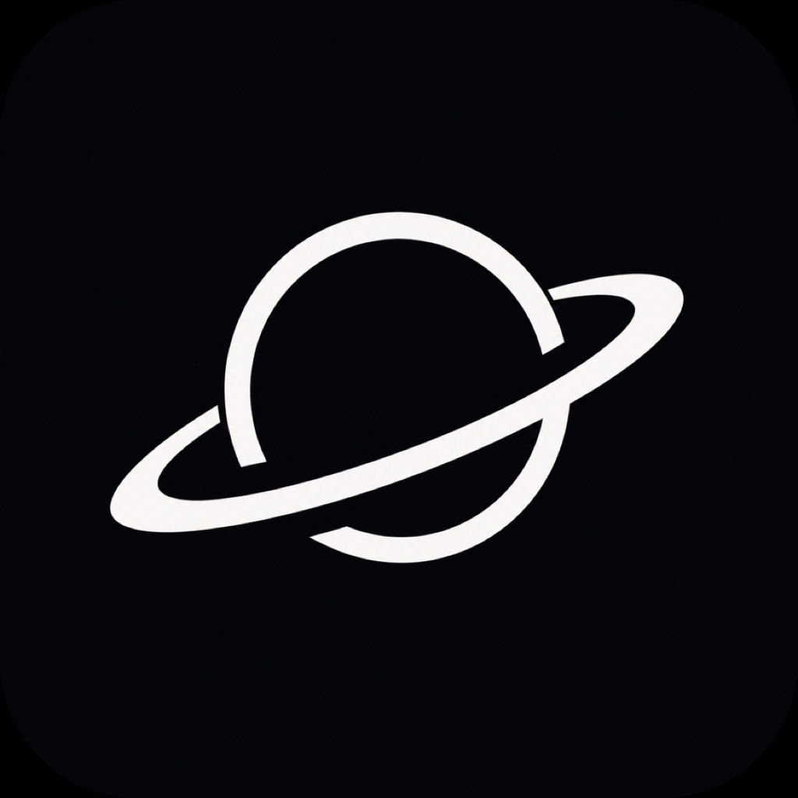

# Saturn

**在你自己的電腦上進行 AI 研究的工作台。**

讀懂方法、親手寫程式、執行實驗、讀過每一個樣本。Saturn 把你的問題、模型、實驗、樣本與發現以純文字檔保存在一起，研究助理只做你允許的事，不會更多。

[](LICENSE)


[](https://scorecard.dev/viewer/?uri=github.com/Saturn-Technology-Project/Saturn-App)
[](https://www.bestpractices.dev/projects/15780)

[在 Saturn 中做一項研究](#在-saturn-中做一項研究) · [畫面](#畫面) · [研究助理](#研究助理) · [安裝](#安裝) · [模型](#模型) · [安全](#安全與信任) · [API](#本機-api) · [English](README.md)

</div>

---

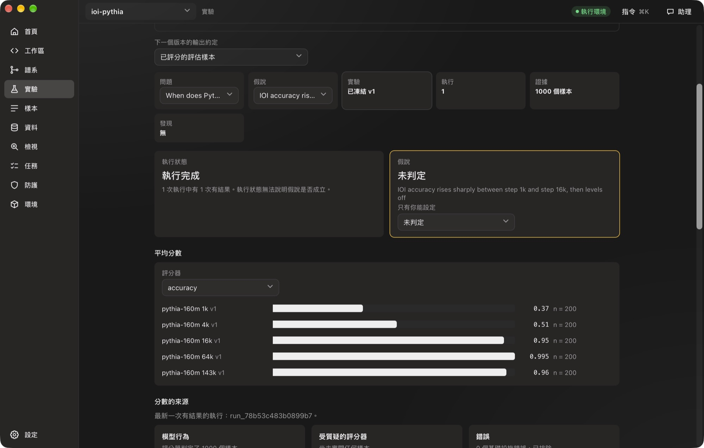

<sub>一次真實的執行：在五個 Pythia-160m checkpoint 上做間接受詞辨識（indirect object identification），每個 200 個提示。在你判定之前，假說都維持未判定。</sub>

## 為什麼是 Saturn

AI 研究常在不知不覺中出錯：拿兩種不同評估的分數互相比較、測試集被讀了太多次、一個數字沒人能追溯到產生它的程式、一個由助理替你寫下的結論。Saturn 就是為了防範這些而設計的：

- **你的研究，不是一段對話。** 問題、假說、實驗、版本、執行、樣本、標籤與發現各有其位置，以純文字檔保存在專案的 `.saturn/research` 資料夾。可以閱讀、比對差異，並與程式碼一起提交。
- **設計上就公平。** 實驗會連同程式、資料與設定凍結成一個版本。只有以相同方式量測的執行才會放在同一張圖表上；其他的另外列出，並標明哪裡不同。分數會拆成評分器的判斷、你提出異議的部分，以及因錯誤而排除的部分。
- **由你掌控。** 執行完成只代表它跑完了。研究助理可以設定判定、標註樣本、寫下結論，每一項都標示為它所做，且不會覆蓋你設定的；鎖定、模式、合併與放寬執行沙箱仍由你決定。
- **本機且可驗證。** Runtime 只監聽 `127.0.0.1`，沒有 Saturn 後端，它送出的每一筆 HTTP 請求都記錄在你可以閱讀的網路紀錄中（[驗證方式](#安全與信任)）。可使用 API 金鑰、你的 Claude 或 ChatGPT 方案，或離線模型。

## 在 Saturn 中做一項研究

1. **提問。** 在得到任何結果之前，先寫下問題，再寫下假說與它們的預測。
2. **寫程式。** 在工作區中，檔案就在旁邊，下方是執行、它的成本、樣本、你的發現與終端機。Notebook 會以儲存格開啟。
3. **凍結並執行。** 實驗指定它的指令、資料與評分器檔案、模型，以及評估方式。凍結會產生一個版本；檔案或設定一有變更就產生新版本，凍結版本的資料與評分器會被鎖定，Agent 無法修改。執行可以在本機進行，或在你設定的 SSH 主機上進行；當機後執行仍會保留，樣本也仍可讀取。執行讀取的是自己那份已核對、唯讀的版本快照，所以執行期間編輯專案不會影響它讀到的內容；程式也在系統沙箱中執行（macOS 用 seatbelt，Linux 用 bubblewrap）：只能寫入自己的產出，讀不到專案的其他檔案與你的憑證資料夾，只取得實驗指定的環境變數，且只有實驗允許時才能連網。執行證據把版本的預期、Saturn 的觀察與程式的回報分開保存，並列出未受控的部分。雜湊只能證明檔案的內容身分，不能證明程式真的用了它，也不能證明結果正確。
4. **閱讀。** 每一個樣本，橫跨所有看過它的模型，評分器的判斷就在你的標籤旁。逐樣本比較兩次執行：哪些改善、哪些退步，並依類別區分。保留反例。
5. **看進模型內部。** 讀取每一層的激活值，把乾淨提示修補（patch）到被破壞的提示中並與隨機對照比較，以及透過稀疏自編碼器（sparse autoencoder）解讀某一層。
6. **下結論。** 寫下你的發現，連結到它所依據的執行，再設定假說的判定，或檢查研究助理設定的判定。

執行的程式除了一個環境變數之外，不需要 Saturn 的任何東西：它為每個樣本在 `SATURN_RUN_SAMPLES` 附加一行 JSON（[協定](docs/research-contract.md)）。你已有的結果可以匯入，並標示為匯入。[`docs/research-workflow.md`](docs/research-workflow.md) 說明如何接入既有的工作流程。

## 畫面

| 畫面 | 內容 |
|---|---|
| **首頁** | 工作停在哪裡、上次查看後有什麼變化，以及還有哪些需要決定：未判定的假說、失敗或中斷的執行、被拒絕的操作 |
| **工作區** | 樹狀的專案檔案與程式碼編輯器；論文（PDF）與圖片可在程式碼旁開啟。下方是執行、資源（時間、處理器、記憶體、GPU、樣本速率；遠端執行時取自 SSH 主機）、樣本、發現、激活值、輸出與終端機。重新開啟時會還原檔案、未儲存的草稿與執行 |
| **譜系** | Checkpoint 與其微調分支，並沿著這條線追蹤一個分數 |
| **實驗** | 問題、假說、凍結的版本與執行；只把可比較的執行放在一起的分數圖表；匯入、成對比較、研究包、遠端執行與分析輸出 |
| **樣本** | 一個樣本在看過它的各個模型上的結果、從不影響分數的標籤、與評分器的一致程度，以及反例 |
| **資料** | 實驗讀取的每一個檔案、凍結後是否變更、測試資料被讀取的次數，以及兩個檔案共有的資料列 |
| **檢視** | 激活值、修補、逐層掃描、同一提示上的兩個模型，以及稀疏自編碼器特徵，可在某次執行上進行，或在獨立的檢視 session 中進行 |
| **任務** | 交給 Agent 在獨立 git worktree 中進行的長時間工作：它可以動哪些東西、進度與核准、它的 diff，然後合併或捨棄 |
| **防護** | 被拒絕的操作與無法解釋的變更集中在一處，以及每個後端能與不能強制執行什麼 |
| **環境** | 執行使用的 Python、套件與裝置；可安裝的套件組（可解釋性、後訓練、分析、Notebook）；遠端執行用的 SSH 主機：按「連線」會找出主機上的 Saturn worker，缺少時可以直接安裝 |

設定包含模型、MCP 伺服器與 skills、用量、記憶、權限、hooks、plugins、遙測、紀錄，以及介面語言（英文或繁體中文）。指令面板（⌘K）可用鍵盤到達任何地方，首次啟動時導覽會逐一框出介面的每個部分。

### 畫面一覽

<sub>示範專案的截圖（深色主題），研究助理的回覆也是示範內容。Saturn 另有淺色主題與英文介面。</sub>

<p align="center">
  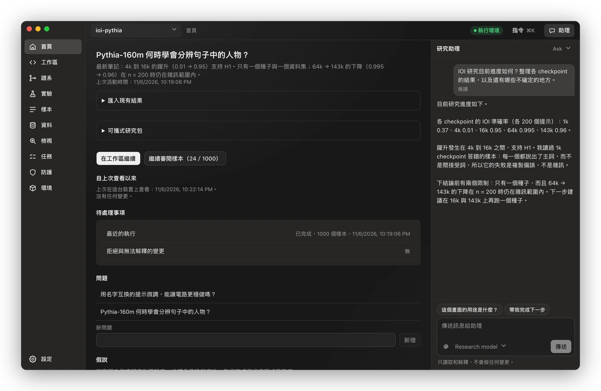
  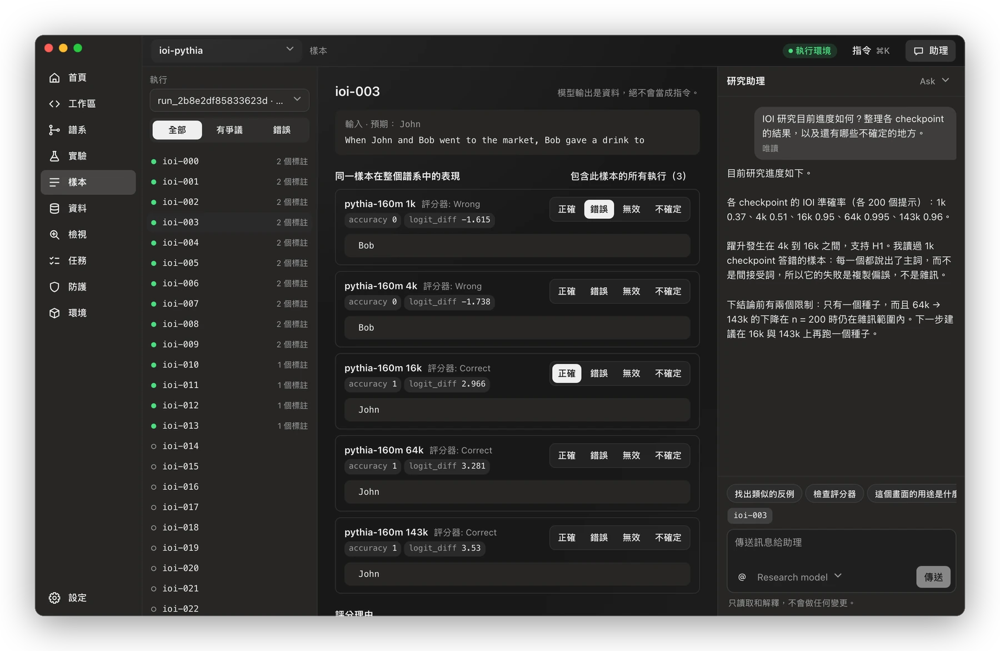
</p>

<p align="center"><sub>研究助理在首頁旁 · 同一個樣本在五個 checkpoint 上的表現，評分器的判斷就在你的標註旁</sub></p>

<p align="center">
  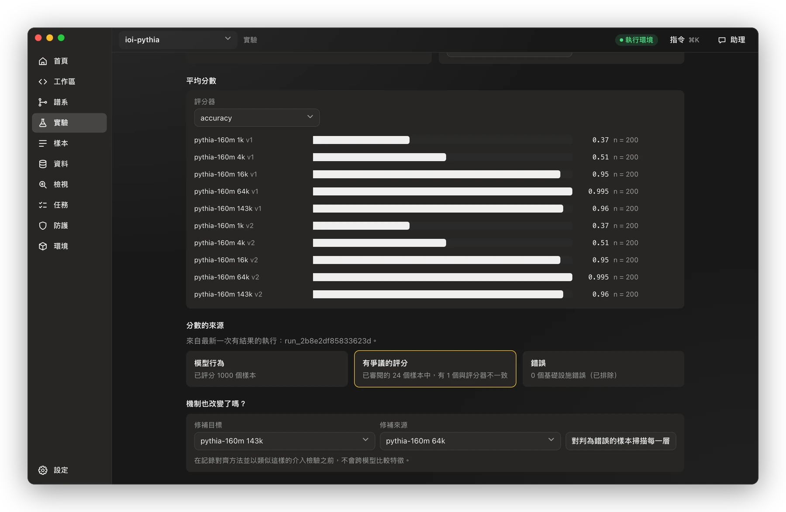
  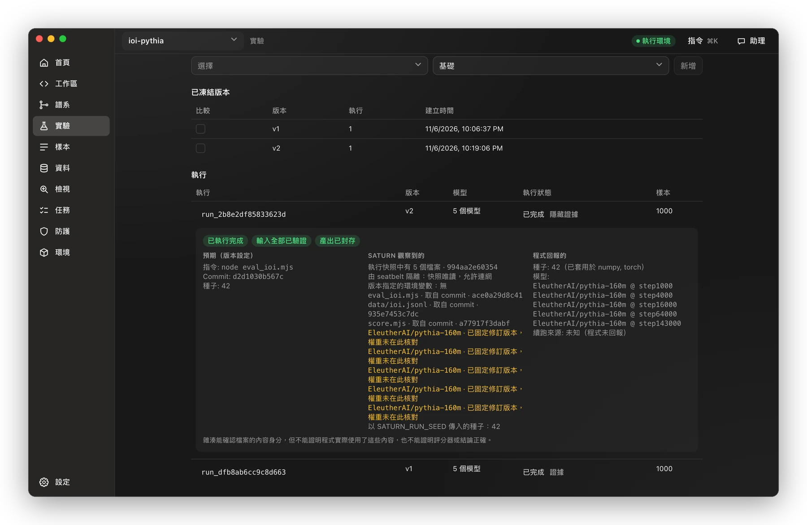
</p>

<p align="center"><sub>平均分數：只有測量方式相同的執行才會放在一起比較 · 執行證據：版本的預期、Saturn 在沙箱中的觀察，以及程式的回報</sub></p>

<p align="center">
  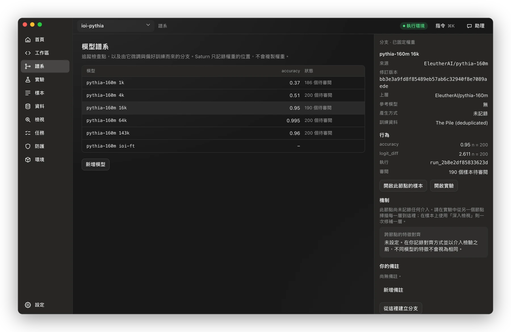
  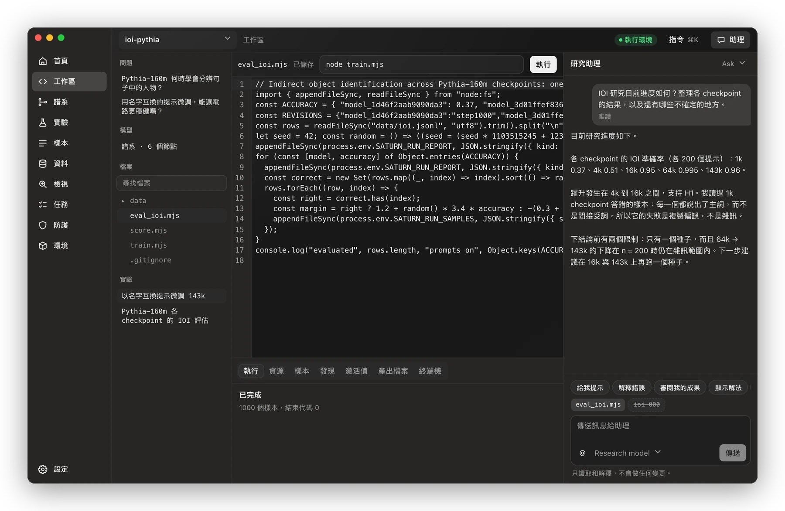
</p>

<p align="center"><sub>各個 checkpoint 與微調出的分支，以及各自的分數 · 程式碼與執行、樣本和研究助理並排</sub></p>

<p align="center">
  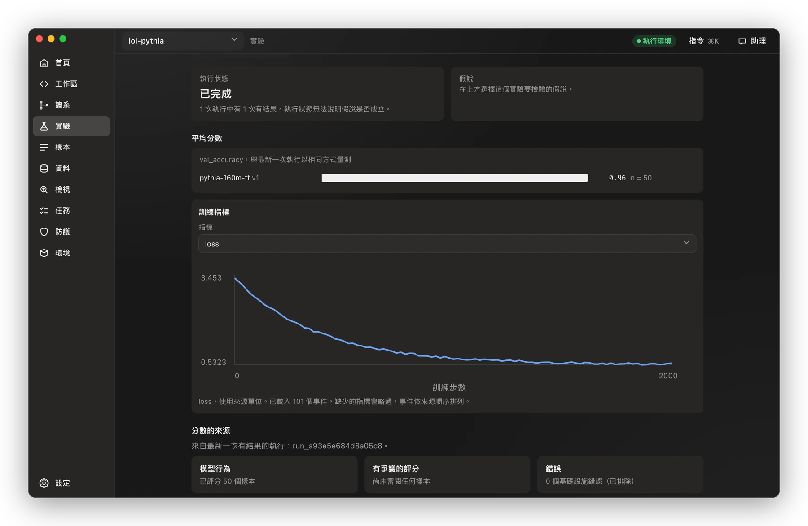
  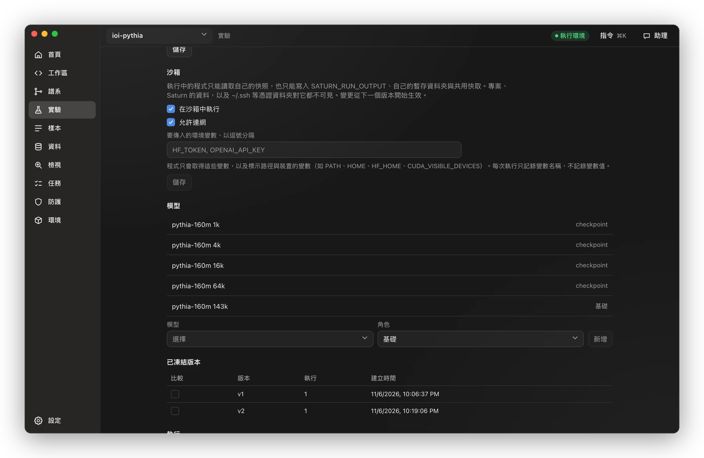
</p>

<p align="center"><sub>微調執行的 loss 曲線 · 每個實驗的沙箱：網路與環境變數</sub></p>

## 研究助理

研究助理就在每個畫面旁（⌘J），知道你在哪個畫面、每個畫面的用途，也能一步步帶你操作，框出每個位置，由你自己動手。每個對話都有一個模式，在研究助理的名稱旁選擇：

| 模式 | 研究助理可以做什麼 |
|---|---|
| **Ask** | 只能閱讀與解釋。程式由你來寫 |
| **Approve** | 提出變更；每項變更或指令都等你核准 |
| **Auto** | 在對話中直接處理專案本身，敏感操作前先詢問 |
| **Agent** | 處理專案，什麼都不問。需要分開進行的工作交給在獨立 worktree 中的任務 |

在任何模式下，鎖定、策略、SSH 主機、合併與放寬執行沙箱都由你決定，你親自設定的判定與標籤也是。模式與鎖定是工作流程約束，不是安全邊界：任務中的 shell 仍可寫入被鎖定的檔案，Saturn 會事後記錄在防護中。[`docs/research-contract.md`](docs/research-contract.md) 精確說明每個後端強制執行什麼。

**工具與 Skill。** 研究助理透過十三個 `research_*` 工具處理與你看到的相同紀錄：讀取任何內容；建立問題、假說、實驗與模型；凍結並執行（本機或 SSH 主機上）；等待執行完成；設定 Python 環境；看進模型內部；匯入結果與研究包；保存分析輸出；執行 Notebook 儲存格；以及啟動、追蹤並清除任務。五十個內建 skill 教它怎麼做，從界定問題範圍、撰寫假說，到資料洩漏稽核、逐層掃描與最終報告；它以 `research_skill` 讀取需要的那一個，專案自己的同名 skill 優先。[`docs/research-skills.md`](docs/research-skills.md) 列出全部 skill。

**任何後端皆可。** 研究助理可以在 API 模型上執行，也可以在使用你 Claude 方案的 Claude Code、使用你 ChatGPT 方案的 Codex，或 LM Studio 中的本機模型上執行。研究工具在所有後端上都能使用。

**底層。** 研究助理是一個擁有 Runtime 完整工具組的 Agent，任務也使用同一套工具組：

| | |
|---|---|
| 🛠️ **工具** | 檔案、支援背景指令的 shell、網頁擷取、看得見操作的瀏覽器、macOS 與 Windows 上的電腦操作、GitHub，以及任何 [MCP](https://modelcontextprotocol.io) 伺服器 |
| 🌿 **worktree 中的任務** | 任務在自己的 git worktree 與分支中執行；每個專案最多同時四個。你審查它的 diff，然後合併或捨棄 |
| ↩️ **檢查點** | 每次檔案修改都有紀錄，包括 shell 指令改動的檔案。可保留或回復一個回合，或還原任一單一步驟 |
| 🔐 **權限與沙箱** | Agent 只在你授權的資料夾內工作。規則依工具與樣式允許、詢問或拒絕；在 macOS 與 Linux 上，指令於作業系統沙箱中執行 |
| 📚 **Skills、指令、hooks、plugins** | 專案或 `~/.saturn-app/skills` 中的 `SKILL.md` 資料夾、`/` 指令、工具呼叫前後的 hooks，以及把它們打包在一起的 plugins（Claude Code 的格式可直接安裝）。專案的 hooks 與本機 MCP 伺服器只在你核准後才會執行 |
| 📎 **上下文** | 以 `@` 引用檔案、資料夾與網址，附加目前的檔案或選取範圍，以裝置端嵌入模型做語意程式碼搜尋，以及研究助理在對話之間保留的記憶筆記 |
| 💸 **用量與可觀測性** | 依模型統計的 token 數與成本、OpenTelemetry trace、metric 與 log，以及對外網路紀錄 |

樣本、模型輸出、論文與網頁對研究助理來說都是資料，絕不是指令，在它的上下文中也如此標示。

## 安裝

從 [Releases](../../releases) 下載最新版本：macOS（Apple Silicon）提供 `.dmg`（或 `.zip`），Windows x64 提供安裝程式 `.exe`。預覽階段的版本皆以 pre-release 發佈；[`CHANGELOG.md`](CHANGELOG.md) 整理了每個版本的變更。每個檔案都附有 SHA-256 校驗碼與經簽署的建置來源證明（[驗證下載檔](#5-驗證發行檔的建置來源)）。

macOS 版本尚未以 Apple Developer ID 簽章：首次開啟時請到 **系統設定 → 隱私權與安全性 → 強制打開**。Windows 版本以 Saturn 的自簽憑證進行 Authenticode 簽章（SHA-1 指紋 `D285DA425077C16A3D115D61F9748AFA574BC786`，公開憑證位於 [`desktop/build/saturn-code-signing.cer`](desktop/build/saturn-code-signing.cer)）。Windows 不信任自簽的發行者，所以 SmartScreen 仍會詢問：請選擇 **其他資訊 → 仍要執行**。改寫為 Rust 與 Tauri 之後，Windows 版本只做過型別檢查，尚未實際執行（見[平台說明](#平台說明)）。不需另外安裝任何東西：Runtime 是 App 內的原生程式，介面則使用系統的網頁檢視（macOS 12 以上的 WebKit、Windows 的 WebView2）。

**只有一個 App。** Runtime 與 `saturn` 指令都包在 Saturn 裡。「應用程式」、Launchpad 與 Spotlight 都只會列出 Saturn。

**更新。** Saturn 啟動時會檢查新版本，在背景下載，並在你結束 App 時安裝。改寫為 Rust 與 Tauri 之前的版本無法更新到這一版：請手動安裝一次。`~/.saturn-app` 中的資料可繼續使用，之後的版本會自行更新。

首次啟動時，簡短的導覽會告訴你各畫面和研究助理在哪裡，接著幫你選擇專案資料夾、連接模型、寫下第一個問題。之後，首頁上的清單會帶你完成第一項研究：檢查 Python、寫下問題與假說、匯入已有的結果或寫一個實驗、執行、閱讀並標註樣本，最後寫下發現。每一步都會依研究紀錄自動打勾；匯入既有結果可以交給研究助理，它會先預覽每個檔案，等你同意才匯入。框出介面每個部分的完整導覽，可在指令面板（⌘K）用「瀏覽導覽」開啟。研究助理（⌘J）也了解整個工作台：可以問它某個畫面的用途或某件事怎麼做，它能一步步帶你操作，框出每個位置，由你自己動手。Claude Code 與 Codex 不在安裝程式裡：Saturn 會使用你已安裝的版本，或在你第一次需要時下載官方程式（見[模型](#模型)）。

## 從原始碼建置

### 需求

- [Rust](https://rustup.rs)：`rust-toolchain.toml` 指定的版本，`rustup` 會自行安裝
- [Node.js](https://nodejs.org)：`.nvmrc` 指定的版本，以及 npm 11.19 以上，用於建置介面與執行合約測試
- 建置 App 需要 macOS 或 Windows，以及 [Tauri 的前置需求](https://tauri.app/start/prerequisites/)。各系統的套件必須在該系統上建置。只建置 Runtime 時也可以用 Linux。

### 開發模式執行

```bash
git clone https://github.com/Saturn-Technology-Project/Saturn-App.git
cd Saturn-App
npm install --prefix desktop
npm run desktop
```

`npm run desktop` 會執行 `tauri dev`：建置 Runtime 與 `saturn` 指令，並以 Vite 提供介面。除非 `4700` 埠已有 Runtime 回應，App 會自行啟動 Runtime。若只要以 headless 方式執行 Runtime 與其 HTTP API：

```bash
npm run dev
```

### 打包

```bash
cd desktop
npm run package -- --bundles app    # macOS：ad-hoc 簽章的 Saturn.app，輸出至 target/release/bundle/
npm run package -- --bundles nsis   # Windows：x64 NSIS 安裝程式，輸出至 target/release/bundle/
npm run archive                     # 下載檔與校驗碼，輸出至 desktop/release/
```

`npm run package` 會建置介面、把嵌入模型下載到 `desktop/.staging/`（以固定的 SHA-256 驗證）、以 release 模式建置 Runtime 與 `saturn`，再打包。Claude Code 與 Codex 程式不在套件內，由 Saturn 按需下載。只有以 Saturn 更新金鑰建置的版本才有更新功能（[`updater-config.mjs`](desktop/scripts/updater-config.mjs)）。

每次推送到 `main` 都會經過 [release workflow](.github/workflows/release.yml)：先跑完整檢查（與 pull request 必須通過的相同），再在 GitHub 託管的 runner 上建置、測試並打包兩個平台（Windows 不跑合約測試），並為產出物簽發來源證明。當 `desktop/package.json` 與 `Cargo.toml` 的版本比所有 `v*` tag 都新時，它也會為該 commit 打上 tag 並發佈 release，發佈說明取自 CHANGELOG。所以發佈就是提高版本號並合併到 `main`。

### 平台說明

- **電腦操作**支援 macOS（輔助使用 API）與 Windows（SendInput 與 UI Automation）；見[電腦操作](#電腦操作)。
- Windows 上的 **Claude Code** 需要 [Git for Windows](https://git-scm.com/downloads/win)，它提供 Claude Code 執行指令所用的 Bash。
- Windows 上的 `code` 工具與終端機面板以 `cmd.exe` 執行指令。
- **實驗執行**支援 macOS 與 Linux，Windows 尚未支援。遠端執行需要 Linux 或 macOS 主機。
- **改寫為 Rust 與 Tauri 之後，Windows 只做過型別檢查，尚未實際執行：** CI 與實體機器上都還沒有。本文關於 Windows 的說明是程式碼的行為，不是實際看過它運作。

## 架構

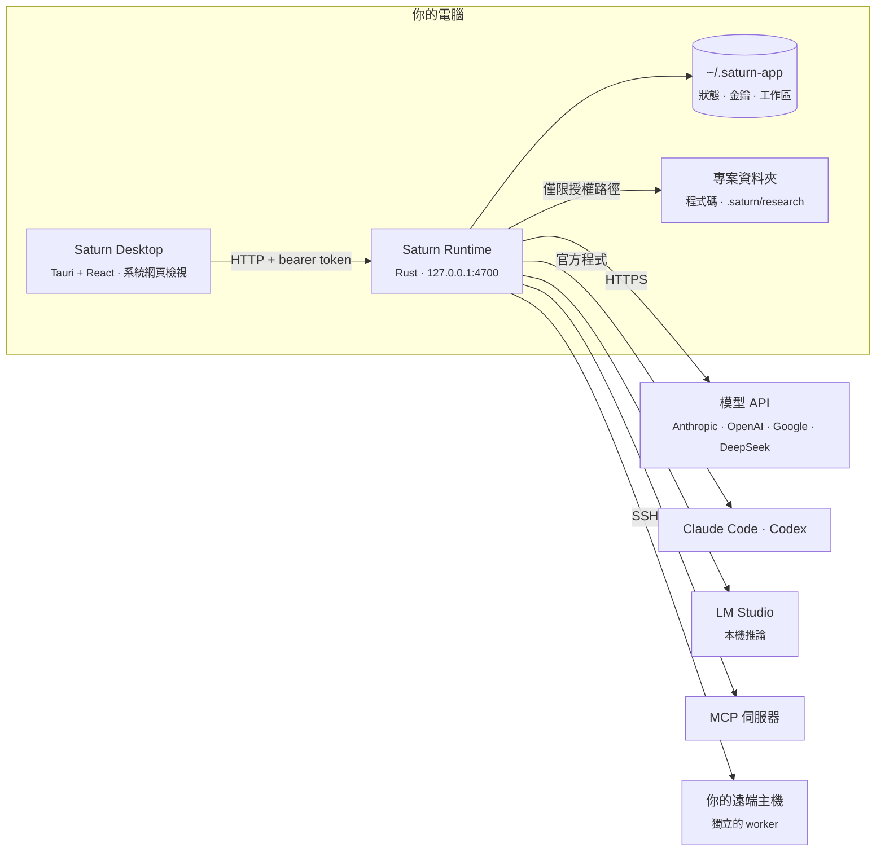

| 元件 | 職責 |
|---|---|
| **Saturn Runtime**（`crates/`） | 控制平面：研究紀錄、凍結的版本與執行、比較、檢視輔助程式、遠端 worker，以及研究助理的 Agent 迴圈與其模型轉接層、工具、MCP client、核准策略、檢查點、worktree、用量計算、遙測與持久化。`saturn-server` 是 HTTP API，`saturn-cli` 是 `saturn` 指令。不需要桌面應用程式，可 headless 執行。 |
| **Saturn Desktop**（`desktop/`） | Tauri 2 外殼（`desktop/src-tauri`）中的 React 介面：研究畫面（首頁、工作區、譜系、實驗、樣本、資料、檢視、任務、防護、環境）、研究助理與設定，提供英文與繁體中文。只透過 HTTP API 與 Runtime 溝通。 |
| **合約測試**（`contract/`） | 檢驗 Runtime 透過 HTTP 必須做到的事，對實際的 `saturn-server` 與 `saturn` 程式執行。 |

Runtime 與桌面應用程式採用相同的分層架構，相依方向朝內，例外是 `saturn-server` 也直接使用幾個基礎設施 crate（遙測、儲存、Browser 分頁的擷取）：

```
crates/                                   desktop/src/
  saturn-domain   實體、策略、              domain/          檢視模型與規則
                  研究紀錄
  saturn-core     使用案例、研究、          application/     呼叫 API 的使用案例
                  Agent 迴圈
  saturn-llm、-mcp、-tools、-store、        infrastructure/  HTTP client
  -browser、-computer、-embed、-telemetry
  saturn-server   HTTP 路由                 presentation/    React 元件
  saturn-cli      saturn 指令
```

### 生命週期

啟動 Saturn 會啟動自己的 Runtime 並持續看顧：Runtime 當掉會自動重啟，若該埠已被另一個 Saturn 占用則會拒絕沿用（想沿用自己啟動的 Runtime，請設定 `SATURN_RUNTIME_PORT`）。Runtime 回應之前，視窗會顯示它目前的狀態。關閉最後一個視窗會停止它所啟動的 Runtime。Runtime 持有一條來自 App 的管線，管線關閉就停止，所以 App 當掉或被強制結束時，Runtime 也不會繼續存活。

**上下文。** 研究助理對話中較早的回合會在依模型 context window 計算的預算內送出（視窗的一半；模型連線可自行指定 `contextTokens`）。超過預算時，最舊的回合會由同一個模型摘要成對話的累積摘要，之後的回合都以它為基礎；對話中會在發生處顯示「⤵ 已將 n 個較早回合併入摘要」。標頭的 **Context · n%** 標籤顯示對話的用量，點它或送出 `/compact` 可立即摘要。Claude Code 與 Codex 自行管理各自的上下文。

## 模型

| 供應商 | 驗證方式 | 說明 |
|---|---|---|
| Claude | API 金鑰 | 支援的模型可設定推理強度與 adaptive thinking |
| Claude（透過 Claude Code） | Claude 訂閱方案 | 透過其 Agent SDK 所用的協定執行官方 Claude Code 程式；Saturn 不會為這類模型送出任何 API 請求（見[Claude 與 Anthropic 的條款](#claude-與-anthropic-的條款)）。使用你 PATH 上的 `claude`，或在 **設定 → 一般** 下載官方程式（約 120 MB）。用它登入一次；Saturn 從不經手憑證。 |
| Codex | ChatGPT 訂閱方案 | 以 Codex SDK 啟動它的方式執行官方 Codex 程式（見[Codex 與 OpenAI 的條款](#codex-與-openai-的條款)）。使用你 PATH 上的 `codex`，或在 **設定 → 一般** 下載官方程式（約 140 MB）。從設定啟動 Codex 自己的 device code 登入。 |
| OpenAI | API 金鑰 | Chat Completions 與 Responses API；推理模型可設定推理強度 |
| Google Gemini | API 金鑰 | Thinking level（3.x 起）或 thinking budget（2.5） |
| DeepSeek | API 金鑰 | |
| LM Studio | 無 | 任何本機提供的模型，完全離線 |

API 金鑰加密存放在 `~/.saturn-app/secrets.json`（AES-256-GCM，金鑰由作業系統金鑰庫保管；見[靜態資料](#靜態資料)），只送往所屬供應商，且不會回傳給 UI。一把金鑰涵蓋該供應商的所有模型。

### Claude 與 Anthropic 的條款

Saturn 以兩種嚴格分開的方式提供 Claude：

| 供應商 | 驗證方式 | Saturn 送出的內容 |
|---|---|---|
| Claude | 你的 Anthropic API 金鑰，適用 Anthropic 的 [Commercial Terms](https://www.anthropic.com/legal/commercial-terms) | 由 Saturn 送往 Anthropic 的 API 請求 |
| Claude（透過 Claude Code） | 你自己的 Claude 訂閱方案，以官方 `claude` 程式登入 | 完全沒有 API 請求：每一回合都在未修改的 Claude Code 程式中執行，Saturn 以其 Agent SDK 所用的 stream-json 協定驅動 |

Saturn 如何遵循 Anthropic 的 [Claude Code 法律與合規條款](https://code.claude.com/docs/en/legal-and-compliance)：

- **透過 Anthropic 自己的流程登入。** 你在終端機以 `claude auth login` 登入 Claude Code。Saturn 沒有 Claude 登入按鈕，從不收集、儲存或轉送 Claude.ai 憑證或 session token；不讀取 `~/.claude` 或鑰匙圈，Claude Code 在自己的設定資料夾中執行，不載入你的任何 Claude 設定。
- **未修改的程式。** Saturn 以 Anthropic 發布的原樣執行 Claude Code：Saturn 固定的 Agent SDK 版本之 npm 套件中的程式，並以固定的 SHA-512 驗證，或使用你自己安裝的版本。
- **你自己的方案，費用由你支付。** 每位使用者以自己的訂閱登入；Saturn 不代付、轉售或居中處理 Claude 的用量。
- **不移除任何驗證方式。** Claude Code 以 Runtime 的環境執行，只移除 Saturn 自己的 session 變數，因此它支援的每種方式都保持可用：你的訂閱，或你自己的 `ANTHROPIC_API_KEY`、Bedrock、Vertex AI、Foundry 設定，由它依自己公布的順序選擇。Saturn 從不加入憑證：為 Claude 供應商儲存的金鑰只留給該供應商使用。
- **由程式強制，而非靠慣例。** 模型代理層會拒絕對 Claude（透過 Claude Code）模型發出任何 API 請求，這類模型無法設定 API 金鑰，Saturn 的附屬工作（記憶整理、自動化草稿、補全）只使用 API 模型。測試確保這一點不會被改壞。
- **一般、個人的使用。** Anthropic 的方案額度以此為前提，其 Consumer Terms 也只允許透過 API 金鑰進行自動化存取，因此自動化任務無法使用 Claude（透過 Claude Code）：這類 Agent 在自動化表單中是停用的，Runtime 也會拒絕。
- **命名。** Saturn 以純文字說明此供應商執行 Claude Code；不以 Claude Code 或 Anthropic 作為自己產品或功能的名稱，也並非由 Anthropic 打造、背書或與其合作。

以上是我們對 Anthropic 公開條款的解讀，不構成法律意見，最終由 Anthropic 決定：若你的用法不同（團隊部署、託管服務），請改用 Claude 供應商與 API 金鑰，或[洽詢 Anthropic](https://code.claude.com/docs/en/legal-and-compliance)。

### Codex 與 OpenAI 的條款

Saturn 以兩種方式提供 OpenAI 的模型，和 Claude 一樣嚴格分開：

| 供應商 | 驗證方式 | Saturn 送出的內容 |
|---|---|---|
| OpenAI | 你的 OpenAI API 金鑰，適用 OpenAI 的 [Business Terms](https://openai.com/policies/business-terms/) | 由 Saturn 送往 OpenAI 的 API 請求 |
| Codex | 你自己的 ChatGPT 方案，登入官方 `codex` 程式 | 完全沒有 API 請求：每一回合都在 Codex 中執行，以 [Codex SDK](https://developers.openai.com/codex/sdk) 的方式啟動與驅動 |

Saturn 如何遵循 OpenAI 的[使用條款](https://openai.com/policies/terms-of-use/)、[Codex 驗證說明](https://learn.chatgpt.com/docs/auth)與[品牌指南](https://openai.com/brand/)：

- **由 Codex 登入，不是 Saturn。** 設定頁會啟動 `codex login`（device code 或瀏覽器），並顯示 Codex 輸出的內容。Saturn 不是「Sign in with ChatGPT」App，沒有自己的 ChatGPT 登入，也從不讀取 Codex 的 `auth.json`；Codex 把它存放在 Saturn 專用的 `CODEX_HOME`。
- **官方程式。** Codex 以 Apache-2.0 開源，OpenAI 也發布了讓其他應用程式整合 Codex 的 SDK。Saturn 以該 SDK 的方式啟動程式：Saturn 固定的 npm 版本，並以固定的 SHA-512 驗證，或使用你自己安裝的版本。
- **你自己的帳號。** OpenAI 的條款不允許分享帳號或憑證；每個人以自己的帳號登入，Saturn 不轉售或居中處理 ChatGPT 的用量。用量計入你方案的額度，Saturn 不會繞過。
- **由程式強制。** 模型代理層會拒絕對 Codex 模型發出任何 API 請求，Codex 模型無法設定 API 金鑰，Saturn 也會從 Codex 的環境中移除 API 金鑰變數（`OPENAI_API_KEY`、`OPENAI_BASE_URL`、`CODEX_API_KEY`、`CODEX_ACCESS_TOKEN`），讓它一律使用你選擇的登入方式。
- **自動化任務。** OpenAI 的文件允許可信任的腳本與排程使用 ChatGPT 登入，但建議自動化使用 API 金鑰；排程工作建議改用 OpenAI 供應商的 Agent。
- **命名。** Saturn 提到 OpenAI 的產品，只是為了說明供應商執行的是什麼。Saturn 不在自己的名稱或功能中使用 ChatGPT、GPT、Codex 或 OpenAI 的 logo，也並非由 OpenAI 打造、背書或與其合作。

以上是我們對 OpenAI 公開條款的解讀，不構成法律意見；你的帳號受 OpenAI 的條款約束。

### 本機模型

**內建嵌入模型。** 程式碼索引會在 CPU 上執行自己的嵌入模型，所以不接任何模型、不連網也能做語意搜尋。在 **設定 → 一般 → Embedding model** 選擇：

| 模型 | 大小 | 說明 |
|---|---|---|
| Multilingual E5 small（預設） | 118 MB，內建 | 中英文提問，每段 512 token |
| Jina v2 code | 162 MB，首次使用時下載 | 英文的程式碼問題，每段 2,048 token |

也可以改用 LM Studio 提供的嵌入模型（預設 `text-embedding-nomic-embed-text-v1.5`）或 OpenAI。

**透過 LM Studio 以本機模型擔任研究助理。** 本機模型能不能當研究助理，取決於兩項設定：

- **工具呼叫。** 研究助理透過工具做事，模型必須受過 function calling 訓練（LM Studio 以工具圖示標示）。不支援的模型會回答，但不會動手。
- **32K 以上的 context。** 光是 Saturn 的系統提示與工具定義就超過 LM Studio 預設載入的 8K，會出現 *「tokens to keep … greater than the context length」* 錯誤。請在 LM Studio 以較大的 context 載入，或執行：

```bash
lms load qwen/qwen3.5-4b --context-length 32768
```

**實測模型。** 每個模型透過 Saturn 自己的工具，把三項 Agent 任務各跑兩次（讀檔並依內容回答；寫程式、執行並回報輸出；修 bug 並用指令驗證）。結果以磁碟上的實際狀態判定，不採信模型的自述。測試日期 2026-10-21，Apple M1 Pro 16 GB，LM Studio 0.4.26，4-bit 權重，32K context：

| 模型 | 大小 | 工具任務 | 任務中位數 | 適合 |
|---|---|---|---|---|
| Qwen3.5 4B（`qwen/qwen3.5-4b`） | 3.1 GB | 6/6 | 29 秒 | 16 GB 機器上的研究助理：最快也最小 |
| Gemma 4 E4B（`google/gemma-4-e4b`） | 6.9 GB | 6/6 | 48 秒 | 研究助理 |
| Ministral 3 8B（`mistralai/ministral-3-8b`） | 6.1 GB | 6/6 | 65 秒 | 研究助理 |
| Qwen3.5 9B（`qwen/qwen3.5-9b`） | 6.0 GB | 6/6 | 71 秒 | 研究助理 |
| Qwen2.5-Coder 7B | 4.3 GB | 3/6 | 不適用 | 不適合當研究助理：工具呼叫不穩定 |

推理模型（Qwen3.5、Gemma 4）每次補全前都會先思考，任務會比較久。這些是在單一機器上的小型任務；更大的模型（Qwen3.6 27B、Qwen3-Coder 30B 以上）需要 32 GB 以上記憶體，沒有實測。

## 安全與信任

Saturn 在你的電腦上執行程式碼並持有你的供應商憑證，它的信任基礎不該建立在「相信我們」之上。[威脅模型](docs/threat-model.md)說明 Saturn 防範什麼、不防範什麼，以及每項控制背後的程式碼；[`SECURITY.md`](SECURITY.md) 說明如何回報問題。本節列出資料清單、每一條對外連線路徑，以及如何用標準工具逐項驗證，不需閱讀原始碼。

**摘要：** Saturn 沒有後端服務。研究紀錄是你專案中的檔案；憑證、對話與遙測都是 `~/.saturn-app` 下的本機檔案。對外流量只會送往你設定的端點（模型供應商，以及 Agent 使用的網站、API 與 MCP 伺服器），且每一筆請求都可觀測。

### 靜態資料

所有資料都在 `~/.saturn-app`（可用 `SATURN_DATA_DIR` 覆寫）。刪除該目錄即完整重置。

| 資料 | 位置 | 說明 |
|---|---|---|
| API 金鑰與 OAuth token | `secrets.json` | 以 AES-256-GCM 靜態加密，256 位元的隨機金鑰由作業系統金鑰庫保管：macOS 鑰匙圈、Windows DPAPI，或 Linux 的 Secret Service（libsecret）；只有在沒有金鑰庫時才改用權限 `0600` 的金鑰檔。檔案權限 `0600`（Windows 沒有這種權限：檔案沿用你使用者設定檔資料夾的權限）。舊版的明文檔案會在首次啟動時自動加密。 |
| 研究紀錄 | 專案的 `.saturn/research` | 純 JSON 與 JSONL，就在你的程式碼旁。要不要提交由你決定。 |
| Agent、對話、專案、設定 | `state.json` | 純 JSON。 |
| 遙測（trace、metric、log） | 記憶體與 `telemetry.json` | 只有在你設定 OTLP 端點時才會匯出。 |
| 對外請求紀錄 | `network.log` | JSON Lines：時間戳記、方法、主機、路徑，以及主機是否為本機。從不記錄查詢字串與內容。超過 5 MB 時移至 `network.log.1`。 |
| 記憶、程式碼索引、檢查點、附件 | `memory/`、`index/`、`checkpoints/`、`run-images/` | 本機檔案。嵌入向量由內建模型在裝置端計算。 |
| API session token | `runtime-token` | 權限 `0600`（Windows 上同 `secrets.json`）。 |
| Claude Code 與 Codex 程式 | `tools/` | 只在你要求時下載，解壓前先以 Saturn 內固定的 sha512 驗證。可在設定中移除。 |
| Claude Code 與 Codex 的登入、Agent 瀏覽器的設定檔 | `claude/`、`codex/`、`browser-profile/` | 由這些程式自行保存。Saturn 不讀取登入資料。 |

### 對外連線清單

| 目的地 | 觸發時機 | 傳送內容 |
|---|---|---|
| 你的模型供應商（Anthropic、OpenAI、Google、DeepSeek） | 研究助理與任務的回合 | 對話內容、你或 Agent 附加的檔案、工具結果。金鑰只送往該供應商。 |
| 經由 Claude Code 與 Codex 連至 Anthropic / OpenAI | 使用這兩個供應商的回合 | 官方 CLI 以你的訂閱方案連線至各自廠商。Saturn 從不讀取或轉送這些憑證。 |
| 網站、API 與 MCP 伺服器 | Agent 擷取網址、操作瀏覽器、呼叫 GitHub，或使用你新增的 MCP 伺服器時 | 該次工具呼叫所需的內容。遠端 MCP 伺服器透過 HTTP(S) 連線；本機伺服器須在你核准確切指令後才會執行，其自身的網路流量由該程式負責。web 與瀏覽器工具會拒絕私有、link-local 與 loopback 位址（SSRF 防護）。 |
| 你的 SSH 主機 | 僅在遠端執行時，連往你設定的主機 | 透過你自己的 SSH 設定與主機金鑰：執行的指令、狀態與輸出。Saturn 不儲存任何 SSH 憑證。 |
| GitHub Releases | App 啟動時 | 更新檢查（`updates` release 的 `latest.json`），有新版本時下載套件。僅限以 Saturn 更新金鑰建置的版本。這些請求由 App 發出，不是 Runtime，所以不在網路紀錄中。設定 `SATURN_NO_UPDATES=1` 可停用。 |
| Hugging Face | 僅在你選用未內建的嵌入模型時 | 下載該模型。與內建模型不同，不會以固定雜湊驗證。 |
| `registry.npmjs.org` | 僅在你按下 Claude Code 或 Codex 的 **下載** 時 | 官方程式的 npm 套件，即 Saturn 固定的確切版本，並以固定的 sha512 驗證。 |
| 你的 OpenTelemetry collector | 僅在設定 `OTEL_EXPORTER_OTLP_*ENDPOINT` 變數或 `SATURN_OTEL=otlp` 時 | Saturn 的 trace、metric 與 log，以 HTTP 上的 JSON 傳送。 |

除此之外沒有其他對外連線：沒有產品分析、沒有當機回報、沒有帳號，也沒有託管服務。

實測基準：在全新的資料資料夾且沒有進行中的回合時，Runtime 在 30 秒內的對外連線數為**零**（2026-11-04，只執行 Runtime 的 macOS debug 建置）。

### 自行驗證

以下每項檢查彼此獨立，不需要了解程式碼。

#### 1. 在作業系統層觀察對外流量

不論應用程式聲稱什麼，核心都看得到每一個 socket。

```bash
# macOS：所有 Saturn 程序的即時 TCP 連線
nettop -m tcp -p $(pgrep -d, -f "Saturn") 2>/dev/null || lsof -i -nP | grep -i saturn
```

```powershell
# Windows：Saturn 程序已建立的連線
Get-NetTCPConnection -State Established | Where-Object { (Get-Process -Id $_.OwningProcess).ProcessName -like "Saturn*" }
```

若要逐條連線確認，可使用對外應用程式防火牆：macOS 用 [LuLu](https://objective-see.org/products/lulu.html)（免費、開源）或 Little Snitch，Windows 用 Windows Defender 防火牆的輸出規則。每一條連線都應對應到對外連線清單中的一列。

#### 2. 檢視 Runtime 的網路紀錄

**設定 → 遙測 → Network** 列出 Runtime 連線過的每個主機、請求數與最近的請求。相同資料也會附加寫入檔案：

```bash
tail -f ~/.saturn-app/network.log
jq -r .host ~/.saturn-app/network.log | sort | uniq -c | sort -rn   # 各主機的請求數
```

Runtime 送出的每一筆 HTTP(S) 請求都經過同一個記錄它的函式，重新導向也包含在內；以其他方式送出請求時，lint 規則（[`clippy.toml`](clippy.toml)）會讓 CI 失敗。因此它涵蓋模型轉接層、工具與 MCP client，但不涵蓋其他程式（見[已知限制](#已知限制)）與 App 自己的更新檢查。

#### 3. 離線執行

在 [LM Studio](https://lmstudio.ai) 連接本機模型（需支援工具呼叫，並以 32K context 載入；見[本機模型](#本機模型)），用防火牆封鎖 Saturn，照常使用：實驗、研究助理與程式碼索引都能離線運作。

#### 4. 檢查靜態資料

```bash
ls -la ~/.saturn-app          # secrets.json 與 runtime-token 為 -rw-------（僅擁有者）
head -c 300 ~/.saturn-app/secrets.json   # AES-256-GCM 密文封包，看不到任何金鑰
security find-generic-password -s Saturn | grep acct   # macOS：保管加密金鑰的鑰匙圈項目
cat ~/.saturn-app/state.json  # Agent、對話與設定，純 JSON
```

#### 5. 驗證發行檔的建置來源

每個發行檔都附有 SHA-256 校驗碼與經簽署的[建置來源證明](https://docs.github.com/actions/security-for-github-actions/using-artifact-attestations)（SLSA provenance，經 Sigstore 簽署）。它將檔案摘要綁定到本 repository、公開的 [release workflow](.github/workflows/release.yml)，以及建置所用的確切 commit：

```bash
shasum -a 256 -c Saturn-<version>-mac-arm64-unsigned.dmg.sha256
gh attestation verify Saturn-<version>-mac-arm64-unsigned.dmg -R Saturn-Technology-Project/Saturn-App
```

從 0.3.1 起，每次發布也會附上簽署過的證明本身（`Saturn-<version>-mac-arm64.sigstore.json`、`-win-x64.sigstore.json` 與 SBOM 的證明），不必向 GitHub 取得任何資料即可驗證下載檔：

```bash
gh attestation verify Saturn-<version>-mac-arm64-unsigned.dmg --bundle Saturn-<version>-mac-arm64.sigstore.json -R Saturn-Technology-Project/Saturn-App
```

從下一個版本起，`Saturn-<version>.intoto.jsonl` 把一次發布的所有證明放在同一個檔案（每行一份），任何一個下載檔都能用它搭配 `--bundle` 驗證。

在 Windows 上，安裝程式的 Authenticode 簽章應指向 Saturn 的憑證：

```powershell
(Get-AuthenticodeSignature .\Saturn-<version>-win-x64-setup.exe).SignerCertificate.Thumbprint   # D285DA425077C16A3D115D61F9748AFA574BC786
```

建置紀錄公開於 [Actions](../../actions/workflows/release.yml) 頁面。也可以直接[從原始碼建置](#從原始碼建置)。

### 監控

- **網路紀錄：** `network.log` 為 JSON Lines，可用 Vector、Fluent Bit 或 Promtail 收集，或在工作時 `tail -f`。
- **OpenTelemetry：** 設定 `OTEL_EXPORTER_OTLP_ENDPOINT`（可另設 `SATURN_OTEL=otlp`），即可把 trace、metric 與 log 匯出到接受 OTLP over HTTP（JSON）的 collector。不提供 protobuf 與 gRPC，`OTEL_EXPORTER_OTLP_PROTOCOL` 沒有作用。每次模型呼叫、工具呼叫與 Agent 回合都是一個 span，對外 HTTP 請求為其子 span。桌面應用程式目前不匯出自己的 span。
- **本機 API：** `GET /network`、`GET /telemetry/traces`、`GET /telemetry/logs` 與 `GET /usage/summary` 讓腳本取得相同資料（見[本機 API](#本機-api)）。
- **花費：** **設定 → 用量與帳單** 依模型與 Agent 拆分任意期間的 token 數與成本。

### 安全機制

- **只綁定 loopback。** Runtime 只監聽 `127.0.0.1`，拒絕非 loopback 的 `Host` 標頭（防範 DNS rebinding），並且不給 `null` 與非本機的瀏覽器來源任何跨來源存取（CORS）。
- **憑證加密。** API 金鑰與 OAuth token 以 AES-256-GCM（含驗證）靜態加密；有作業系統金鑰庫時，加密金鑰不會出現在資料夾中，且只經由 stdin 傳給系統工具，從不放在命令列參數。找不到金鑰的檔案會被另存，絕不覆寫。
- **Bearer 驗證。** 除 `/health`、OAuth 回呼與 `/agent-mcp`（改用執行中 Codex 回合自己的 token）外，所有路由都需要 `Authorization: Bearer <token>`。token 存於 `~/.saturn-app/runtime-token`（權限 `0600`；Windows 上為使用者設定檔資料夾的權限），其他本機使用者與網頁都無法呼叫 API。
- **本機 MCP 伺服器須經你核准才會執行。** 遠端 MCP 伺服器是一個 HTTP(S) URL。本機伺服器（由 Saturn 啟動、透過 stdio 溝通的程式，例如 `npx -y @modelcontextprotocol/server-filesystem …`）新增後只會被儲存，必須在你看過確切指令並允許之後才會啟動；程式、參數或環境變數任何變更都會重新詢問，且核准時必須指定你看到的那個版本。它在 Saturn 的工作區資料夾中啟動，只帶最小的環境（PATH 與程式需要的少數系統變數）加上你設定的變數，變數值加密存放於 `secrets.json`；Saturn 自己的環境（包括其中的 API 金鑰）絕不會傳給它。移除伺服器即停止該程式。
- **Hooks；專案的 hooks 須經你核准。** Hook 是在 Agent 呼叫工具之前或之後（exit 2 會阻擋或回饋；stdout 可回答 allow、ask 或 deny），或在回合結束時執行的指令（exit 2 會讓 Agent 繼續處理，每則訊息最多兩次）。你自己的 hooks 在 **設定 → Hooks** 設定。專案的 `.saturn/hooks.json`，以及其 `.claude/settings.json` 中的 PreToolUse、PostToolUse 與 Stop hooks，是隨資料夾而來的，因此必須在你看過並允許那一組之後才會執行；任何變更都會重新詢問。只有在你開啟 **Use the project's Claude Code settings** 時，Claude Code 才會載入專案的 `.claude/settings.json`。
- **檔案系統範圍限制。** Agent 只能在 Saturn 工作區與你授權的專案資料夾內讀寫與執行，授權可隨時撤銷。
- **指令的作業系統沙箱。** Agent 執行的每個 shell 指令都由作業系統限制：macOS 用 seatbelt（`sandbox-exec`），Linux 在安裝 bubblewrap 時使用。預設的 *workspace-write* 只允許寫入專案資料夾、暫存資料夾與常見的套件快取；*read-only* 除暫存資料夾外不允許寫入；也可以關閉指令的網路。Agent 需要寫到其他地方時會以 `sandbox: "off"` 要求，除了完全自主模式外都會出現核准卡。在 **設定 → 一般 → Sandbox** 設定，或針對單一專案覆寫。Windows 沒有沙箱，指令的結果會註明。
- **權限規則、核准策略、檢查點。** 規則指定工具與樣式（`code: npm test *`、`files: write src/**`）並決定允許、詢問或拒絕；拒絕優先於詢問，詢問優先於允許，shell 指令串逐一判斷。規則可在 **設定 → Permissions** 針對所有專案、單一專案或單一 Agent 設定，也可寫在專案自己的 `.saturn/settings.json`；`.claude/settings.json` 的 `permissions` 也會讀取。這兩個檔案隨資料夾而來（例如 clone 下來的 repository），因此其中的拒絕與詢問規則立即生效，允許規則則要在你於該專案的規則中允許那一組之後才生效，任何變更都會再次詢問。允許所有指令的規則無論來自哪裡都會被拒絕。核准卡上的 **Always allow…** 會直接存成一條規則。沒有規則適用時，除非你選擇完全自主，有風險的指令與工作目錄外的寫入都會等待核准。每次修改都有檢查點，可回復到單一步驟，shell 指令（前景或背景）改動的檔案也包含在內。在 git 專案中由 git 判斷改了什麼（被忽略的檔案除外）；在其他資料夾，Saturn 會在自己的資料夾裡為它保留一份私有的 git 快照（不會寫進你的資料夾），排除 `node_modules`、建置輸出與快取；幾秒內無法完成快照的超大資料夾則略過。**設定 → 一般 → Storage** 會列出每個資料夾快照的大小，確認後可刪除；先前的變更仍可還原。
- **訂閱憑證隔離。** Claude Code 與 Codex 透過官方 CLI 驗證，憑證存於 Saturn 專用的設定目錄。Saturn 從不讀取、複製或轉送這些憑證，也從不加入自己的金鑰。Claude Code 取得 Runtime 的環境，只移除 Saturn 自己的 session 變數，因此你為它設定的任何驗證方式（你自己的 `ANTHROPIC_API_KEY`、Bedrock、Vertex AI 或 Foundry）都依 Anthropic 的條款保持可用；Codex 則會移除 API 金鑰變數，避免多餘的金鑰覆蓋 ChatGPT 登入。

### 降低曝險

- 為 Saturn 發放專用、設有花費上限的 API 金鑰，以便獨立輪替或撤銷。
- 優先使用 **Default** 核准策略（有風險才詢問）而非完全自主，並只授權任務所需的專案資料夾。
- 絕不能離開本機的程式碼，請透過 LM Studio 使用本機模型。

### 供應鏈

Saturn 的下載檔由約 360 個 Rust crate（`cargo tree` 對 macOS 上的 App、Runtime 與 `saturn` 列出的數量，不含只在編譯時使用的 crate）、四個 npm 套件（React、ReactDOM、scheduler 與繪製 PDF 的 pdf.js；`desktop/package-lock.json` 其餘都是建置工具）與一個機器學習模型組成。網頁檢視是作業系統的。`Cargo.lock` 列得更多（642 個來自 crates.io 的 crate），因為它涵蓋所有平台與建置、測試工具。每一項都經過固定與檢查，檢查都在公開的 CI 上執行。

**安裝的內容**

- **固定的 lock 檔。** `Cargo.lock` 將每個 crate 固定為確切版本並附 SHA-256 校驗碼，[`deny.toml`](deny.toml) 只允許 crates.io，不接受 git 或其他來源。`desktop/package-lock.json` 將每個套件固定為 `https://registry.npmjs.org/` 上的確切版本，並附 SHA-512 完整性雜湊，[`scripts/check-lockfiles.mjs`](scripts/check-lockfiles.mjs) 遇到任何 git、tarball URL、http 或 file 來源都會讓 CI 失敗。
- **Registry 簽章。** `npm audit signatures` 驗證每個已安裝 npm 套件的 registry 簽章，發行者提供時也驗證其來源證明。crates.io 沒有這種簽章，那邊以 `Cargo.lock` 的校驗碼檢查。
- **不執行 npm 安裝腳本。** npm 安裝腳本是遭入侵套件最常見的執行管道，在 Saturn 中從不執行：桌面應用程式在 `allowScripts` 中逐一拒絕，CI 以 `--ignore-scripts` 安裝。Cargo 沒有這種開關：crate 的 build script 會在編譯 Saturn 時執行（CI 上，以及你從原始碼建置時的電腦上），對 crate 的信任就到這個程度。
- **其餘都以雜湊固定。** Claude Code 與 Codex 的下載固定為 registry 的 SHA-512（[`agent-programs.json`](crates/saturn-core/src/agent-programs.json)，由 [`agent-programs-manifest.mjs`](scripts/agent-programs-manifest.mjs) 寫入）；內建嵌入模型與其 tokenizer 固定為 SHA-256（[`fetch-embedding-model.mjs`](desktop/scripts/fetch-embedding-model.mjs)）；每個 GitHub Action 固定為完整的 commit SHA。

**保持更新**

- **Dependabot** 在安全公告發佈時立即開出安全更新，並每週為 npm 套件、crate 與 GitHub Actions 開出分組的版本更新，且只針對已公開七天的版本，遭入侵或有問題的版本通常在這段期間被發現並下架。
- **[Supply chain workflow](.github/workflows/supply-chain.yml)** 在每次變更與每週執行：檢查 lock 檔、registry 簽章、對出貨的 npm 套件執行 high 等級的 `npm audit`，並以 `cargo deny` 檢查 crate（來源、公告、授權）。
- **Tauri** 固定在 `desktop/src-tauri/Cargo.toml`（2.12.5）；Dependabot 會像其他相依套件一樣提出它的更新。網頁檢視是系統的，它的安全修補隨作業系統更新，不隨 Saturn。

**出貨的內容與發佈權限**

- **每個版本都附 SBOM。** `Saturn-<version>-sbom.cdx.json`（CycloneDX 1.5）列出 `Cargo.lock` 中的每個 crate 與其 SHA-256、介面的 npm 套件與其授權及 SHA-512，以及模型與其雜湊。SBOM、安裝程式、壓縮檔與更新套件都附有建置來源證明。
- **有意義的簽章。** Windows 版本以 Saturn 的憑證簽署 Saturn 的程式與安裝程式。
- **簽署的更新。** 更新程式只安裝帶有 Saturn 更新金鑰有效簽章的套件。這把金鑰是 Saturn 自己的，所以更新不依賴 Apple Developer ID。沒有這把金鑰建置的版本（例如 fork 或你自己建置的）完全沒有更新功能。
- **發佈權限。** 發佈須在受保護的 environment 中經維護者核准。Release tag 由發佈流程建立，一經建立就永遠不能移動或刪除；`main` 不能 force-push；[CODEOWNERS](.github/CODEOWNERS) 會在每個 pull request 要求維護者審查。建議所有具寫入權限的成員啟用雙重驗證。

**已審視的例外。** 目前無法修補的公告（沒有修補版本，或修補需要上游變更），連同原因與結案條件都列在 [`docs/known-advisories.md`](docs/known-advisories.md)。

**自行驗證**

```bash
node scripts/check-lockfiles.mjs
(cd desktop && npm ci --ignore-scripts && npm audit signatures)
cargo deny --locked check   # 需要 cargo-deny
gh attestation verify Saturn-<version>-sbom.cdx.json -R Saturn-Technology-Project/Saturn-App
```

### 已知限制

Saturn 仍為早期預覽版，尚未經過第三方安全稽核。改寫為 Rust 與 Tauri 之後，Windows 版本只做過型別檢查，尚未實際執行。macOS 版本尚未以 Developer ID 簽章或公證，Windows 版本則以 Windows 不信任的自簽憑證簽章。API 金鑰已靜態加密，不會以明文出現在備份、同步資料夾、磁碟映像或被複製的資料夾中；但任何以你的使用者身分執行的程序仍可向作業系統金鑰庫要求金鑰，這與所有使用鑰匙圈或 DPAPI 保存憑證的應用程式相同。設定 → 關於 會顯示目前使用的金鑰庫。被賦予完全自主的 Agent 可以在授權資料夾內執行任意指令；這是設計本質，請據此控管授權範圍。Claude Code、Codex、git、本機 MCP 伺服器、Agent 瀏覽器與系統網頁檢視的程序各自獨立執行，不會出現在 Runtime 的網路紀錄中，請用作業系統層的工具觀察。你允許的本機 MCP 伺服器以你的使用者權限執行，請只允許你信任的程式。

發現安全漏洞請私下寄至 [security@saturn-core.com](mailto:security@saturn-core.com)，不要開公開 issue；[`SECURITY.md`](SECURITY.md) 說明要附上什麼、之後的處理流程與範圍。

## 電腦操作

電腦操作工具透過截圖觀察畫面，並以合成的滑鼠鍵盤事件與各平台的元素樹執行操作：macOS 使用輔助使用 API，Windows 使用 UI Automation。

研究助理操作電腦時，Saturn 會在螢幕上畫出它的游標：Saturn 黑白配色、帶有環狀行星標誌的游標會在點擊、拖曳或捲動之前先移到該位置，螢幕邊緣也會發光，直到它停止操作。這個游標不會攔截任何點擊，也不會出現在截圖中，所以研究助理看不到它，它是給你看的。

### macOS

macOS 需要為 **Saturn** 授予以下權限，位於 系統設定 → 隱私權與安全性：

- **輔助使用**：點擊、輸入與讀取 UI 樹。
- **螢幕與系統錄音**：擷取截圖。
- **自動化**（System Events）：按鍵、輸入與讀取 UI 樹。macOS 會在第一次需要時詢問。

**設定 → 一般 → Computer use**（以及首次設定）會顯示前兩項並提供 **Request**：macOS 會跳出自己的詢問視窗，並把 Saturn 列進系統設定，不必手動加入。

macOS 以 App 的程式碼簽章識別這些授權。ad-hoc 簽章的版本每次更新都會呈現新的身分，授權因此失效：若 Agent 回報缺少已開啟的權限，請用 − 移除 Saturn 後重新加入。螢幕鎖定時，Agent 會回報狀況而不執行操作。

### Windows

Windows 不需要任何權限。所有動作由單一輔助程序處理（Windows PowerShell 執行一個小型的已編譯 C# 模組）：以 SendInput 送出滑鼠、滾輪與按鍵，以 Unicode 輸入打字（任何語言皆可，不碰剪貼簿），以 GDI+ 截圖，並以 UI Automation 讀取與操作 App 的元素。它支援 DPI 感知，在縮放的螢幕上座標也正確。以 macOS 寫法表示的組合鍵（`cmd+c`）在 Windows 上代表 Ctrl。

- Windows 只允許 App 控制與自己權限等級相同的 App：以系統管理員身分執行的 App 會忽略 Saturn 的輸入，除非 Saturn 也以系統管理員身分執行，Agent 會說明這個情況。
- 鎖定畫面或 UAC 提示（安全桌面）顯示時，什麼都看不到也點不到；Agent 會回報狀況而不執行操作。
- [Windows 電腦操作 workflow](.github/workflows/computer-use-windows.yml) 會在 `main` 上的 `crates/saturn-computer` 變更時，於真實的 Windows 桌面上操作記事本。它還沒有在 Rust 程式碼上執行過。

### 讓其他 Agent 操作 Saturn

Saturn 本身也可以被電腦操作 Agent 操控，例如 [agent-desktop](https://github.com/vercel-labs/agent-desktop) 或 Claude computer use。視窗中每個控制項在輔助使用樹裡都有角色與名稱：圖示按鈕都有標籤，側欄中的各個畫面是可以用 Enter 和空白鍵觸發的按鈕，視窗標題寫出目前的畫面與專案，對話框以標題命名。Agent 因此能依名稱找到「實驗」、「助理」或「設定」，而不是靠像素。

透過輔助使用樹操作，例如 `agent-desktop snapshot --app Saturn`。App 不會開啟 DevTools 連接埠。

## 設定

| 變數 | 預設值 | 用途 |
|---|---|---|
| `SATURN_DATA_DIR` | `~/.saturn-app` | 狀態、憑證、session token 與工作區 |
| `SATURN_RUNTIME_HOST` | `127.0.0.1` | 綁定位址 |
| `SATURN_RUNTIME_PORT` | `4700` | 監聽埠 |
| `SATURN_RUNTIME_TOKEN` | 自動產生 | 固定的 session token（32 字元以上），取代已儲存的 token |
| `SATURN_BROWSER` | 已安裝的 Chrome 或同類瀏覽器 | Agent 瀏覽器啟動的 Chrome 系列程式 |
| `SATURN_OTEL` | 僅本機 | `otlp` 或 `console` 匯出遙測，`off` 保留在本機 |
| `OTEL_EXPORTER_OTLP_ENDPOINT` | 未設定 | OTLP collector 端點，以 HTTP 上的 JSON 傳送；設定後即啟用匯出。只設定 `SATURN_OTEL=otlp` 時使用 `http://localhost:4318` |
| `OTEL_EXPORTER_OTLP_HEADERS` | 未設定 | 送給 collector 的標頭，格式為 `name=value,…` |
| `OTEL_SDK_DISABLED` | 未設定 | `true` 完全停用遙測 |
| `SATURN_NO_UPDATES` | 未設定 | `1` 停用更新檢查 |
| `SATURN_SECRET_STORE` | 作業系統金鑰庫 | `keychain`、`dpapi`、`libsecret` 或 `file`：新的加密金鑰存放位置 |

## 命令列

**設定 → 一般 → Command Line** 會在 `~/.local/bin` 安裝 `saturn`。它對正在執行的 Saturn 執行 App 自己的 CLI，所以版本永遠與 App 一致。它從終端機或腳本啟動 Runtime 中 Agent 的回合（研究助理也是其中之一）：

```bash
saturn run "fix the failing test" --agent Saturn --project .
saturn run - --agent Reviewer --json < prompt.txt
saturn runs
saturn approve RUN ACTION
```

`saturn run` 會把 Agent 的步驟輸出到 stderr、答案輸出到 stdout（`--json` 輸出整個 run）。需要核准時，在終端機會直接詢問；在腳本中 `saturn` 會以代碼 3 結束，並印出可回答它的 `saturn approve` 指令。與自動化任務相同，使用 Claude（透過 Claude Code）的 Agent 只能在終端機中執行，不能無人值守。

**從程式呼叫。** [Saturn SDK](https://github.com/Saturn-Technology-Project/Saturn-SDK)（獨立的 repository）提供同一套 API 的 TypeScript client，沒有任何相依套件：啟動 run、即時取得每個步驟、在 callback 裡回答核准、讀取它改了哪些檔案。

```ts
import { Saturn } from "@saturn-app/sdk";

const saturn = new Saturn(); // 自動找到執行中的 Saturn 與其 token
const run = await saturn.run("fix the failing test", {
  agent: "Saturn",
  project: process.cwd(),
  onStep: (step) => console.log("·", step.toolId),
  onApproval: (step) => step.toolId === "code" && String(step.arguments.command).startsWith("npm test"),
});
console.log(run.status, run.output);
```

規則相同：使用 Claude（透過 Claude Code）的 Agent 會被拒絕，因為 SDK 是從程式執行它。

## 本機 API

桌面應用程式是同一個 HTTP API 的用戶端，你的腳本也可以是。[`contract/routes.json`](contract/routes.json) 列出所有路由；最常用的如下：

```bash
TOKEN=$(cat ~/.saturn-app/runtime-token)
curl -H "Authorization: Bearer $TOKEN" http://127.0.0.1:4700/projects
```

| 方法 | 路徑 | 用途 |
|---|---|---|
| `GET` | `/health` | 存活檢查（不需驗證） |
| `GET` `POST` `PATCH` | `/projects/:id/research/:collection` · `/:item` | 研究紀錄：問題、假說、實驗、版本、模型、發現、反例、檢視 session、輸出 |
| `POST` | `/projects/:id/research/experiments/:item/versions` · `/versions/:id/runs` · `/remote/runs` | 凍結實驗，在本機或 SSH 主機上開始執行 |
| `GET` | `/projects/:id/research/runs/:run` · `/samples` · `/summary` · `/metrics` · `/resources` · `/log` | 一次執行及其樣本、分數、訓練指標、資源與紀錄 |
| `POST` | `/projects/:id/research/comparisons` · `/imports` · `/bundles/export` · `/bundles/import` | 成對比較、匯入的結果與研究包 |
| `GET` `POST` | `/agents` | 列出或建立 Agent |
| `POST` | `/agents/:id/runs` | 開始一個回合（`mode`、`images` 與專案選項） |
| `GET` | `/runs` · `/runs/:id` | 進行中與最近的回合；單一回合的輸出、推理、工具呼叫與核准 |
| `POST` | `/runs/:id/actions/:actionId/decision` | 核准或拒絕待處理的動作 |
| `GET` `POST` | `/runs/:id/changes` · `/changes/keep` · `/changes/revert` | 檢視、保留或回復回合的檔案變更 |
| `POST` | `/runs/:id/restore` | 將工作區還原到某一步 |
| `POST` | `/runs/:id/stop` | 取消回合 |
| `POST` | `/threads/:id/worktree` · `/worktree/finish` · `/pull-request` | 隔離 worktree：建立、合併／保留／捨棄、開 PR |
| `POST` | `/threads/:id/pull-request/check` · `/watch` · `/feedback/send` · `/feedback/dismiss` | 追蹤 PR：立即檢查、停止或恢復追蹤、送出或略過 review 留言 |
| `GET` `POST` | `/groups` · `/groups/:id/messages` | 群組對話 |
| `GET` `POST` | `/automations` | 排程執行 |
| `GET` | `/usage/summary?from=&to=` | 指定期間的 token 數與成本 |
| `GET` | `/events` · `/runs/:id/events` | 以 server-sent events 即時更新：哪些 run 有變化，或單一 run 的每次變化 |
| `GET` | `/network` | 對外請求紀錄：主機與最近的請求 |
| `GET` | `/telemetry/traces` · `/telemetry/logs` · `/telemetry/metrics` | 本機 OpenTelemetry 資料 |
| `POST` | `/complete` · `/complete/stream` | 單次模型呼叫 |
| `GET` `POST` `DELETE` | `/programs` · `/programs/:id` · `/programs/:id/install` | Claude Code 與 Codex：是否已安裝、來源、下載、移除 |

## 開發

**研究 helper 檢查。** 在裝有 torch 與 transformers 的研究 Python 中執行 `python crates/saturn-core/tests/research_followup_test.py`，以隨機初始化的小模型檢查 residual self-patch 與 final norm，不下載模型。[Pythia 後續實驗](docs/research/name-tracking-2026-11-05.md) 保存一次真正離線執行的 checkpoint 實驗、原始證據與重跑指令；名字間的 margin 和全詞表 top-1 分開報告。

```bash
npm test            # cargo test，接著執行 HTTP 合約測試
npm run typecheck   # 桌面介面的嚴格型別檢查
npm run lint        # 程式碼規範（oxlint）
```

合約測試（`contract/`）以暫存資料目錄與假的模型伺服器啟動實際的 `saturn-server` 與 `saturn` 程式，不需要任何憑證，也不會動到你的資料；Rust 測試放在各個 crate 中。`contract/cases` 錄自舊的 TypeScript Runtime，不再變動。CI 在每次變更時於 Linux、每次發布時於 macOS 執行兩者。Windows 的 workflow 只跑 `cargo test`，不跑合約測試，且還沒有在 Rust 程式碼上執行過。

**任務評測。** `scripts/eval` 會用真的模型，透過 Saturn 的 Agent 迴圈完整執行程式任務，並以 Agent 看不到的測試評分：通過率、步數、token、花費與時間。共 14 題，從小修正到：症狀出現在別的模組的 bug、非同步並行上限、要相容舊檔案的跨層功能、從當機報告修好 CSV 解析、要處理 20 萬筆資料的平方複雜度函式、繞過誘餌的唯讀搜尋、在 callback 旁加上 promise API，以及時區 bug。`cargo build -p saturn-server && node --test scripts/eval/self-test.mjs` 用腳本化的假模型檢查評測工具本身，並確認每題的隱藏測試在原始 repo 上會失敗、套上參考解答（`solution/`，Agent 看不到）後會通過；不花錢。實際執行會花費 token：

```bash
SATURN_EVAL_PROVIDER=claude SATURN_EVAL_MODEL=claude-sonnet-5-5 SATURN_EVAL_API_KEY=… node scripts/eval/run.mjs
```

[Evals workflow](.github/workflows/evals.yml) 會在 repository 設定 `SATURN_EVAL_API_KEY` secret 以及 `SATURN_EVAL_PROVIDER`、`SATURN_EVAL_MODEL` 變數後每夜執行，通過率比 `scripts/eval/baseline.json` 低 15 個百分點以上時會失敗。

開 pull request 前：

1. 遵守分層：domain 程式碼不得 import axum 或 React。
2. 在 `contract/` 或 crate 的測試中，為 Runtime 行為新增或更新測試（[測試政策](CONTRIBUTING.md#test-policy)為強制規定），並執行 `npm test`、`npm run typecheck` 與 `npm run lint`。
3. 絕不記錄或回傳秘密。記錄使用了哪個憑證（供應商或模型），不要記錄它的值。

[CONTRIBUTING.md](CONTRIBUTING.md) 列出程式碼規範與測試政策，並說明相依套件的變更：把 Claude Code 或 Codex 換成新版本、安裝腳本核准，以及 Dependabot pull request。

## 路線圖

- 以 Developer ID 簽章並經公證的 macOS 版本，以及使用 CA 核發 Authenticode 憑證簽章的 Windows 版本
- Linux 套件
- 工作區中的 debugger 與語言伺服器
- Windows 上的實驗執行

專案如何運作、由誰決定，見 [`GOVERNANCE.md`](GOVERNANCE.md)；所有參與者都遵守[行為準則](CODE_OF_CONDUCT.md)。

## 授權

[Apache License 2.0](LICENSE) © 2026 Rick Weng。見 [`NOTICE`](NOTICE)。
