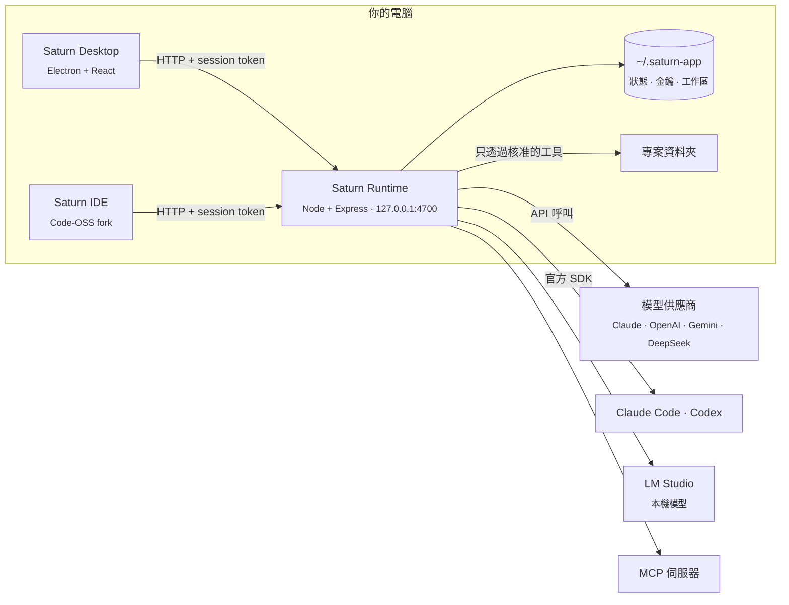

<div align="center">


# Saturn

**在你自己的電腦上執行的 AI Agent。**

由你決定用哪些模型、哪些工具，以及它們能碰哪些資料夾。Saturn 的 Agent 會讀程式碼、跑指令、改檔案、自動化工作，而它們做的每件事都看得到、可審查、可還原。

[](LICENSE)


[功能](#功能) · [快速開始](#快速開始) · [架構](#架構) · [模型](#模型) · [安全](#安全設計) · [API](#本機-api) · [English](README.md)

</div>

---

## 為什麼是 Saturn

多數 Agent 工具跑在別人的雲端，或是把你的終端機整個交給 AI，你很難管它做了什麼。Saturn 走另一條路：

- **本機優先。** Agent 的核心是一個跑在 `127.0.0.1` 的小型伺服器。你的 Agent、對話、金鑰和遙測資料都留在你的電腦上。
- **模型自己選。** Claude、OpenAI、Gemini、DeepSeek 用你自己的 API 金鑰；Claude Code 用你的 Claude 方案；Codex 用你的 ChatGPT 方案；或是在 LM Studio 跑完全離線的模型。
- **主控權在你手上。** Agent 只能在你授權的資料夾裡工作。有風險的操作會等你核准，每次修改都有檢查點，任何變更都能還原。

## 功能

| | |
|---|---|
| 🤖 **Agent** | 為每個 Agent 設定指示、模型、思考強度（effort）和工具。可以單獨對話，也可以在專案裡對話。 |
| 📁 **專案就是真實資料夾** | 專案是磁碟上的一個資料夾。Agent 要在你授權後才能讀寫，而且隨時可以收回。 |
| 👥 **群組** | 把多個 Agent 放進同一個對話。每個 Agent 會讀對話內容、判斷自己需不需要出手，並用 `@提及` 把工作交給其他 Agent。 |
| 🛠️ **工具** | 檔案、終端機、網頁、多步驟計畫、電腦操作（computer use）、自動化，以及任何 [MCP](https://modelcontextprotocol.io) 伺服器，可從內建市集一鍵安裝。 |
| ✅ **核准** | 可針對每個 Agent 或每個群組設定：每個動作都先問、只有危險操作才問，或讓 Agent 自己做。 |
| ↩️ **檢查點** | Agent 的每次修改都會記錄。可以用 diff 檢視，保留、還原，或把對話退回任何一輪之前。 |
| ⏰ **自動化** | 用 cron 排程執行 Agent，例如「每個工作日早上 9 點，整理昨天的 commit」。 |
| 🧠 **思考強度** | 從 Low 到 Max 設定模型要想多深。Saturn 會對應到各家供應商自己的設定。 |
| 💸 **用量與費用** | 依各家官方價格計算 token 數與費用，可按模型、按 Agent 查看，也能篩選今天、本週、本月或任意日期區間。 |
| 📈 **可觀測性** | OpenTelemetry 的 traces、metrics、logs 預設保存在本機，也可以匯出到任何 OTLP collector。 |
| 💻 **Saturn IDE** | 接上同一組 Agent 的 Code-OSS 編輯器：Tab 補全、下一步編輯建議、行內編輯，以及能用 diff 審查變更的 Agent 面板。 |

## 快速開始

### 需求

- [Node.js](https://nodejs.org) 22 以上
- macOS 或 Windows。macOS 版必須在 Mac 上建置。

### 從原始碼執行

```bash
git clone https://github.com/Saturn-Technology-Project/Saturn-App.git
cd Saturn-App
npm install --prefix runtime
npm install --prefix desktop
npm run desktop
```

如果 `4700` 埠上沒有服務，桌面視窗會自己啟動 Runtime。打開 **Settings → Models** 連上一個模型，建立 Agent，然後交給它一個任務。

只啟動 Runtime（帶 HTTP API 的本機核心）：

```bash
npm run dev
```

### 打包 App

```bash
npm run dist:mac   # 未簽章的 Saturn.app，輸出到 desktop/release/
npm run dist:win   # Windows x64 安裝程式，輸出到 desktop/release/
```

macOS 版會一併打包 Saturn IDE，所以請先建置 IDE（見下方），或用 `SATURN_SKIP_IDE=1` 打包出不含編輯器的 App。

`dist:win` 在 Mac 或 Windows 上都能執行：它會把 Runtime 的 win32-x64 相依套件安裝到 `desktop/.staging/`（Claude Code 和 Codex 每個平台各有一個套件），打包的是這份，而不是 Mac 上的 `runtime/node_modules`。

#### Windows 注意事項

Windows 版目前尚未在實機上測試。在 Windows 上：

- **電腦操作**（透過 `osascript` 控制畫面）和 **Saturn IDE** 只支援 macOS。「開啟 IDE」會改為開啟 Agent App。
- **Claude Code** 需要安裝 [Git for Windows](https://git-scm.com/downloads/win)，它會在其提供的 Bash 中執行指令。
- `code` 工具和終端機面板以 `cmd.exe` 執行指令。

### 建置 Saturn IDE

Saturn IDE 是放在 [`Saturn-IDE/`](Saturn-IDE) 的 Code-OSS fork。它需要 [`Saturn-IDE/.nvmrc`](Saturn-IDE/.nvmrc) 指定的 Node 版本，以及數 GB 的相依套件：

```bash
cd Saturn-IDE
npm install
cd ..
npm run build:ide --prefix desktop   # 輸出 Saturn IDE.app 到 VSCode-darwin-arm64/
```

Saturn 自己的編輯器功能都在 [`Saturn-IDE/extensions/saturn/`](Saturn-IDE/extensions/saturn)；其餘部分跟隨上游 [microsoft/vscode](https://github.com/microsoft/vscode)。

目前的版本尚未簽章。macOS 第一次開啟請按右鍵 → 打開；Windows 可能會跳出 SmartScreen 確認。不需要另外安裝 Node：打包後的 Runtime 直接用 App 本身的執行檔執行。

## 架構



| 組成 | 角色 |
|---|---|
| **Saturn Runtime**（`runtime/`） | 本機核心。負責呼叫模型、執行 Agent 迴圈與工具、連接 MCP 伺服器、執行核准規則、記錄用量與遙測，並保存狀態。不依賴 Electron，可以單獨執行。 |
| **Saturn Desktop**（`desktop/`） | Electron App：對話、專案、群組、自動化、自訂功能與設定。只透過 HTTP 和 Runtime 溝通。 |
| **Saturn IDE**（`Saturn-IDE/`） | 編輯器，一個 Code-OSS fork。透過同一個 token 找到 Runtime，並在視窗開著時讓 Runtime 保持執行。 |

Runtime 和桌面 App 採用相同的分層，內層永遠不會 import 外層：

```
runtime/src/                    desktop/src/
  domain/          規則、型別       domain/          畫面用的型別與規則
  application/     用例            application/     呼叫 Runtime 的用例
  infrastructure/  模型、MCP、      infrastructure/  HTTP 用戶端
                   檔案、儲存
  presentation/    HTTP 路由       presentation/    React 畫面
```

### 生命週期

啟動 Saturn 時會先啟動 Runtime，再開啟你設定的預設 App：Agent App 或 IDE。關掉最後一個 Saturn 視窗時，Runtime 也會停止，除非 IDE 還開著。如果桌面 App 當掉，看門狗會結束 Runtime，所以 Runtime 不會比 App 活得更久。

## 模型

| 供應商 | 登入方式 | 說明 |
|---|---|---|
| Claude | API 金鑰 | 支援的模型可用思考強度與自適應思考 |
| Claude Code | 你的 Claude 方案 | 執行官方 Claude Agent SDK。用官方 `claude` 程式登入一次即可；Saturn 不會看到憑證。 |
| Codex | 你的 ChatGPT 方案 | 執行官方 Codex SDK。在設定裡用一次性裝置碼登入。 |
| OpenAI | API 金鑰 | Chat Completions 與 Responses API；推理模型可設定 reasoning effort |
| Gemini | API 金鑰 | thinking level（3.x 以後）或 thinking budget（2.5） |
| DeepSeek | API 金鑰 | |
| LM Studio | 不需要 | 任何在本機提供服務的模型，完全離線 |

API 金鑰存在 `~/.saturn-app/secrets.json`，只有擁有者能讀取。金鑰只會送到對應的供應商，永遠不會回傳給介面。同一個供應商的所有模型共用一把金鑰。

## 安全設計

Saturn 會在你的電腦上執行程式碼，所以預設值都很嚴格：

- **只限本機。** Runtime 綁定在 `127.0.0.1`，拒絕 `Host` 不是本機位址的請求，也拒絕 `null` 和非本機的瀏覽器來源。
- **Session token。** 除了 `/health` 和 OAuth 回呼，每個路由都需要 `Authorization: Bearer <token>`。Token 存在 `~/.saturn-app/runtime-token`（權限 `0600`），其他使用者和網頁都無法呼叫 API。
- **工作範圍受限。** 檔案和指令只能在 Runtime 的 `workspace/`，或你授權的專案資料夾裡。`web` 工具會拒絕本機與私有網段位址。
- **核准機制。** 除非你選擇完全自主，否則破壞性指令和工作資料夾以外的修改都會等你核准。
- **方案登入只屬於官方程式。** Claude Code 和 Codex 透過各自的官方程式登入，憑證存在 Saturn 專用的設定資料夾。Saturn 從不讀取、複製或轉送這些憑證，並會移除 API 金鑰相關的環境變數，避免它們取代方案登入。

發現安全漏洞？請私下寄信到 [security@saturn-core.com](mailto:security@saturn-core.com) 回報，不要開公開 issue。

## 電腦操作（macOS）

有「電腦操作」工具的 Agent 會透過截圖看螢幕，並用真實的滑鼠、鍵盤與輔助使用操作來控制。macOS 需要你在「系統設定 → 隱私權與安全性」給 **Saturn** 兩個權限：

- **輔助使用**：用來點擊、打字和讀取 App 視窗。
- **螢幕與系統錄音**：用來截圖。

沒有用固定開發者身分簽名的版本，每次更新後在 macOS 眼中都是新的 App，這些權限就會失效。如果 Saturn 明明已經打開，Agent 卻回報缺少權限，請用 − 按鈕把 Saturn 移除再重新加入。螢幕鎖定時什麼都做不了，Agent 會直接告訴你，而不是盲目操作。

## 設定

狀態存在 `~/.saturn-app`。以下環境變數可以覆寫預設值：

| 變數 | 預設值 | 用途 |
|---|---|---|
| `SATURN_DATA_DIR` | `~/.saturn-app` | 狀態、金鑰、session token 與工作區 |
| `SATURN_RUNTIME_HOST` | `127.0.0.1` | Runtime 綁定的位址 |
| `SATURN_RUNTIME_PORT` | `4700` | Runtime 的埠號 |
| `SATURN_RUNTIME_TOKEN` | 自動產生 | 指定要使用的 session token（至少 32 個字元），取代已儲存的那一個 |
| `SATURN_NODE` | `PATH` 上的 `node` | 開發時桌面 App 用來啟動 Runtime 的 Node 執行檔 |
| `SATURN_OTEL` | 只存本機 | `otlp` 或 `console` 會匯出遙測，`off` 只保存在本機 |
| `OTEL_EXPORTER_OTLP_ENDPOINT` | 未設定 | 你的 collector；設定後會啟用 OTLP 匯出 |
| `SATURN_SKIP_IDE` | 未設定 | 設為 `1` 時，打包 macOS App 不含 Saturn IDE |

## 本機 API

桌面 App 和 IDE 使用同一套 HTTP API，你自己的腳本也可以用：

```bash
TOKEN=$(cat ~/.saturn-app/runtime-token)
curl -H "Authorization: Bearer $TOKEN" http://127.0.0.1:4700/agents
```

| 方法 | 路徑 | 用途 |
|---|---|---|
| `GET` | `/health` | Runtime 是否在執行（不需要 token） |
| `GET` `POST` | `/agents` | 列出或建立 Agent |
| `POST` | `/agents/:id/runs` | 交給 Agent 一個任務 |
| `GET` | `/runs/:id` | 讀取一輪的輸出、推理、工具呼叫與核准狀態 |
| `POST` | `/runs/:id/actions/:actionId/decision` | 核准或拒絕等待中的動作 |
| `GET` `POST` | `/runs/:id/changes` · `/changes/revert` | 檢視或還原這一輪改過的檔案 |
| `POST` | `/runs/:id/stop` | 停止這一輪 |
| `GET` `POST` | `/groups` · `/groups/:id/messages` | 群組對話 |
| `GET` `POST` | `/automations` | 排程執行的 Agent |
| `GET` | `/usage/summary?from=&to=` | Token 與費用，可指定時間區間 |
| `POST` | `/complete` | 單次模型呼叫（IDE 的 Tab 補全與行內編輯使用） |

## 開發

```bash
npm test            # Runtime 測試
npm run typecheck   # Runtime 與桌面 App 的型別檢查
```

測試會用暫存資料夾和假的模型伺服器啟動 Runtime 的 HTTP API，所以不需要任何金鑰，也不會碰到你自己的資料。

歡迎貢獻。開 pull request 前請先：

1. 遵守分層：domain 程式碼不 import Express 或 React。
2. 為 Runtime 的行為新增或更新測試，並跑過 `npm test` 和 `npm run typecheck`。
3. 永遠不要記錄或回傳金鑰。只記錄用了哪一把（模型的或供應商的），不記錄金鑰本身。

## 路線圖

- 已簽章並經過公證的 macOS 版本，以及自動更新
- Linux 套件

## 授權

[MIT](LICENSE) © 2026 Prism Capital LLC
