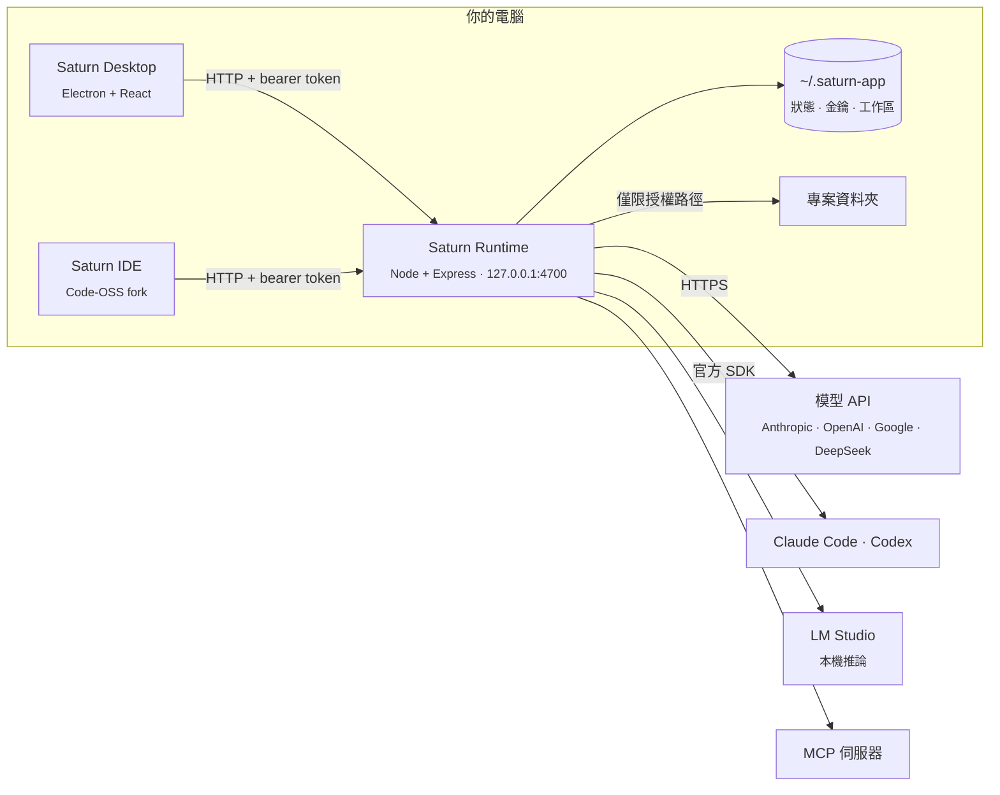

<div align="center">


# Saturn

**本機優先的 Agent Runtime、桌面應用程式與 IDE。**

自帶模型、以授權資料夾限縮每個 Agent 的權限，每一次工具呼叫、檔案修改與網路請求都可檢視、可審查、可回復。

[](LICENSE)


[功能](#功能) · [安裝](#安裝) · [架構](#架構) · [模型](#模型) · [安全](#安全與信任) · [API](#本機-api) · [English](README.md)

</div>

---

## 為什麼是 Saturn

多數 Agent 產品把控制平面放在廠商雲端，或是直接把不受限的 shell 交給模型。Saturn 把控制平面留在你的電腦上：

- **本機優先，且可驗證。** Runtime 是只綁定 `127.0.0.1` 的 HTTP 服務。狀態、憑證與遙測都是磁碟上的檔案，每一筆對外請求都有紀錄（[驗證方式](#安全與信任)）。
- **不綁定模型供應商。** Anthropic、OpenAI、Google、DeepSeek 以你的 API 金鑰呼叫；Claude Code 與 Codex 透過官方 SDK 使用你既有的訂閱方案；或以 LM Studio 執行完全離線的本機模型。
- **預設最小權限。** Agent 只能存取授權的資料夾，有副作用的操作須經過核准策略，每次修改都有檢查點，可逐步回復。

### Saturn、Claude Code 與 Codex

Saturn 自己的 Agent 迴圈（API 模型與本機模型；使用 Claude Code 或 Codex 的 Agent 則用那兩個程式自己的機制）與兩者的比較。「—」表示本表未查證。

| | Saturn | Claude Code | Codex |
|---|---|---|---|
| 在你的電腦上執行，任何供應商或本機模型 | 是：Anthropic、OpenAI、Google、DeepSeek、LM Studio | Anthropic 模型 | OpenAI 模型，可用 `--oss` 跑本機模型 |
| 權限規則（依樣式允許、詢問、拒絕） | 是，也會讀 `.claude/settings.json` 的規則 | 是 | 核准模式 |
| 指令的作業系統沙箱 | macOS、Linux（bubblewrap）；Windows 沒有 | 是 | 是 |
| 上下文壓縮 | 是，含 `/compact` | 是 | 是 |
| 子 Agent | 是（`delegate`） | 是 | — |
| 背景指令 | 是 | 是 | — |
| Hooks | 是（`pre_tool`、`post_tool`、`stop`；可讀 Claude Code 格式） | 是 | — |
| Skills 與斜線指令 | 是（`SKILL.md`，可讀 `.claude/commands`） | 是 | — |
| Plugins | 是（Claude Code 的格式可直接安裝） | 是 | — |
| 無介面 CLI | `saturn run` | `claude -p` | `codex exec` |
| SDK | 尚未提供：本機 HTTP API 與其事件串流 | Agent SDK | Codex SDK |
| Pull request 追蹤（修正失敗的檢查） | 是，最多兩輪 | 是，在網頁版 Claude Code | — |
| 桌面應用程式與 IDE | Agent App、Saturn IDE（Code-OSS） | 桌面應用程式、IDE 擴充套件 | IDE 擴充套件、App |
| 電腦操作、瀏覽器、多 Agent 群組、排程 | 是 | — | — |
| 評測 | 任務評測（`scripts/eval`），設定金鑰後每夜執行 | Anthropic 自己的評測 | OpenAI 自己的評測 |

Saturn 比兩者都年輕，實際使用也少得多；評測是用來檢查它的 Agent 迴圈改動的方法。

## 功能

| | |
|---|---|
| 🤖 **Agent** | 每個 Agent 各自設定 system prompt、模型、推理強度、工具集與核准策略。每則訊息可切換 Agent、Ask（唯讀）與 Plan 模式。 |
| 📋 **Agents 總覽** | 跨對話檢視所有執行中、排隊、受阻與已完成的任務，含核准與失敗的收件匣，以及系統原生通知。 |
| 🌿 **隔離 worktree** | 任務在獨立的 git worktree 與分支中於背景執行。可合併、保留或捨棄；由 Agent 協助解決衝突；直接從分支開 pull request。 |
| 🔁 **Pull request 追蹤** | Saturn 開出 pull request 後，會用你的 GitHub token 每 2 分鐘追蹤一次。檢查失敗時，會把失敗紀錄的結尾交給 Agent 修正（最多兩次），修好後自動 commit 並推送，讓檢查重跑。新留言與未解決的 review 討論會留在對話中，等你送給 Agent（它的回應也會推送）或略過。pull request 合併或關閉後即停止追蹤。 |
| 📎 **上下文** | 以 `@` 引用檔案、資料夾、git 變更與網址；貼上截圖；從 `AGENTS.md` 等檔案載入專案規則；以內建的裝置端嵌入模型做語意程式碼搜尋。 |
| ✅ **驗證迴圈** | 回合修改檔案後，自動執行專案的檢查指令（型別檢查、lint、測試），失敗時回饋給 Agent，最多自動修正兩輪。 |
| 🔍 **審查** | 每回合的 diff 可逐行留言並回送 Agent，計畫可編輯，每回合有摘要卡片、終端機輸出，以及可重播的瀏覽器錄影。 |
| ↩️ **檢查點** | 每次檔案修改都有紀錄。可保留或回復整個回合，或將工作區還原到任一步驟。 |
| 👥 **群組** | 多個 Agent 在同一對話中協作；各自判斷是否被點名，並以 `@mention` 分派工作。 |
| 📚 **Skills** | 含 `SKILL.md`（名稱、說明、步驟）的資料夾，放在專案的 `.agents/skills`、`.saturn/skills` 或 `.claude/skills`，或你的 `~/.saturn-app/skills`。Agent 只看到名稱與說明，任務需要時才載入；你也可以在輸入框打 `/名稱` 直接使用。 |
| 🧩 **Plugins** | 把 skills、`/` 指令、hooks 與 MCP 伺服器打包在一個資料夾，在 **設定 → Plugins** 從資料夾或 git URL 安裝，整組開啟或關閉。Claude Code 的 plugin（`.claude-plugin/plugin.json`）可直接安裝。安裝時不會執行任何東西：plugin 的 hooks 與本機 MCP 伺服器都要各自經你核准。 |
| ⌨️ **斜線指令** | 在輸入框打 `/` 會列出 Saturn 內建指令（`/compact`、`/plan`、`/ask`、`/new`）、對話可用的 skills，以及專案 `.saturn/commands`、`.claude/commands` 或你的 `~/.saturn-app/commands` 中的提示範本（`$ARGUMENTS` 會換成指令名稱後的內容）。對話只顯示你輸入的內容，展開後的內容會送給 Agent。 |
| 🪆 **子 Agent** | Agent 可把獨立的任務（大範圍搜尋、調查、子任務）交給擁有全新上下文的子 Agent，只取回它的答案；可多個平行執行，預設唯讀，巢狀顯示在啟動它的步驟下，核准與檢查點與對話相同。 |
| 🛠️ **工具** | 檔案系統、shell（支援背景指令：dev server 或 watcher 可跨回合持續執行，在 Terminal 分頁讀取輸出或停止）、網頁擷取、headless 瀏覽器、多步驟規劃、macOS 與 Windows 電腦操作、GitHub、自動化，以及內建市集中的任何 [MCP](https://modelcontextprotocol.io) 伺服器。 |
| ⏰ **自動化** | 以 cron 排程執行 Agent，內建範本如每日審查 pull request。 |
| 💸 **用量與成本** | 依模型與 Agent 統計任意期間的 token 數與牌價成本。 |
| 📈 **可觀測性** | OpenTelemetry trace、metric 與 log，對外網路請求紀錄，並可選擇以 OTLP 匯出到自己的 collector。 |
| 💻 **Saturn IDE** | 接上同一個 Runtime 的 Code-OSS 發行版：Tab 補全、下一步編輯建議、行內編輯、可審查 diff 的 Agent 面板，以及提供給 Agent 的 LSP 工具。 |

## 安裝

從 [Releases](../../releases) 下載最新版本：macOS（Apple Silicon）提供 `.dmg`（或 `.zip`），Windows x64 提供安裝程式 `.exe`。預覽階段的版本皆以 pre-release 發佈。每個檔案都附有 SHA-256 校驗碼與經簽署的建置來源證明（[驗證下載檔](#5-驗證發行檔的建置來源)）。

macOS 版本尚未以 Apple Developer ID 簽章：首次開啟時請到 **系統設定 → 隱私權與安全性 → 強制打開**。Windows 版本以 Saturn 的自簽憑證進行 Authenticode 簽章（SHA-1 指紋 `D285DA425077C16A3D115D61F9748AFA574BC786`，公開憑證位於 [`desktop/build/saturn-code-signing.cer`](desktop/build/saturn-code-signing.cer)）。Windows 不信任自簽的發行者，所以 SmartScreen 仍會詢問：請選擇 **其他資訊 → 仍要執行**。不需另外安裝 Node.js：內建的 Runtime 直接使用 App 本身的 Electron 執行檔。

首次啟動時，引導流程會帶你連接模型、建立 Agent 並授權專案資料夾。Claude Code 與 Codex 不在安裝程式裡：Saturn 會使用你已安裝的版本，或在你第一次需要時下載官方程式（見[模型](#模型)）。

## 從原始碼建置

### 需求

- [Node.js](https://nodejs.org) 22 以上
- macOS 或 Windows。macOS 版本必須在 macOS 上建置。

### 開發模式執行

```bash
git clone https://github.com/Saturn-Technology-Project/Saturn-App.git
cd Saturn-App
npm install --prefix runtime
npm install --prefix desktop
npm run desktop
```

除非 `4700` 埠已有服務在監聽，桌面應用程式會自行啟動 Runtime。若只要以 headless 方式執行 Runtime 與其 HTTP API：

```bash
npm run dev
```

### 打包

```bash
npm run dist:mac   # 未簽章的 Saturn.app，輸出至 desktop/release/
npm run dist:win   # Windows x64 NSIS 安裝程式，輸出至 desktop/release/
```

macOS 套件會內嵌 Saturn IDE，請先建置 IDE（見下方），或設定 `SATURN_SKIP_IDE=1` 只打包 Agent App。

`dist:win` 可在 macOS 或 Windows 上執行。它會把 Runtime 的 `win32-x64` 正式環境相依套件安裝到 `desktop/.staging/`，打包的是這份，而不是主機上的 `runtime/node_modules`。暫存時會移除 Claude Code 與 Codex 程式（約 530 MB），由 Saturn 按需下載。

正式版本由 [release workflow](.github/workflows/release.yml) 產出：在 GitHub 託管的 runner 上建置並測試兩個平台、對 IDE 做 smoke test、為產出物簽發來源證明，並在推送 `v*` tag 時發佈 release。

### 建置 Saturn IDE

Saturn IDE 是位於 [`Saturn-IDE/`](Saturn-IDE) 的 Code-OSS fork。需要 [`Saturn-IDE/.nvmrc`](Saturn-IDE/.nvmrc) 指定的 Node 版本，以及數 GB 的相依套件：

```bash
cd Saturn-IDE
npm install
cd ..
npm run build:ide --prefix desktop       # macOS：VSCode-darwin-arm64/Saturn IDE.app
npm run build:ide:win --prefix desktop   # Windows：VSCode-win32-x64/（須在 Windows 上執行）
```

原生模組依主機的工具鏈編譯，因此 Windows 版 IDE 必須在 Windows 上建置；[Windows workflow](.github/workflows/windows.yml) 會在每次推送到 `main` 時產出。Windows 上的 IDE 直接從 `resources\Saturn IDE\` 執行。

`node Saturn-IDE/test/smoke/smoke.mjs [path]` 會以拋棄式設定檔啟動建置結果，檢查 workbench、終端機、檔案總管與原始檔控制。

Saturn 的編輯器整合位於 [`Saturn-IDE/extensions/saturn/`](Saturn-IDE/extensions/saturn)；其餘部分追隨上游 [microsoft/vscode](https://github.com/microsoft/vscode)。

### 平台說明

- **電腦操作**支援 macOS（輔助使用 API）與 Windows（SendInput 與 UI Automation）；見[電腦操作](#電腦操作)。
- Windows 上的 **Claude Code** 需要 [Git for Windows](https://git-scm.com/downloads/win)，它提供 Claude Code 執行指令所用的 Bash。
- Windows 上的 `code` 工具與終端機面板以 `cmd.exe` 執行指令。
- Windows 版本已通過 CI 測試，但在實體機器上的使用經驗仍有限。

## 架構



| 元件 | 職責 |
|---|---|
| **Saturn Runtime**（`runtime/`） | 控制平面：模型轉接層、Agent 迴圈、工具執行、MCP client、核准策略、檢查點、worktree、用量計算、遙測與持久化。不依賴 Electron，可 headless 執行。 |
| **Saturn Desktop**（`desktop/`） | Electron 用戶端：對話、Agents 總覽、專案、群組、自動化與設定。只透過 HTTP API 與 Runtime 溝通。 |
| **Saturn IDE**（`Saturn-IDE/`） | 編輯器。以同一個 token 驗證身分，視窗開啟期間維持 Runtime 運作，並透過 server-sent events 橋接把語言伺服器工具提供給 Agent。 |

Runtime 與桌面應用程式採用相同的分層架構，相依方向只朝內：

```
runtime/src/                    desktop/src/
  domain/          實體、策略      domain/          檢視模型與規則
  application/     使用案例        application/     呼叫 API 的使用案例
  infrastructure/  模型 SDK、MCP、 infrastructure/  HTTP client
                   儲存
  presentation/    HTTP 路由       presentation/    React 元件
```

### 生命週期

啟動 Saturn 會先啟動 Runtime，再開啟預設介面：Agent App 或 IDE。關閉最後一個視窗會停止 Runtime，除非 IDE 仍開著。父程序 watchdog 會在桌面應用程式異常結束時終止 Runtime，確保它不會比宿主活得更久。

**上下文。** 對話較早的回合會在依模型 context window 計算的預算內送出（視窗的一半；模型連線可自行指定 `contextTokens`）。超過預算時，最舊的回合會由同一個模型摘要成對話的累積摘要，之後的回合都以它為基礎；對話中會在發生處顯示「⤵ 已將 n 個較早回合併入摘要」。標頭的 **Context · n%** 標籤顯示對話的用量，點它或送出 `/compact` 可立即摘要。Claude Code 與 Codex 自行管理各自的上下文。

## 模型

| 供應商 | 驗證方式 | 說明 |
|---|---|---|
| Claude | API 金鑰 | 支援的模型可設定推理強度與 adaptive thinking |
| Claude（透過 Claude Code） | Claude 訂閱方案 | 透過 Claude Agent SDK 執行 Claude Code；Saturn 不會為這類模型送出任何 API 請求（見[Claude 與 Anthropic 的條款](#claude-與-anthropic-的條款)）。使用你 PATH 上的 `claude`，或在 **設定 → 一般** 下載官方程式（約 95 MB）。用它登入一次；Saturn 從不經手憑證。 |
| Codex | ChatGPT 訂閱方案 | 透過 Codex SDK 執行官方 Codex 程式（見[Codex 與 OpenAI 的條款](#codex-與-openai-的條款)）。使用你 PATH 上的 `codex`，或在 **設定 → 一般** 下載官方程式（約 135 MB）。從設定啟動 Codex 自己的 device code 登入。 |
| OpenAI | API 金鑰 | Chat Completions 與 Responses API；推理模型可設定推理強度 |
| Google Gemini | API 金鑰 | Thinking level（3.x 起）或 thinking budget（2.5） |
| DeepSeek | API 金鑰 | |
| LM Studio | 無 | 任何本機提供的模型，完全離線 |

API 金鑰加密存放在 `~/.saturn-app/secrets.json`（AES-256-GCM，金鑰由作業系統金鑰庫保管；見[靜態資料](#靜態資料)），只送往所屬供應商，且不會回傳給 UI。一把金鑰涵蓋該供應商的所有模型。

### Claude 與 Anthropic 的條款

Saturn 以兩種嚴格分開的方式提供 Claude：

| 供應商 | 驗證方式 | Saturn 送出的內容 |
|---|---|---|
| Claude | 你的 Anthropic API 金鑰，適用 Anthropic 的 [Commercial Terms](https://www.anthropic.com/legal/commercial-terms) | 由 Saturn 送往 Anthropic 的 API 請求 |
| Claude（透過 Claude Code） | 你自己的 Claude 訂閱方案，以官方 `claude` 程式登入 | 完全沒有 API 請求：每一回合都在未修改的 Claude Code 程式中執行，透過 Claude Agent SDK 驅動 |

Saturn 如何遵循 Anthropic 的 [Claude Code 法律與合規條款](https://code.claude.com/docs/en/legal-and-compliance)：

- **透過 Anthropic 自己的流程登入。** 你在終端機以 `claude auth login` 登入 Claude Code。Saturn 沒有 Claude 登入按鈕，從不收集、儲存或轉送 Claude.ai 憑證或 session token；不讀取 `~/.claude` 或鑰匙圈，Claude Code 在自己的設定資料夾中執行，不載入你的任何 Claude 設定。
- **未修改的程式。** Saturn 以 Anthropic 發布的原樣執行 Claude Code：其 SDK 建置時所用的 npm 套件，並以固定的 SHA-512 驗證，或使用你自己安裝的版本。
- **你自己的方案，費用由你支付。** 每位使用者以自己的訂閱登入；Saturn 不代付、轉售或居中處理 Claude 的用量。
- **不移除任何驗證方式。** Claude Code 以未經修改的 Runtime 環境執行，因此它支援的每種方式都保持可用：你的訂閱，或你自己的 `ANTHROPIC_API_KEY`、Bedrock、Vertex AI、Foundry 設定，由它依自己公布的順序選擇。Saturn 從不加入憑證：為 Claude 供應商儲存的金鑰只留給該供應商使用。
- **由程式強制，而非靠慣例。** 模型代理層會拒絕對 Claude（透過 Claude Code）模型發出任何 API 請求，這類模型無法設定 API 金鑰，Saturn 的附屬工作（記憶整理、自動化草稿、編輯器補全）只使用 API 模型。測試確保這一點不會被改壞。
- **一般、個人的使用。** Anthropic 的方案額度以此為前提，其 Consumer Terms 也只允許透過 API 金鑰進行自動化存取，因此自動化任務無法使用 Claude（透過 Claude Code）：這類 Agent 在自動化表單中是停用的，Runtime 也會拒絕。
- **命名。** Saturn 以純文字說明此供應商執行 Claude Code；不以 Claude Code 或 Anthropic 作為自己產品或功能的名稱，也並非由 Anthropic 打造、背書或與其合作。

以上是我們對 Anthropic 公開條款的解讀，不構成法律意見，最終由 Anthropic 決定：若你的用法不同（團隊部署、託管服務），請改用 Claude 供應商與 API 金鑰，或[洽詢 Anthropic](https://code.claude.com/docs/en/legal-and-compliance)。

### Codex 與 OpenAI 的條款

Saturn 以兩種方式提供 OpenAI 的模型，和 Claude 一樣嚴格分開：

| 供應商 | 驗證方式 | Saturn 送出的內容 |
|---|---|---|
| OpenAI | 你的 OpenAI API 金鑰，適用 OpenAI 的 [Business Terms](https://openai.com/policies/business-terms/) | 由 Saturn 送往 OpenAI 的 API 請求 |
| Codex | 你自己的 ChatGPT 方案，登入官方 `codex` 程式 | 完全沒有 API 請求：每一回合都在 Codex 中執行，透過 [Codex SDK](https://developers.openai.com/codex/sdk) 驅動 |

Saturn 如何遵循 OpenAI 的[使用條款](https://openai.com/policies/terms-of-use/)、[Codex 驗證說明](https://learn.chatgpt.com/docs/auth)與[品牌指南](https://openai.com/brand/)：

- **由 Codex 登入，不是 Saturn。** 設定頁會啟動 `codex login`（device code 或瀏覽器），並顯示 Codex 輸出的內容。Saturn 不是「Sign in with ChatGPT」App，沒有自己的 ChatGPT 登入，也從不讀取 Codex 的 `auth.json`；Codex 把它存放在 Saturn 專用的 `CODEX_HOME`。
- **官方程式。** Codex 以 Apache-2.0 開源，OpenAI 也發布了讓其他應用程式整合 Codex 的 SDK。Saturn 執行其 SDK 建置時所用的 npm 版本，並以固定的 SHA-512 驗證，或使用你自己安裝的版本。
- **你自己的帳號。** OpenAI 的條款不允許分享帳號或憑證；每個人以自己的帳號登入，Saturn 不轉售或居中處理 ChatGPT 的用量。用量計入你方案的額度，Saturn 不會繞過。
- **由程式強制。** 模型代理層會拒絕對 Codex 模型發出任何 API 請求，Codex 模型無法設定 API 金鑰，Saturn 也會從 Codex 的環境中移除 API 金鑰變數（`OPENAI_API_KEY`、`CODEX_API_KEY`、`CODEX_ACCESS_TOKEN`），讓它一律使用你選擇的登入方式。
- **自動化任務。** OpenAI 的文件允許可信任的腳本與排程使用 ChatGPT 登入，但建議自動化使用 API 金鑰；排程工作建議改用 OpenAI 供應商的 Agent。
- **命名。** Saturn 提到 OpenAI 的產品，只是為了說明供應商執行的是什麼。Saturn 不在自己的名稱或功能中使用 ChatGPT、GPT、Codex 或 OpenAI 的 logo，也並非由 OpenAI 打造、背書或與其合作。

以上是我們對 OpenAI 公開條款的解讀，不構成法律意見；你的帳號受 OpenAI 的條款約束。

### 本機模型

**內建嵌入模型。** 程式碼索引會在 CPU 上執行自己的嵌入模型，所以不接任何模型、不連網也能做語意搜尋。在 **設定 → 一般 → Embedding model** 選擇：

| 模型 | 大小 | 說明 |
|---|---|---|
| Multilingual E5 small（預設） | 118 MB，內建 | 中英文提問，每段 512 token |
| Jina v2 code | 162 MB，首次使用時下載 | 英文的程式碼問題，每段 2,048 token |

也可以改用 LM Studio 提供的嵌入模型（預設 `text-embedding-nomic-embed-text-v1.5`）或 OpenAI。

**透過 LM Studio 使用聊天與 Agent 模型。** 本機模型能不能當 Saturn 的 Agent，取決於兩件事：

- **工具呼叫。** Agent 透過工具做事，模型必須受過 function calling 訓練（LM Studio 以工具圖示標示）。不支援的模型會回答，但不會動手。
- **32K 以上的 context。** 光是 Saturn 的系統提示與工具定義就超過 LM Studio 預設載入的 8K，會出現 *「tokens to keep … greater than the context length」* 錯誤。請在 LM Studio 以較大的 context 載入，或執行：

```bash
lms load qwen/qwen3.5-4b --context-length 32768
```

**實測模型。** 每個模型透過 Saturn 自己的工具，把三項 Agent 任務各跑兩次（讀檔並依內容回答；寫程式、執行並回報輸出；修 bug 並用指令驗證），再測一次 Tab 補全。結果以磁碟上的實際狀態判定，不採信模型的自述。測試日期 2026-10-21，Apple M1 Pro 16 GB，LM Studio 0.4.26，4-bit 權重，32K context：

| 模型 | 大小 | Agent 任務 | 任務中位數 | Tab 補全 | 適合 |
|---|---|---|---|---|---|
| Qwen3.5 4B（`qwen/qwen3.5-4b`） | 3.1 GB | 6/6 | 29 秒 | 正確，10 秒 | 16 GB 機器的 Agent：最快也最小 |
| Gemma 4 E4B（`google/gemma-4-e4b`） | 6.9 GB | 6/6 | 48 秒 | 正確，12 秒 | Agent |
| Ministral 3 8B（`mistralai/ministral-3-8b`） | 6.1 GB | 6/6 | 65 秒 | 正確，1.5 秒 | Agent 與 Tab 補全 |
| Qwen3.5 9B（`qwen/qwen3.5-9b`） | 6.0 GB | 6/6 | 71 秒 | 正確，8 秒 | Agent |
| Qwen2.5-Coder 7B | 4.3 GB | 3/6 | 不適用 | 正確，1 秒 | 只適合 Tab 補全：工具呼叫不穩定 |

推理模型（Qwen3.5、Gemma 4）每次補全前都會先思考，用在 Tab 太慢：建議 Agent 用其中一個，補全模型（**設定 → 一般 → Completion model**）另選 Ministral 3 8B 或 Qwen2.5-Coder 7B。這些是在單一機器上的小型任務；更大的模型（Qwen3.6 27B、Qwen3-Coder 30B 以上）需要 32 GB 以上記憶體，沒有實測。

## 安全與信任

Saturn 在你的電腦上執行程式碼並持有你的供應商憑證，它的信任基礎不該建立在「相信我們」之上。本節列出資料清單、每一條對外連線路徑，以及如何用標準工具逐項驗證，不需閱讀原始碼。

**摘要：** Saturn 沒有後端服務。憑證、對話與遙測都是 `~/.saturn-app` 下的本機檔案。對外流量只會送往你設定的端點（模型供應商，以及 Agent 使用的網站、API 與 MCP 伺服器），且每一筆請求都可觀測。

### 靜態資料

所有資料都在 `~/.saturn-app`（可用 `SATURN_DATA_DIR` 覆寫）。刪除該目錄即完整重置。

| 資料 | 位置 | 說明 |
|---|---|---|
| API 金鑰與 OAuth token | `secrets.json` | 以 AES-256-GCM 靜態加密，256 位元的隨機金鑰由作業系統金鑰庫保管：macOS 鑰匙圈、Windows DPAPI，或 Linux 的 Secret Service（libsecret）；只有在沒有金鑰庫時才改用權限 `0600` 的金鑰檔。檔案權限 `0600`。舊版的明文檔案會在首次啟動時自動加密。 |
| Agent、對話、專案、設定 | `state.json` | 純 JSON。 |
| 遙測（trace、metric、log） | 記憶體與 `telemetry.json` | 只有在你設定 OTLP 端點時才會匯出。 |
| 對外請求紀錄 | `network.log` | JSON Lines：時間戳記、方法、主機、路徑。從不記錄查詢字串與內容。達 5 MB 時輪替。 |
| 記憶、程式碼索引、檢查點、附件 | `memory/`、`index/`、`checkpoints/`、`run-images/` | 本機檔案。嵌入向量由內建模型在裝置端計算。 |
| API session token | `runtime-token` | 權限 `0600`。 |
| Claude Code 與 Codex 程式 | `tools/` | 只在你要求時下載，解壓前先以 Saturn 內固定的 sha512 驗證。可在設定中移除。 |
| Saturn IDE 遙測 | 由 `127.0.0.1` 上的 Runtime 接收 | Code-OSS 原本送往 Microsoft 的遙測與當機回報端點已被取代，不會傳送任何資料給 Microsoft。 |

### 對外連線清單

| 目的地 | 觸發時機 | 傳送內容 |
|---|---|---|
| 你的模型供應商（Anthropic、OpenAI、Google、DeepSeek） | Agent 回合、Tab 補全、行內編輯 | 對話內容、你或 Agent 附加的檔案、工具結果。金鑰只送往該供應商。 |
| 經由 Claude Code 與 Codex 連至 Anthropic / OpenAI | 使用這兩個供應商的回合 | 官方 CLI 以你的訂閱方案連線至各自廠商。Saturn 從不讀取或轉送這些憑證。 |
| 網站、API 與 MCP 伺服器 | Agent 擷取網址、操作瀏覽器、呼叫 GitHub，或使用你新增的 MCP 伺服器時 | 該次工具呼叫所需的內容。遠端 MCP 伺服器透過 HTTP(S) 連線；本機伺服器須在你核准確切指令後才會執行，其自身的網路流量由該程式負責。web 與瀏覽器工具會拒絕私有、link-local 與 loopback 位址（SSRF 防護）。 |
| GitHub Releases | App 啟動時 | electron-updater 的更新檢查。macOS 上僅限 Developer ID 簽章的版本。設定 `SATURN_NO_UPDATES=1` 可停用。 |
| Open VSX 與 `raw.githubusercontent.com` | Saturn IDE：擴充套件市集，以及啟動時一次 | 擴充套件中繼資料，以及 Open VSX 的封鎖清單。 |
| GitHub（由 Saturn IDE） | 僅在你於 IDE 登入 GitHub 後 | Git 與 GitHub 擴充套件的流量。 |
| Hugging Face | 僅在你選用未內建的嵌入模型時 | 下載該模型。 |
| `registry.npmjs.org` | 僅在你按下 Claude Code 或 Codex 的 **下載** 時 | 官方程式的 npm 套件，即 Saturn 的 SDK 建置時所用的版本，並以固定的 sha512 驗證。 |
| 你的 OpenTelemetry collector | 僅在設定 `OTEL_EXPORTER_OTLP_ENDPOINT` 時 | Saturn 的 trace、metric 與 log。 |

除此之外沒有其他對外連線：沒有產品分析、沒有當機回報、沒有帳號，也沒有託管服務。

實測基準：全新安裝且沒有進行中的回合時，Runtime 的對外連線數為**零**，Saturn IDE 只有一條（其網路工具程序從 `raw.githubusercontent.com` 取得 Open VSX 封鎖清單）。

### 自行驗證

以下每項檢查彼此獨立，不需要了解程式碼。

#### 1. 在作業系統層觀察對外流量

不論應用程式聲稱什麼，核心都看得到每一個 socket。

```bash
# macOS：所有 Saturn 程序的即時 TCP 連線
nettop -m tcp -p $(pgrep -d, -f "Saturn") 2>/dev/null || lsof -i -nP | grep -i saturn
```

```powershell
# Windows：Saturn 程序已建立的連線
Get-NetTCPConnection -State Established | Where-Object { (Get-Process -Id $_.OwningProcess).ProcessName -like "Saturn*" }
```

若要逐條連線確認，可使用對外應用程式防火牆：macOS 用 [LuLu](https://objective-see.org/products/lulu.html)（免費、開源）或 Little Snitch，Windows 用 Windows Defender 防火牆的輸出規則。每一條連線都應對應到對外連線清單中的一列。

#### 2. 檢視 Runtime 的網路紀錄

**設定 → 遙測 → Network** 列出 Runtime 連線過的每個主機、請求數與最近的請求。相同資料也會附加寫入檔案：

```bash
tail -f ~/.saturn-app/network.log
jq -r .host ~/.saturn-app/network.log | sort | uniq -c | sort -rn   # 各主機的請求數
```

紀錄來自 Node 的 `diagnostics_channel` 對 `undici` 與 `http`/`https` 的掛鉤，因此涵蓋 Runtime 程序中所有 HTTP client，包括各家模型 SDK，不需要逐一插樁。

#### 3. 離線執行

在 [LM Studio](https://lmstudio.ai) 連接本機模型（需支援工具呼叫，並以 32K context 載入；見[本機模型](#本機模型)），用防火牆封鎖 Saturn，照常使用：Agent、Tab 補全與程式碼索引都能離線運作。

#### 4. 檢查靜態資料

```bash
ls -la ~/.saturn-app          # secrets.json 與 runtime-token 為 -rw-------（僅擁有者）
head -c 300 ~/.saturn-app/secrets.json   # AES-256-GCM 密文封包，看不到任何金鑰
security find-generic-password -s Saturn | grep acct   # macOS：保管加密金鑰的鑰匙圈項目
cat ~/.saturn-app/state.json  # Agent、對話與設定，純 JSON
```

#### 5. 驗證發行檔的建置來源

每個發行檔都附有 SHA-256 校驗碼與經簽署的[建置來源證明](https://docs.github.com/actions/security-for-github-actions/using-artifact-attestations)（SLSA provenance，經 Sigstore 簽署）。它將檔案摘要綁定到本 repository、公開的 [release workflow](.github/workflows/release.yml)，以及建置所用的確切 commit：

```bash
shasum -a 256 -c Saturn-<version>-mac-arm64-unsigned.dmg.sha256
gh attestation verify Saturn-<version>-mac-arm64-unsigned.dmg -R Saturn-Technology-Project/Saturn-App
```

在 Windows 上，安裝程式的 Authenticode 簽章應指向 Saturn 的憑證：

```powershell
(Get-AuthenticodeSignature .\Saturn-<version>-win-x64-setup.exe).SignerCertificate.Thumbprint   # D285DA425077C16A3D115D61F9748AFA574BC786
```

建置紀錄公開於 [Actions](../../actions/workflows/release.yml) 頁面。也可以直接[從原始碼建置](#從原始碼建置)。

### 監控

- **網路紀錄：** `network.log` 為 JSON Lines，可用 Vector、Fluent Bit 或 Promtail 收集，或在工作時 `tail -f`。
- **OpenTelemetry：** 設定 `OTEL_EXPORTER_OTLP_ENDPOINT`（可另設 `SATURN_OTEL=otlp`），即可把 trace、metric 與 log 匯出到 Grafana、Jaeger、Honeycomb、Datadog 或任何 OTLP collector。每次模型呼叫、工具呼叫與 Agent 回合都是一個 span，對外 HTTP 請求為其子 span。
- **本機 API：** `GET /network`、`GET /telemetry/traces`、`GET /telemetry/logs` 與 `GET /usage/summary` 讓腳本取得相同資料（見[本機 API](#本機-api)）。
- **花費：** **設定 → 用量與帳單** 依模型與 Agent 拆分任意期間的 token 數與成本。

### 安全機制

- **只綁定 loopback。** Runtime 只監聽 `127.0.0.1`，拒絕非 loopback 的 `Host` 標頭（防範 DNS rebinding），並拒絕 `null` 與非本機的瀏覽器來源（CORS）。
- **憑證加密。** API 金鑰與 OAuth token 以 AES-256-GCM（含驗證）靜態加密；有作業系統金鑰庫時，加密金鑰不會出現在資料夾中，且只經由 stdin 傳給系統工具，從不放在命令列參數。找不到金鑰的檔案會被另存，絕不覆寫。
- **Bearer 驗證。** 除 `/health` 與 OAuth 回呼外，所有路由都需要 `Authorization: Bearer <token>`。token 存於 `~/.saturn-app/runtime-token`（權限 `0600`），其他本機使用者與網頁都無法呼叫 API。
- **本機 MCP 伺服器須經你核准才會執行。** 遠端 MCP 伺服器是一個 HTTP(S) URL。本機伺服器（由 Saturn 啟動、透過 stdio 溝通的程式，例如 `npx -y @modelcontextprotocol/server-filesystem …`）新增後只會被儲存，必須在你看過確切指令並允許之後才會啟動；程式、參數或環境變數任何變更都會重新詢問，且核准時必須指定你看到的那個版本。它在 Saturn 的工作區資料夾中啟動，只帶最小的環境（PATH 與程式需要的少數系統變數）加上你設定的變數，變數值加密存放於 `secrets.json`；Saturn 自己的環境（包括其中的 API 金鑰）絕不會傳給它。移除伺服器即停止該程式。
- **Hooks；專案的 hooks 須經你核准。** Hook 是在 Agent 呼叫工具之前或之後（exit 2 會阻擋或回饋；stdout 可回答 allow、ask 或 deny），或在回合結束時執行的指令（exit 2 會讓 Agent 繼續處理，每則訊息最多兩次）。你自己的 hooks 在 **設定 → Hooks** 設定。專案的 `.saturn/hooks.json`，以及其 `.claude/settings.json` 中的 PreToolUse、PostToolUse 與 Stop hooks，是隨資料夾而來的，因此必須在你看過並允許那一組之後才會執行；任何變更都會重新詢問。只有在你開啟 **Use the project's Claude Code settings** 時，Claude Code 才會載入專案的 `.claude/settings.json`。
- **檔案系統範圍限制。** Agent 只能在 Saturn 工作區與你授權的專案資料夾內讀寫與執行，授權可隨時撤銷。
- **指令的作業系統沙箱。** Agent 執行的每個 shell 指令都由作業系統限制：macOS 用 seatbelt（`sandbox-exec`），Linux 在安裝 bubblewrap 時使用。預設的 *workspace-write* 只允許寫入專案資料夾、暫存資料夾與常見的套件快取；*read-only* 完全不允許寫入；也可以關閉指令的網路。Agent 需要寫到其他地方時會以 `sandbox: "off"` 要求，除了完全自主模式外都會出現核准卡。在 **設定 → 一般 → Sandbox** 設定，或針對單一專案覆寫。Windows 沒有沙箱，指令的結果會註明。
- **權限規則、核准策略、檢查點。** 規則指定工具與樣式（`code: npm test *`、`files: write src/**`）並決定允許、詢問或拒絕；拒絕優先於詢問，詢問優先於允許，shell 指令串逐一判斷。規則可在 **設定 → Permissions** 針對所有專案、單一專案或單一 Agent 設定，也可寫在專案自己的 `.saturn/settings.json`；`.claude/settings.json` 的 `permissions` 也會讀取。核准卡上的 **Always allow…** 會直接存成一條規則。沒有規則適用時，除非你選擇完全自主，有風險的指令與工作目錄外的寫入都會等待核准。每次修改都有檢查點，可回復到單一步驟。
- **訂閱憑證隔離。** Claude Code 與 Codex 透過官方 CLI 驗證，憑證存於 Saturn 專用的設定目錄。Saturn 從不讀取、複製或轉送這些憑證，也從不加入自己的金鑰。Claude Code 取得未經修改的 Runtime 環境，因此你為它設定的任何驗證方式（你自己的 `ANTHROPIC_API_KEY`、Bedrock、Vertex AI 或 Foundry）都依 Anthropic 的條款保持可用；Codex 則會移除 API 金鑰變數，避免多餘的金鑰覆蓋 ChatGPT 登入。

### 降低曝險

- 為 Saturn 發放專用、設有花費上限的 API 金鑰，以便獨立輪替或撤銷。
- 優先使用 **Default** 核准策略（有風險才詢問）而非完全自主，並只授權任務所需的專案資料夾。
- 絕不能離開本機的程式碼，請透過 LM Studio 使用本機模型。

### 供應鏈與上游維護

Saturn 內含約一千個開源套件、Electron、一個 Code-OSS 分支與一個機器學習模型。每一項都經過固定、檢查且可替換，檢查都在公開的 CI 上執行。

**安裝的內容**

- **固定的 lock 檔。** Runtime、桌面應用程式與 Saturn IDE 將每個套件固定為 `https://registry.npmjs.org/` 上的確切版本，並附 SHA-512 完整性雜湊。[`scripts/check-lockfiles.mjs`](scripts/check-lockfiles.mjs) 遇到任何 git、tarball URL、http 或 file 來源都會讓 CI 失敗。
- **Registry 簽章。** `npm audit signatures` 驗證每個已安裝套件的 registry 簽章，發行者提供時也驗證其來源證明。
- **不執行安裝腳本。** 相依套件的安裝腳本是遭入侵套件最常見的執行管道，在 Saturn 中從不執行：Runtime 與桌面應用程式在 `allowScripts` 中逐一拒絕，CI 以 `--ignore-scripts` 安裝。Saturn IDE 沿用 Code-OSS 自己的白名單，用於必須編譯的原生模組。
- **npm 以外的一切都以雜湊固定。** Claude Code 與 Codex 的下載固定為 lock 檔的 SHA-512（[`agent-programs-manifest.ts`](runtime/src/infrastructure/agent-programs-manifest.ts)，由測試保持一致）；內建嵌入模型固定為 SHA-256（[`fetch-embedding-model.mjs`](desktop/scripts/fetch-embedding-model.mjs)）；每個 GitHub Action 固定為完整的 commit SHA。

**保持更新**

- **Dependabot** 在安全公告發佈時立即開出安全更新，並每週開出分組的版本更新，且只針對已公開七天的版本，遭入侵或有問題的版本通常在這段期間被發現並下架。
- **[Supply chain workflow](.github/workflows/supply-chain.yml)** 在每次變更與每週執行：檢查 lock 檔、registry 簽章，以及對所有出貨內容執行 high 等級的 `npm audit`。
- **Electron** 在桌面應用程式與 Saturn IDE 使用同一版本（43.7.7），仍在 Electron 的安全修補支援範圍內，並隨上游 Code-OSS 更新。

**出貨的內容與發佈權限**

- **每個版本都附 SBOM。** `Saturn-<version>-sbom.cdx.json`（CycloneDX 1.5）列出約一千個元件及其授權與雜湊，另含 Electron 與模型。SBOM、安裝程式與壓縮檔都附有建置來源證明。
- **有意義的簽章。** Windows 版本只簽署 Saturn 自己的執行檔，第三方程式保留其發行者的簽章。
- **發佈權限。** 發佈須在受保護的 environment 中經維護者核准。Release tag 只有管理員能建立，且永遠不能移動或刪除；`main` 不能 force-push；[CODEOWNERS](.github/CODEOWNERS) 會在每個 pull request 要求維護者審查。建議所有具寫入權限的成員啟用雙重驗證。

**上游 Code-OSS**

Saturn IDE 是 microsoft/vscode 加上一小組列明的修改。[`Saturn-IDE/UPSTREAM.md`](Saturn-IDE/UPSTREAM.md) 記錄基準 commit 與版本、修改規則（Saturn 的功能放在自己的擴充套件；上游檔案只從建置中排除，絕不刪除），以及 Saturn 修改的全部 50 個檔案。每週的 [upstream sync](.github/workflows/upstream-sync.yml) 會以上游歷史為基準，將每個新的 VS Code 版本進行三方合併、建置並測試，再開出 pull request；需要人工處理時則以草稿列出衝突。每月版本在兩週內合併，上游安全修補在一週內合併。

**已審視的例外。** 目前無法修補的公告（沒有修補版本，或修補需要上游變更），以及 Dependabot 在不會出貨的程式碼中回報的公告，連同原因與結案條件都列在 [`docs/known-advisories.md`](docs/known-advisories.md)。

**自行驗證**

```bash
node scripts/check-lockfiles.mjs
(cd runtime && npm ci --ignore-scripts && npm audit signatures)
gh attestation verify Saturn-<version>-sbom.cdx.json -R Saturn-Technology-Project/Saturn-App
```

### 已知限制

Saturn 仍為早期預覽版，尚未經過第三方安全稽核。macOS 版本尚未以 Developer ID 簽章或公證，Windows 版本則以 Windows 不信任的自簽憑證簽章。API 金鑰已靜態加密，不會以明文出現在備份、同步資料夾、磁碟映像或被複製的資料夾中；但任何以你的使用者身分執行的程序仍可向作業系統金鑰庫要求金鑰，這與所有使用鑰匙圈或 DPAPI 保存憑證的應用程式相同。設定 → 關於 會顯示目前使用的金鑰庫。被賦予完全自主的 Agent 可以在授權資料夾內執行任意指令；這是設計本質，請據此控管授權範圍。Claude Code、Codex、git 與本機 MCP 伺服器以獨立程序執行，不會出現在 Runtime 的網路紀錄中，請用作業系統層的工具觀察。你允許的本機 MCP 伺服器以你的使用者權限執行，請只允許你信任的程式。

發現安全漏洞請私下寄至 [security@saturn-core.com](mailto:security@saturn-core.com)，不要開公開 issue。

## 電腦操作

電腦操作工具透過截圖觀察畫面，並以合成的滑鼠鍵盤事件與各平台的元素樹執行操作：macOS 使用輔助使用 API，Windows 使用 UI Automation。

### macOS

macOS 需要為 **Saturn** 授予兩項 TCC 權限，位於 系統設定 → 隱私權與安全性：

- **輔助使用**：點擊、輸入與讀取 UI 樹。
- **螢幕與系統錄音**：擷取截圖。

macOS 以 App 的程式碼簽章識別這些授權。ad-hoc 簽章的版本每次更新都會呈現新的身分，授權因此失效：若 Agent 回報缺少已開啟的權限，請用 − 移除 Saturn 後重新加入。螢幕鎖定時，Agent 會回報狀況而不執行操作。

### Windows

Windows 不需要任何權限。所有動作由單一輔助程序處理（Windows PowerShell 執行一個小型的已編譯 C# 模組）：以 SendInput 送出滑鼠、滾輪與按鍵，以 Unicode 輸入打字（任何語言皆可，不碰剪貼簿），以 GDI+ 截圖，並以 UI Automation 讀取與操作 App 的元素。它支援 DPI 感知，在縮放的螢幕上座標也正確。以 macOS 寫法表示的組合鍵（`cmd+c`）在 Windows 上代表 Ctrl。

- Windows 只允許 App 控制與自己權限等級相同的 App：以系統管理員身分執行的 App 會忽略 Saturn 的輸入，除非 Saturn 也以系統管理員身分執行，Agent 會說明這個情況。
- 鎖定畫面或 UAC 提示（安全桌面）顯示時，什麼都看不到也點不到；Agent 會回報狀況而不執行操作。
- [Windows 電腦操作 workflow](.github/workflows/computer-use-windows.yml) 會在每次變更時，於真實的 Windows 桌面上操作記事本。

## 設定

| 變數 | 預設值 | 用途 |
|---|---|---|
| `SATURN_DATA_DIR` | `~/.saturn-app` | 狀態、憑證、session token 與工作區 |
| `SATURN_RUNTIME_HOST` | `127.0.0.1` | 綁定位址 |
| `SATURN_RUNTIME_PORT` | `4700` | 監聽埠 |
| `SATURN_RUNTIME_TOKEN` | 自動產生 | 固定的 session token（32 字元以上），取代已儲存的 token |
| `SATURN_NODE` | `PATH` 上的 `node` | 開發模式啟動 Runtime 所用的 Node 執行檔 |
| `SATURN_OTEL` | 僅本機 | `otlp` 或 `console` 匯出遙測，`off` 保留在本機 |
| `OTEL_EXPORTER_OTLP_ENDPOINT` | 未設定 | OTLP collector 端點；設定後即啟用匯出 |
| `OTEL_SDK_DISABLED` | 未設定 | `true` 完全停用遙測 |
| `SATURN_NO_UPDATES` | 未設定 | `1` 停用更新檢查 |
| `SATURN_SECRET_STORE` | 作業系統金鑰庫 | `keychain`、`dpapi`、`libsecret` 或 `file`：新的加密金鑰存放位置 |
| `SATURN_SKIP_IDE` | 未設定 | `1` 打包時不含 Saturn IDE |
| `SATURN_IDE_BUILD` | 本機建置 | 打包時內嵌的 IDE 建置 |

## 命令列

**設定 → 一般 → Command Line** 會在 `~/.local/bin` 安裝 `saturn`。它對正在執行的 Saturn 執行 App 自己的 CLI，所以版本永遠與 App 一致：

```bash
saturn run "fix the failing test" --agent Saturn --project .
saturn run - --agent Reviewer --json < prompt.txt
saturn runs
saturn approve RUN ACTION
```

`saturn run` 會把 Agent 的步驟輸出到 stderr、答案輸出到 stdout（`--json` 輸出整個 run）。需要核准時，在終端機會直接詢問；在腳本中 `saturn` 會以代碼 3 結束，並印出可回答它的 `saturn approve` 指令。與自動化任務相同，使用 Claude（透過 Claude Code）的 Agent 只能在終端機中執行，不能無人值守。

## 本機 API

桌面應用程式與 IDE 都是同一個 HTTP API 的用戶端，你的腳本也可以是：

```bash
TOKEN=$(cat ~/.saturn-app/runtime-token)
curl -H "Authorization: Bearer $TOKEN" http://127.0.0.1:4700/agents
```

| 方法 | 路徑 | 用途 |
|---|---|---|
| `GET` | `/health` | 存活檢查（不需驗證） |
| `GET` `POST` | `/agents` | 列出或建立 Agent |
| `POST` | `/agents/:id/runs` | 開始一個回合（`mode`、`images` 與專案選項） |
| `GET` | `/runs` · `/runs/:id` | 進行中與最近的回合；單一回合的輸出、推理、工具呼叫與核准 |
| `POST` | `/runs/:id/actions/:actionId/decision` | 核准或拒絕待處理的動作 |
| `GET` `POST` | `/runs/:id/changes` · `/changes/keep` · `/changes/revert` | 檢視、保留或回復回合的檔案變更 |
| `POST` | `/runs/:id/restore` | 將工作區還原到某一步 |
| `POST` | `/runs/:id/stop` | 取消回合 |
| `POST` | `/threads/:id/worktree` · `/worktree/finish` · `/pull-request` | 隔離 worktree：建立、合併／保留／捨棄、開 PR |
| `POST` | `/threads/:id/pull-request/check` · `/watch` · `/feedback/send` · `/feedback/dismiss` | 追蹤 PR：立即檢查、停止或恢復追蹤、送出或略過 review 留言 |
| `GET` `POST` | `/groups` · `/groups/:id/messages` | 群組對話 |
| `GET` `POST` | `/automations` | 排程執行 |
| `GET` | `/usage/summary?from=&to=` | 指定期間的 token 數與成本 |
| `GET` | `/events` · `/runs/:id/events` | 以 server-sent events 即時更新：哪些 run 有變化，或單一 run 的每次變化 |
| `GET` | `/network` | 對外請求紀錄：主機與最近的請求 |
| `GET` | `/telemetry/traces` · `/telemetry/logs` · `/telemetry/metrics` | 本機 OpenTelemetry 資料 |
| `POST` | `/complete` · `/complete/stream` | 單次模型呼叫（IDE 的 Tab 補全與行內編輯） |
| `GET` `POST` `DELETE` | `/programs` · `/programs/:id` · `/programs/:id/install` | Claude Code 與 Codex：是否已安裝、來源、下載、移除 |

## 開發

```bash
npm test            # Runtime 測試
npm run typecheck   # Runtime 與桌面應用程式的嚴格型別檢查
npm run test:ide    # Saturn IDE 擴充套件檢查
```

測試會以暫存資料目錄與假的模型伺服器啟動 Runtime 的 HTTP API，不需要任何憑證，也不會動到你的資料。

**任務評測。** `scripts/eval` 會用真的模型，透過 Saturn 的 Agent 迴圈完整執行小型程式任務，並以 Agent 看不到的測試評分：通過率、步數、token、花費與時間。`node --test scripts/eval/self-test.mjs` 用腳本化的假模型檢查評測工具本身，不花錢；實際執行會花費 token：

```bash
SATURN_EVAL_PROVIDER=claude SATURN_EVAL_MODEL=claude-sonnet-5-5 SATURN_EVAL_API_KEY=… node scripts/eval/run.mjs
```

[Evals workflow](.github/workflows/evals.yml) 會在 repository 設定 `SATURN_EVAL_API_KEY` secret 以及 `SATURN_EVAL_PROVIDER`、`SATURN_EVAL_MODEL` 變數後每夜執行，通過率比 `scripts/eval/baseline.json` 低 15 個百分點以上時會失敗。

開 pull request 前：

1. 遵守分層：domain 程式碼不得 import Express 或 React。
2. 為 Runtime 行為新增或更新測試，並執行 `npm test` 與 `npm run typecheck`。
3. 絕不記錄或回傳秘密。記錄使用了哪個憑證（供應商或模型），不要記錄它的值。

[CONTRIBUTING.md](CONTRIBUTING.md) 說明相依套件的變更：更新 Claude Agent SDK 或 Codex SDK、安裝腳本核准、Dependabot pull request，以及 Saturn IDE 的上游合併。

## 路線圖

- 以 Developer ID 簽章並經公證的 macOS 版本，以及使用 CA 核發 Authenticode 憑證簽章的 Windows 版本
- Linux 套件

## 授權

[MIT](LICENSE) © 2026 Prism Capital LLC

### Saturn IDE 與 Microsoft 的條款

Saturn IDE 建置自 [Code-OSS](https://github.com/microsoft/vscode)，也就是 Visual Studio Code 以 MIT 授權的原始碼，© Microsoft Corporation，並隨附 Code-OSS 的授權與第三方聲明。它不是 Visual Studio Code（那是 Microsoft 另行建置與授權的產品），也並非由 Microsoft 打造、背書或與其合作。

- **名稱與圖示。** Saturn IDE 使用自己的名稱、圖示、bundle identifier 與連結，不使用 Microsoft 的商標。
- **擴充套件來自 [Open VSX](https://open-vsx.org)。** Visual Studio Marketplace 的條款只允許其擴充套件用於 Microsoft 的產品，所以 Saturn IDE 不連線到它。
- **不包含 Microsoft 的專有擴充套件。** 部分 Microsoft 擴充套件（例如 C/C++、Pylance、C# Dev Kit、Remote - SSH、Live Share）只授權用於 Microsoft 的 Visual Studio 產品。Saturn IDE 既不內建也不推薦它們；手動安裝不在其授權範圍內。Saturn IDE 內建的 Microsoft 擴充套件（JavaScript Debugger）採 MIT 授權。
- **預設不使用 Microsoft 的服務。** 遙測送往 `127.0.0.1` 上的 Saturn Runtime；沒有 Microsoft 的更新服務、設定同步或實驗服務，GitHub 登入使用 Saturn IDE 自己的 OAuth App。與 Code-OSS 的每一項差異見 [`Saturn-IDE/UPSTREAM.md`](Saturn-IDE/UPSTREAM.md)。
